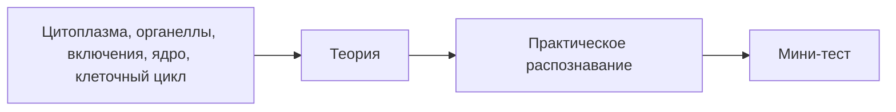

# Занятие 2. Цитология. Цитоплазма. Органеллы и включения

> **Дисциплина:** Гистология, эмбриология, цитология (30.05.01 Медицинская биохимия).
> **Тема ДЗ:** Цитология. Органеллы и включения (часть файлика «1. Цитология» — до ядра).
> **Источники:** файлик «1.Цитология» (папка «Схемы и таблицы к занятиям») · УМП «Цитология и эмбриология» (ДВГМУ, 2024), Тема 2 · Сборник тестовых заданий ДВГМУ (цитология и эмбриология) · экзаменационные электронограммы № 1–9.
> **Статус:** черновик для последующей интеграции на сайт. Электронограммы — в `assets/elektronogrammy/`.

---

## § 1. Домашнее задание (по заданию преподавателя)

1. Лекцию БЯ по теме **выучить**.
2. Прочитать соответствующий раздел в учебнике (Афанасьев/Юрина, гл. 4, § 4.2.1–4.2.2).
3. Написать файлик **«1. Цитология» (до ядра)** и выучить.
4. Распечатать электронограммы, составить в правильном порядке как на стенде.
5. **Выучить электронограммы с 1 по 9.**
6. Альбом, карандаши, тетради, папка с электронограммами — на занятие.

---

**✅ Проверь себя — тест на усвоение блока «§ 1. Домашнее задание (по заданию преподавателя)»**

```quiz
{"questionIds": ["c64690b1-67ea-4a65-ab2e-d63735940ce5", "ac42d415-e164-43bf-95ea-eb1c4eb28dfb", "cec17d60-3331-4a51-b89e-87785df8591d", "ebb865b9-414c-4bca-a202-6e7ec835b09c"], "subjectId": "977d78ca-7a58-4b0a-9e93-29d8e03f6946", "title": "Проверь себя · § 1. Домашнее задание (по заданию препод"}
```

## § 2. Теория (файлик «1. Цитология», часть до ядра — дословно)

**✅ Проверь себя — тест на усвоение блока «§ 2. Теория (файлик «1. Цитология», часть до ядра — дословно»**

```quiz
{"questionIds": ["c39a9ed9-7b85-4fbd-832e-78838fb8ed58", "10669b7f-fd26-4712-8f1f-bbba24496989", "c044f827-1f50-4b1c-a52c-37ef95459844", "e1e70e0b-210b-447e-812d-e57149febfa5"], "subjectId": "977d78ca-7a58-4b0a-9e93-29d8e03f6946", "title": "Проверь себя · § 2. Теория (файлик «1. Цитология», част"}
```

### Общий план строения клетки

**Клетка** — элементарная живая система, состоящая из цитоплазмы и ядра и являющаяся основой развития, строения и функционирования животных и растительных организмов.

| Цитоплазма — компоненты | Ядро — компоненты |
|---|---|
| гиалоплазма · органеллы · включения | ядерная оболочка · хроматин · ядрышко · кариоплазма |

**Гиалоплазма** — бесструктурная часть цитоплазмы, коллоидный раствор, «внутренняя среда» для остальных компонентов цитоплазмы; может менять агрегатное состояние (**гель↔золь**). В ней происходят многие химические процессы.

**Включения** — непостоянные структуры цитоплазмы, появляющиеся и исчезающие в зависимости от функционального состояния клетки.

**Классификация включений со способами выявления:**

| Вид включений | Разновидности | Методы выявления |
|---|---|---|
| **Трофические** (используются клеткой как энергетический и пластический материал) | углеводы (гликоген) · липиды · белки · витамины | гликоген: **кармин по Бесту (красный)**, **ШИК-реакция (малиновый)**; липиды: **судан-3 (оранжевый)**, **осмиевая кислота (чёрный)** |
| **Секреторные** (синтезируются «на экспорт», для нужд организма) | ферменты, гормоны, иммуноглобулины и др. | — |
| **Экскреторные** (продукты метаболизма, шлаки, подлежащие удалению) | мочевина, креатинин, мочевая кислота | — |
| **Пигментные** (имеют естественную окраску): связанные с тканевым дыханием | гемоглобин, миоглобин | собственная окраска |
| — не связанные с тканевым дыханием | меланин, липофусцин | собственная окраска |

**✅ Проверь себя — тест на усвоение блока «Общий план строения клетки»**

```quiz
{"questionIds": ["5b29215d-bd67-4f67-9586-451bf0dc4138", "ba8f9f29-cdf2-434a-893b-825d3d47abd5", "886d62dc-9925-4c1a-be48-9afc3ce61e40", "bb697a21-2080-4da7-87b4-5bae5401fb2d", "a83284ca-6cc9-4a2d-b1a2-10b0ffd0f815", "9de33a18-678a-49de-8604-44d06c09267f"], "subjectId": "977d78ca-7a58-4b0a-9e93-29d8e03f6946", "title": "Проверь себя · Общий план строения клетки"}
```

### Биологическая мембрана

Входит в состав плазмолеммы, ядерной оболочки, мембранных органелл и т.д.

- **Белки — до 60%** (интегральные, полуинтегральные, примембранные)
- **Липиды — до 40%** (фосфолипиды, сфингомиелины, **холестерин** и др.)
- **Углеводы — 5–10%**

**✅ Проверь себя — тест на усвоение блока «Биологическая мембрана»**

```quiz
{"questionIds": ["3bf267de-f31a-4fbb-be9b-797e27d7e7b5", "67bc8a63-16ac-4e0c-8bd7-1cf4d7f6abee", "fd79cd8d-e371-473b-90f5-7d013a60a90b", "cd90f62e-5602-4a54-b10d-6066fc453f94", "c2f45dd1-d153-48a7-be16-d35fa6f5b3e3", "abe53911-ead0-41ab-9d46-d2a920ac4fad"], "subjectId": "977d78ca-7a58-4b0a-9e93-29d8e03f6946", "title": "Проверь себя · Биологическая мембрана"}
```

### Органеллы

🔬 Интерактив: [Строение клетки](https://lab.neofamily.ru/cell-structure/)

**Органеллы** — постоянные структуры цитоплазмы, имеющие определённое строение и выполняющие определённые функции. **Классификации:**

1. **Морфологическая**: мембранные (ЭПС, комплекс Гольджи и др.) / немембранные (рибосомы, цитоскелет и др.).
2. **Функциональная**: общего назначения (есть во всех клетках — ЭПС, комплекс Гольджи) / специального назначения (только в некоторых клетках — реснички, жгутик).

**Строение и функции органелл (таблица файлика — дословно):**

| Органелла (кем, когда открыта) | Светооптическое строение | Электронно-микроскопическое строение | Функции |
|---|---|---|---|
| **Плазмолемма** | Чёткая линия, ограничивающая клетку от внешней среды | В основе — биологическая мембрана (~10 нм). Снаружи — **гликокаликс**, изнутри — **кортикальный слой** (примембранный слой гиалоплазмы с микрофиламентами и микрофибриллами) | 1. Разграничительная 2. Барьерная 3. Рецепторная 4. Участие в образовании контактов между клетками 5. Транспортная: пассивный (без затрат энергии: диффузия, осмос), активный (с затратой энергии: белки-переносчики; экзоцитоз; эндоцитоз — пиноцитоз, фагоцитоз) |
| **Митохондрии** (открыты Р. Альтманом 1894; название дал К. Бенда 1897) | Вид нитей (mitos) и зёрнышек (chondrion). Толщина до 0,5 мкм, длина до 10 мкм, чаще 1 мкм. **Оксифильные** | 2 мембраны: наружная — гладкая, внутренняя — образует складки (**кристы**). Внутри **матрикс**, собственная кольцевая ДНК и рибосомы. На внутренней мембране — ансамбли ферментов окисления и синтеза АТФ | 1. Энергетическая — образуют большое количество АТФ |
| **Рибосомы** (Дж. Паладе, 1955) | Участки цитоплазмы, богатые рибосомами, окрашиваются **базофильно** | Размеры 15–35 нм. Состоят из 2 субъединиц, молекул р-РНК в комплексе с белками. Образуются в ядрышках | 1. Синтез белка |
| **ЭПС** (К.Р. Портер, 1945) | — | Система плоских мембранных цистерн, формирующих трёхмерную сеть. **Гранулярная ЭПС** — постоянный диаметр ~20 нм, на внешней поверхности рибосомы; **гладкая ЭПС** — непостоянный диаметр 20–100 нм, рибосом нет | ГрЭПС: 1. Синтез белка «на экспорт» 2. Транспорт синтезированных продуктов 3. Модификация 4. «Мягкий скелет» 5. Разделение клетки на отсеки. ГлЭПС: 1. Синтез углеводов и липидов 2. Транспорт синтезированных веществ 3. Депо ионов кальция 4. Детоксикация |
| **Комплекс Гольджи** (К. Гольджи, 1898) | При окраске AgNO₃ или OsO₄ — сетчатые образования коричневого или чёрного цвета вокруг ядра или с одной стороны от него | Структурно-функциональная единица — **диктиосома**: 5–10 плоских цистерн с ампулярными расширениями по бокам. В одной клетке может быть несколько взаимосвязанных диктиосом | 1. Накопление синтезированных веществ 2. Сегрегация веществ 3. Модификация 4. Синтез некоторых полисахаридов 5. Секреция 6. Обновление мембран 7. Формирование мембран первичных лизосом |
| **Лизосомы** (К. де Дюв, 1949–1952) | — | Мелкие мембранные пузырьки d 0,2–0,5 мкм с комплексами гидролитических ферментов; отшнуровываются от комплекса Гольджи — **первичные**. **Вторичные**: гетерофаголизосомы (первичная + фагоцитарная вакуоль или пиноцитозный пузырёк); аутофаголизосомы (первичная + собственная разрушающаяся органелла). **Третичная** = телолизосома = **остаточное тельце** — содержит непереваренные продукты, служит основой для липофусцина. **Маркерный фермент — кислая фосфатаза** | 1. Участие в процессах переваривания в клетке 2. «Чистильщики» в долгоживущих клетках, разрушая их повреждённые компоненты |
| **Пероксисомы** (К. де Дюв, 1965–1966) | — | Более крупные, чем лизосомы, микропузырьки (d 0,3–1,5 мкм) с зернистым матриксом. Содержат ферменты, разрушающие перекиси. Образуются в ГрЭПС. **Маркерный фермент — каталаза** | 1. Защита клеток от повреждения перекисями |
| **Микрофиламенты** (1950-е) | — | Тонкие нити (d до 5 нм), основа — белок **актин** | 1. Поддержание формы клетки 2. Формирование контактов 3. Транспортные процессы 4. Перемещение клетки 5. Образование микроворсинок 6. Образование миофибрилл 7. Образование перетяжек в телофазе митоза |
| **Промежуточные филаменты** | — | Тонкие неветвящиеся нити (d ~10 нм). В клетках разных тканей — разные белки: в **эпителиальных — кератин**, в производных мезенхимы — **виментин** и т.д. | 1. Опорная (цитоскелет) 2. Поддержание формы 3. Формирование контактов 4. Фиксация миофибрилл к плазмолемме 5. Участие в образовании рогового вещества в эпидермисе |
| **Микротрубочки** (1963) | — | Интерфазные: тонкие полые цилиндры (d ~25 нм), белок **тубулин**. Могут собираться и разбираться | 1. Опорная (цитоскелет) 2. Внутриклеточный транспорт структур |
| **Центриоли** (термин Т. Бовери, 1895) | — | Производные микротрубочек: полый цилиндр 0,2×0,5 мкм; стенка из **9 триплетов** микротрубочек — формула **(9×3)+0**. Две центриоли под углом 90° формируют **диплосому клеточного центра** | 1. Организуют интерфазные микротрубочки 2. Формируют веретено деления |
| **Реснички (жгутики)** | — | Производные центриолей: в основании — **базальное тельце** (центриоль), формула **(9×3)+0**; от каждого триплета по 2 микротрубочки отрастают над поверхностью клетки, формируя **аксонему** — формула **(9×2)+2**. Для движения нужен белок **динеин** | 1. Передвижение слизи в дыхательных путях (очищение вдыхаемого воздуха) 2. Ток жидкости в половых путях 3. Перемещение сперматозоидов за счёт биения жгутиков |

> **Памятка-логика «конвейер синтеза» (всегда спрашивают):** синтез секреторного белка: рибосомы ГрЭПС  —  полость ГрЭПС (модификация)  —  транспорт к комплексу Гольджи (накопление, сегрегация, модификация, формирование первичных лизосом и секреторных гранул)  —  выведение экзоцитозом. Липиды и углеводы — гладкая ЭПС + Гольджи. Энергия для всего — митохондрии.

---

**✅ Проверь себя — тест на усвоение блока «Органеллы»**

```quiz
{"questionIds": ["b386afeb-b049-4185-b92f-b8cb8e81929d", "0b9a4f10-4261-458b-aef0-61531a38caa4", "7a1e0ce4-41fd-4a5e-9c1c-48a10984083a", "2483268e-1e7e-4c10-a98b-0e36aa6ac892", "6384c86f-9291-4f46-a5ab-09448bba9cda", "9b1cb225-15a8-4a80-85bf-7b3a8af4a1a5"], "subjectId": "977d78ca-7a58-4b0a-9e93-29d8e03f6946", "title": "Проверь себя · Органеллы"}
```

## § 3. Электронограммы № 1–9 (выучить: название + подписи + теорию)

> **Электронограмма** — фотография гистологического препарата, сделанная при помощи электронного микроскопа с большой разрешающей способностью.

**✅ Проверь себя — тест на усвоение блока «§ 3. Электронограммы № 1–9 (выучить: название + подписи + те»**

```quiz
{"questionIds": ["6b56ed74-4a6e-40f1-91e5-d4a07798559d", "6db6feda-168f-47d8-b7c3-d6c6243b0477", "e1f17f6f-b5a2-4781-85b6-11a3e3feff43", "3794c2b1-164c-47d9-bee3-959c357325e9"], "subjectId": "977d78ca-7a58-4b0a-9e93-29d8e03f6946", "title": "Проверь себя · § 3. Электронограммы № 1–9 (выучить: наз"}
```

### Электронограмма 1. Эндоплазматическая сеть

🔬 Интерактив: [Секреторный путь](https://lab.neofamily.ru/secretory-pathway/)

```image
{"url": "/library/lectures/gistologiya/elektronogrammy/01-eps.png", "caption": "Электронограмма 1. Эндоплазматическая сеть"}
```

Органелла **общего назначения, мембранного типа**. Совокупность канальцев, стенки которых образованы мембранами (2). Две разновидности: **гранулярная** и **гладкая**. Гранулярная отличается от гладкой наличием **рибосом (1)**, покрывающих канальцы ГрЭПС (4) со стороны гиалоплазмы (3). Рибосомы содержат много РНК — при световой микроскопии участки скопления ГрЭПС окрашиваются **базофильно**. Виден поперечный срез канальцев **гладкой ЭПС (5)** — на её канальцах рибосом нет.

**Теория для «5» на КР:** ЭПС — органелла общего назначения, мембранного типа, открыта К.Р. Портером (1945). ГрЭПС: синтез белка «на экспорт», транспорт, модификация, «мягкий скелет», деление клетки на отсеки; световой эквивалент — **эргастоплазма** (базофилия). ГлЭПС: синтез углеводов и липидов, транспорт, депо Ca²⁺, детоксикация.

**✅ Проверь себя — тест на усвоение блока «Электронограмма 1. Эндоплазматическая сеть»**

```quiz
{"questionIds": ["7a5ee8fc-e4ab-4c34-8c5e-75b633ab3bb0", "b22ad869-7fb8-4dbe-91a3-5e741a0f9f3d", "2be72826-1449-428a-a793-ab53730f3b24", "83fefb23-c291-4e35-a2d5-a756b5ad4e97"], "subjectId": "977d78ca-7a58-4b0a-9e93-29d8e03f6946", "title": "Проверь себя · Электронограмма 1. Эндоплазматическая се"}
```

### Электронограмма 2. Диктиосома пластинчатого комплекса Гольджи

```image
{"url": "/library/lectures/gistologiya/elektronogrammy/02-golgi-diktiosoma.png", "caption": "Электронограмма 2. Диктиосома комплекса Гольджи"}
```

Комплекс Гольджи — органелла **общего назначения, мембранного строения**. Структурная единица — **диктиосома**: три генетически связанные структуры — уплощённые **цистерны (1)** («стопка блюдец»), **вакуоли (2)** и **микропузырьки (3)**. На электронограмме также видна попавшая в срез разрушающаяся **митохондрия (4)**.

**Теория:** открыта К. Гольджи (1898); выявляется **AgNO₃ или OsO₄** (сетчатые образования коричнево-чёрного цвета вокруг ядра); функции: накопление, сегрегация, модификация секретов, синтез полисахаридов, секреция, обновление мембран, формирование мембран первичных лизосом.

**✅ Проверь себя — тест на усвоение блока «Электронограмма 2. Диктиосома пластинчатого комплекса Гольдж»**

```quiz
{"questionIds": ["272ab941-d729-40b7-bf8a-48cb7cbc3b79", "1e200d35-d3c2-4175-8468-241ea6323f53", "118a1a4d-8e64-45e6-85cc-adf6d7693b23", "4fd347b1-df07-4e8b-bb9a-5ca973a93e1f"], "subjectId": "977d78ca-7a58-4b0a-9e93-29d8e03f6946", "title": "Проверь себя · Электронограмма 2. Диктиосома пластинчат"}
```

### Электронограмма 3. Лизосомы и митохондрии

🔬 Интерактив: [Эндосимбиоз митохондрий](https://lab.neofamily.ru/endosymbiosis/)

```image
{"url": "/library/lectures/gistologiya/elektronogrammy/03-lizosomy-mitohondrii.png", "caption": "Электронограмма 3. Лизосомы и митохондрии"}
```

Округлые тельца, окружённые мембраной — **лизосомы (1)**. Под наружной мембраной (2) лизосом — комплекс ферментов класса **гидролаз**; маркерный фермент — **кислая фосфатаза**. **Митохондрии (3)** — несколько меньших размеров; в них видны **кристы** — складки внутренней мембраны.

**✅ Проверь себя — тест на усвоение блока «Электронограмма 3. Лизосомы и митохондрии»**

```quiz
{"questionIds": ["97fd560c-bb49-4ac6-8fc6-354dcb7d4947", "294ec7df-f85f-441e-944d-a7c82a3905fb", "3d7c6bac-3e56-4b8c-9ae5-635e1bde1b50", "740fa9bd-67b6-4dba-85ac-f74babdc5ade"], "subjectId": "977d78ca-7a58-4b0a-9e93-29d8e03f6946", "title": "Проверь себя · Электронограмма 3. Лизосомы и митохондри"}
```

### Электронограмма 4. Остаточное тельце (третичная лизосома) и включения липидов

```image
{"url": "/library/lectures/gistologiya/elektronogrammy/04-ostatochnoe-telce-lipidy.png", "caption": "Электронограмма 4. Остаточное тельце и включения липидов"}
```

Ещё одно название структуры — **миелиновая фигура (МФ)**. Третичная лизосома образуется в результате взаимодействия первичной лизосомы с фагосомой (фагоцитированная частица, окружённая мембраной) либо с аутофагосомой при неполном переваривании. На электронограмме также видны **липидные капли (Л)**. Накопление остаточных телец со временем приводит к формированию пигмента старения — **липофусцина**.

**✅ Проверь себя — тест на усвоение блока «Электронограмма 4. Остаточное тельце (третичная лизосома) и »**

```quiz
{"questionIds": ["8023a2fc-01e2-40ea-bbcf-77a40c342b11", "79be7756-8fd8-463f-adbc-e463acfddc24", "0a2696a4-b36f-4719-9951-cd2392053082", "5d0074ff-ef5c-4c74-9abc-eace1e1d4b58"], "subjectId": "977d78ca-7a58-4b0a-9e93-29d8e03f6946", "title": "Проверь себя · Электронограмма 4. Остаточное тельце (тр"}
```

### Электронограмма 5. Митохондрии

```image
{"url": "/library/lectures/gistologiya/elektronogrammy/05-mitohondrii.png", "caption": "Электронограмма 5. Митохондрии"}
```

Митохондрии различаются по форме: **А — палочковидная, Б — шаровидная, В — разрушающаяся** (окружена лизосомами). Найти **наружную (1)** и **внутреннюю (2)** мембраны; внутренняя образует складки — **кристы (3)**. Между кристами — **матрикс (4)**: темнее гиалоплазмы, содержит гранулы (рибосомы) разной величины. Митохондрии окружает **гранулярная ЭПС (5)**.

**Теория:** открыты Р. Альтманом (1894), название дал К. Бенда (1897); на свету — нити и зёрнышки, оксифильны; 2 мембраны, собственная кольцевая ДНК и рибосомы; функция — энергетическая (АТФ; «энергетические станции» клетки); основная функция — **аэробное окисление**.

**✅ Проверь себя — тест на усвоение блока «Электронограмма 5. Митохондрии»**

```quiz
{"questionIds": ["c45b1088-e864-423a-9fdf-481b18084c4d", "ac9a98e5-2360-4c0b-a56b-06baed31d238", "20353fdb-8c4e-44d3-af5a-f7e8d8445487", "47451aa8-5c5c-406f-9956-9312be82e233"], "subjectId": "977d78ca-7a58-4b0a-9e93-29d8e03f6946", "title": "Проверь себя · Электронограмма 5. Митохондрии"}
```

### Электронограмма 6. Микроворсинки эпителиоцитов кишечника

```image
{"url": "/library/lectures/gistologiya/elektronogrammy/06-mikrovorsinki.png", "caption": "Электронограмма 6. Микроворсинки эпителиоцитов кишечника"}
```

**А — продольный срез микроворсинок; Б — поперечный срез.** Микроворсинки (1) — органеллы **специального назначения, производные (выросты) плазмолеммы** (цитолеммы), значительно увеличивают площадь поверхности клеток (эпителиоцитов тонкого кишечника, нефроцитов почечных канальцев), обеспечивая функцию **всасывания**. В цитоплазме — **пиноцитозные пузырьки (2)**. Светооптический эквивалент — **щёточная кайма**.

**✅ Проверь себя — тест на усвоение блока «Электронограмма 6. Микроворсинки эпителиоцитов кишечника»**

```quiz
{"questionIds": ["c3f43e5c-3238-4ce5-b192-713a8c365323", "756943e0-e4d2-43b2-9267-c44c4562a2cb", "0dfbc429-d7ca-47d5-90e9-e341cc40ae3d", "9ae34cad-d327-41a3-8e5f-ca45f75834fd"], "subjectId": "977d78ca-7a58-4b0a-9e93-29d8e03f6946", "title": "Проверь себя · Электронограмма 6. Микроворсинки эпители"}
```

### Электронограмма 7. Ресничка (жгутик)

```image
{"url": "/library/lectures/gistologiya/elektronogrammy/07-resnichka-zgutik.png", "caption": "Электронограмма 7. Ресничка (жгутик)"}
```

**А — поперечный срез на уровне аксонемы; Б — поперечный срез на уровне базального тельца.** На срезе **базального тельца** периферические микротрубочки собраны по три — **триплеты (3)**, в центре микротрубочек нет: формула **9×3+0**. На срезе **аксонемы** — девять периферических **дуплетов (2)** и один **центральный (4)**: формула **9×2+2**. Реснички способны к движению, характерны для апикальной поверхности эпителиоцитов воздухоносных путей; жгутики у млекопитающих — только у сперматозоидов.

**✅ Проверь себя — тест на усвоение блока «Электронограмма 7. Ресничка (жгутик)»**

```quiz
{"questionIds": ["1fd70e0d-24b8-43c7-97ff-2ffbd0ff8aa7", "5afeff1d-6fed-4fb2-8a02-f0c2f97ca0ed", "e5e31b6a-a298-4953-adde-1c5d12f35654", "069104f0-2072-411e-b2c0-c11747525c52"], "subjectId": "977d78ca-7a58-4b0a-9e93-29d8e03f6946", "title": "Проверь себя · Электронограмма 7. Ресничка (жгутик)"}
```

### Электронограмма 8. Фагоцитоз

🔬 Интерактив: [Фагоцитоз](https://lab.neofamily.ru/phagocytosis/)

```image
{"url": "/library/lectures/gistologiya/elektronogrammy/08-fagocitoz-neytrofil.png", "caption": "Электронограмма 8. Фагоцитоз нейтрофильным лейкоцитом"}
```

**А — ранняя стадия фагоцитоза; Б — более поздняя.** 1. Ядро нейтрофила. 2. Цитоплазма нейтрофила. 3. **Ложноножки (псевдоподии)** нейтрофила. 4. **Бактерия**. Фагоцитоз — разновидность эндоцитоза: инвагинация плазмолеммы  —  фагосома  —  слияние с первичной лизосомой (гетерофаголизосома)  —  переваривание  —  остаточное тельце.

**✅ Проверь себя — тест на усвоение блока «Электронограмма 8. Фагоцитоз»**

```quiz
{"questionIds": ["0400e90c-775f-4d8c-a0c7-f0f5cbd383f6", "324e79c9-84e7-485e-8bc4-65960fabbae2", "6b8def55-0b13-4f75-9f0a-4fa778dfeb20", "c738577d-dc83-435a-96e5-b70aa382670a"], "subjectId": "977d78ca-7a58-4b0a-9e93-29d8e03f6946", "title": "Проверь себя · Электронограмма 8. Фагоцитоз"}
```

### Электронограмма 9. Пиноцитоз в эндотелиальных клетках капилляра

```image
{"url": "/library/lectures/gistologiya/elektronogrammy/09-pinocitoz-endotelij.png", "caption": "Электронограмма 9. Пиноцитоз в эндотелиальных клетках капилляра"}
```

1. Ядро эндотелиальной клетки. 2. Рибосомы. 3. Контакты соседних эндотелиальных клеток. 4. **Пиноцитозные пузырьки**. 5. Базальная мембрана капилляра. 6. Просвет кровеносного капилляра. Пиноцитоз — «питьё клеткой»: захват жидких веществ мелкими пузырьками (в отличие от фагоцитоза — «поедания», захват крупных частиц).

---

**✅ Проверь себя — тест на усвоение блока «Электронограмма 9. Пиноцитоз в эндотелиальных клетках капилл»**

```quiz
{"questionIds": ["605d8b4a-af55-43a3-a1e1-204456463fe9", "7c4d94c9-1f13-4fa0-aae4-af1cf4381960", "e123bd0a-9445-46a4-9a46-4c64bfeaf150", "8a36dc20-6e4c-41d8-8461-241cfa60413e"], "subjectId": "977d78ca-7a58-4b0a-9e93-29d8e03f6946", "title": "Проверь себя · Электронограмма 9. Пиноцитоз в эндотелиа"}
```

## § 3а. Атласные рисунки к теме (Кузнецов С.Л. и др., 2002)

```image
{"url": "/library/lectures/gistologiya/atlas/kuzn_01-membrany-kletochnoj-poverhnosti.png", "caption": "Атлас, с. 14. 2.2. Клеточные мембраны и структуры клеточной поверхности"}
```

```image
{"url": "/library/lectures/gistologiya/atlas/kuzn_01-mikrovorsinki.png", "caption": "Атлас, с. 15. Рис. 17. Микроворсинки на апикальной поверхности клеток тонкой кишки"}
```

```image
{"url": "/library/lectures/gistologiya/atlas/kuzn_01-resnichki.png", "caption": "Атлас, с. 16. Рис. 19. Реснички эпителиальных клеток стенки трахеи"}
```

```image
{"url": "/library/lectures/gistologiya/atlas/kuzn_01-membrannaya-sistema-citoplazmy.png", "caption": "Атлас, с. 19. 3.2. Мембранная система цитоплазмы"}
```

```image
{"url": "/library/lectures/gistologiya/atlas/kuzn_01-golgi.png", "caption": "Атлас, с. 20. Рис. 27. Комплекс Гольджи"}
```

```image
{"url": "/library/lectures/gistologiya/atlas/kuzn_01-lizosomy.png", "caption": "Атлас, с. 23. Рис. 31. Лизосомы"}
```

```image
{"url": "/library/lectures/gistologiya/atlas/kuzn_01-mitohondrii.png", "caption": "Атлас, с. 25. Рис. 36-1. Митохондрии"}
```

```image
{"url": "/library/lectures/gistologiya/atlas/kuzn_01-centrioli.png", "caption": "Атлас, с. 27. Рис. 39. Две пары центриолей в фибробласте"}
```

---

**✅ Проверь себя — тест на усвоение блока «§ 3а. Атласные рисунки к теме (Кузнецов С.Л. и др., 2002)»**

```quiz
{"questionIds": ["e1318700-38ac-4a91-9394-1042058e3822", "64d856b2-5ae4-4ef7-890d-50991ce08acc", "f59e333f-e7b2-4e8e-b451-fadd73b5e79a", "2de567f2-3662-4791-963e-5142129ad412"], "subjectId": "977d78ca-7a58-4b0a-9e93-29d8e03f6946", "title": "Проверь себя · § 3а. Атласные рисунки к теме (Кузнецов "}
```

## § 4. Препараты к занятию (зарисовать в альбом)

1. **Комплекс Гольджи (нейроциты спинального ганглия), импрегнация осмием/AgNO₃.** Нейроны (1) группами по периферии узла; сетчатый аппарат (2) — коричнево-чёрные точки и «запятые» вокруг светлого ядра (3) с ядрышком, на бледно-жёлтой цитоплазме (4).
2. **Включения гликогена (печень млекопитающего), ШИК-реакция.** Гепатоциты (1) полигональные; глыбки гликогена (2) — малиново-красные; различное распределение (артефакт фиксации спиртом); ядра (3) пустые (не содержат гликогена).
3. **Жировые включения (печень аксолотля), OsO₄ + кармин.** Гепатоциты (1); округлые чёрные жировые включения (3) (окрашены осмиевой кислотой); ядра (2) красные (базофильны, кармин — основной краситель).

---

**✅ Проверь себя — тест на усвоение блока «§ 4. Препараты к занятию (зарисовать в альбом)»**

```quiz
{"questionIds": ["e6d6a5fa-3b94-4450-bf86-9124da21b6f0", "7c3b590a-a385-4c3a-bd3a-4f0015de83e9", "93e3301a-9046-44d7-ad41-c4e13c5f4a47", "64049dbe-d313-423b-a39d-2fb7694369ed", "2efeb6c1-d540-4086-b2be-38c53486aab7", "f62f5b86-5c9b-48d4-b35f-54a2f63b49b8"], "subjectId": "977d78ca-7a58-4b0a-9e93-29d8e03f6946", "title": "Проверь себя · § 4. Препараты к занятию (зарисовать в а"}
```

## § 5. Контрольно-обучающие задачи (методичка 2024 — с разбором)

1. При исследовании клетки под электронным микроскопом на одной её поверхности обнаружены микроворсинки, на другой — десмосомы. Какая поверхность свободная, а какая — контактирующая? *(Микроворсинки — на свободной (апикальной) поверхности; десмосомы — механические контакты, на контактирующей.)*
2. Назовите органеллы клетки, участвующие в синтезе (белков, липидов, углеводов), транспорте и выведении веществ. *(Белки — рибосомы ГрЭПС; липиды и углеводы — глЭПС; транспорт и выведение — комплекс Гольджи + экзоцитоз.)*
3. В какой органелле происходит синтез липидов и углеводов? *(Гладкая ЭПС.)*
4. С какой функцией клетки связано обилие рибосом? *(Активный синтез белка.)*
5. Как окрашивается участок цитоплазмы с большим содержанием рибосом? *(Базофильно.)*
6. Что общего в строении и функции клеточного центра, ресничек и жгутиков? *(Все — производные микротрубочек/центриолей; реснички и жгутики — производные центриолей (базальное тельце), центриоли организуют микротрубочки и веретено деления.)*
7. Назовите последовательные стадии изменения лизосом при фагоцитозе. *(Первичная лизосома  —  слияние с фагосомой  —  вторичная (гетерофаго)лизосома  —  переваривание  —  третичная/остаточное тельце.)*
8. Какой органеллой в клетке вырабатывается большая часть энергии? *(Митохондриями.)*
9. Какие функции выполняет пластинчатый комплекс Гольджи? *(См. таблицу: накопление, сегрегация, модификация, синтез полисахаридов, секреция, обновление мембран, формирование мембран первичных лизосом.)*
10. К какому типу органических веществ относятся гликоген и из чего он синтезируется? *(Углеводы — трофические включения; синтезируется из глюкозы.)*
11. Объясните механизм исчезновения гликогена в клетках печени при охлаждении организма. *(Охлаждение  —  потребность в тепле  —  гликоген расщепляется до глюкозы, которая окисляется с образованием АТФ и тепла — включение исчезает.)*
12. Назовите пигмент, образующийся в коже под действием солнечных лучей, и его биологическое значение. *(Меланин; защита от УФ-излучения.)*
13. На трёх препаратах представлены клетки: у одной — микроворсинки, у другой — реснички, третья имеет длинные отростки. Для какой характерна функция всасывания? *(Для клетки с микроворсинками — они увеличивают поверхность всасывания.)*
14. С какой органеллой взаимодействует фагоцитированная частица? Назовите 3 возможных варианта её дальнейшей судьбы. *(С лизосомой: переваривается полностью; переваривается частично  —  остаточное тельце (липофусцин); остаётся непереваренной.)*
15. Какое количество микротрубочек характерно для реснички и её базального тельца? *(Аксонема 9×2+2 = 20 микротрубочек; базальное тельце 9×3+0 = 27 микротрубочек.)*

---

**✅ Проверь себя — тест на усвоение блока «§ 5. Контрольно-обучающие задачи (методичка 2024 — с разборо»**

```quiz
{"questionIds": ["2079cef9-7a8f-4355-ba47-6764c6b8bb8c", "ebeff063-d325-40ae-9f28-dd7a8fcf6371", "5f66fe9a-8e45-41d3-a288-ece1854560c6", "a92134dc-1cd5-4e95-8053-3a72644cbad4"], "subjectId": "977d78ca-7a58-4b0a-9e93-29d8e03f6946", "title": "Проверь себя · § 5. Контрольно-обучающие задачи (методи"}
```

## § 6. Подготовка к тестам/КР

**✅ Проверь себя — тест на усвоение блока «§ 6. Подготовка к тестам/КР»**

```quiz
{"questionIds": ["9a9e62a9-ec08-48b6-b7cb-f6816a1ce3f5", "6d12a376-79f6-43be-befd-9d6ffb45da6a", "faf7cd2c-8cf6-4f84-8e17-b561da7f8cc2", "8b95e219-e307-41a2-a9bc-f0b2cb042c22"], "subjectId": "977d78ca-7a58-4b0a-9e93-29d8e03f6946", "title": "Проверь себя · § 6. Подготовка к тестам/КР"}
```

### Тесты закрытого типа (сборник ДВГМУ; ключ в скобках)

1. Содержимое клетки отделено от внешней среды или соседних клеток: сарколеммой / кариолеммой / кортикальным слоем / **плазмолеммой** / слоем липидов *(в сборнике ключа нет; по логике — плазмолемма)*
2. Эукариотическая клетка состоит из: **ядра и цитоплазмы** (2)
3. Микроскоп был изобретён: **Г. Галилеем** (2)
4. Элементарной живой системой является: **клетка** (1)
5. Межклеточное вещество — это: **продукт жизнедеятельности клеток** (2)
6. Симпласт представляет собой: производное клеток, **имеющее более 10 ядер** (2)
7. Межклеточное вещество представлено: **волокнами и аморфным веществом** (5)
8. Основной химический компонент аморфного вещества: **гликозаминогликаны** (5)
9. Эластические волокна межклеточного вещества выявляются: **орсеином** (5)
10. Примером симпласта является: **скелетное мышечное волокно** (3)
11. Примером синцития может быть: **сперматогенный эпителий** (4)
12. Органеллой специального значения в мышечных клетках является: **миофибрилла** (4)
13. Гиалоплазма — это: **матрикс цитоплазмы** (2)
14. Морфологически цитоплазма включает в себя органеллы, включения и: **гиалоплазму** (3)
15. Снаружи от плазмолеммы располагается: **гликокаликс** (4)
16. Толщина клеточных мембран составляет в среднем: **6–10 нм** (2)
17. Белки клеточных мембран составляют около: **60%** (2)
18. Липиды клеточных мембран составляют около: **40%** (1)
19. Углеводы клеточных мембран составляют около: **5–10%** (3)
20. Функциональная роль десмосом — обеспечение: **механической связи клеток** (3)
21. Характерный представитель стероидных липидов мембран: **холестерин** (3)
22. Заключительные этапы синтеза липидов — в: **гладкой эндоплазматической сети** (4)
23. Зона скопления мембран комплекса Гольджи называется: **диктиосома** (3)
24. Органелла, ограниченная от гиалоплазмы двумя мембранами: **митохондрия** (4)
25. Синтез секретируемых белков осуществляется в: **гранулярной ЭПС** (4)
26. Среди лизосом выделяют 3 типа: первичные, вторичные и **третичные** (1)
27. Вторичные лизосомы формируются при слиянии первичных лизосом с: **фагосомами** (2)
28. Определяющая роль в процессах клеточной гибели принадлежит: **аутофагосомам** (3)
29. Органелла внутриклеточного пищеварения: **лизосома** (1)
30. Строение центриоли: **9×3+0** (3)
31. В диплосоме центриоли расположены под углом: **90°** (3)
32. Реснички являются производными органеллы: **центриоли** (2)
33. Микроворсинки являются производными органеллы: **плазмолеммы** (1)
34. Основная функция митохондрий: **аэробное окисление** (2)
35. Микротрубочки содержат белки: **тубулины** (4)
36. Микротрубочки создают временные структуры: **веретена деления** (4)
37. Микротрубочки создают постоянные структуры: **ресничек** (3)
38. Немембранная органелла синтеза белков: **рибосома** (4)
39. Мембраны комплекса Гольджи — производные: **гранулярной ЭПС** (3)
40. Ядерная оболочка состоит из: **двух мембран** (2)
41. Комплексные рибосомы называются: **полисомы** (3)
42. В состав хроматина входит комплекс белков с: **ДНК** (3)
43. Ядрышко является производным: **хромосом** (2)
44. Ядро сообщается с цитоплазмой через: **поры** (3)
45. При подготовке к митозу происходит: **удвоение центриолей** (3)
46. Перенос веществ по электрохимическому градиенту: **пассивным транспортом** (4)
47. Энергетические затраты требуются при: **активном транспорте** (4)
48. Перенос против электрохимического градиента: **активным транспортом** (5)
49. Органеллы, увеличивающие площадь поверхности клетки: **микроворсинки** (4)
50. Коннексоны входят в состав: **щелевидных соединений** (5)
51. Эндоцитоз начинается с: **инвагинации плазмолеммы** (1)
52. Контакты односторонней передачи возбуждения (торможения): **синапсы** (2)
53. Эргастоплазма — светооптический эквивалент: **гранулярной ЭПС** (3)
54. Синтез мембранных интегральных белков — в: **гранулярной ЭПС** (4)
55. Диаметр канальцев гладкой ЭПС в среднем: **50–100 нм** *(в сборнике ключа нет; 20–100 нм по файлику)*
56. ЭПС была открыта: **К.Р. Портером** (2)
57. «Энергетическими станциями» клетки называют: **митохондрии** (4)
58. Транспорт аминокислот осуществляют: **т-РНК** (5)
59. Термин «митохондрии» введён: **Бенда** (2)
60. Пероксисомы являются разновидностью: **лизосом** (4)
61. Лизосомы были открыты: **де Дювом** (2)
62. Внутренний сетчатый аппарат был открыт: **К. Гольджи** (2)
63. Впервые выявлен в клетках: **нервных** (3)
64. Комплекс Гольджи можно выявить: **азотнокислым серебром** (4)
65. В полярных клетках комплекс Гольджи расположен: **в апикальной части** (3)
66. Маркерный фермент пероксисом: **каталаза** (3)
67. Участок цитоплазмы с большим содержанием рибосом окрашивается: **базофильно** (3)
68. Диффузия является примером: **пассивного транспорта** *(в сборнике ключа нет)*
69. Сократительный белок микротрубочек: **тубулин** (4)
70. Белок промежуточных филаментов эпителия: **кератин** (3)
71. Белок промежуточных филаментов мышечных тканей: **десмин** (1)
72. Включения для питания клеток — к: **трофическим** (3)
73. Гликоген выявляют: **кармином Беста** (4)
74. Жировые включения выявляют: **4-окисью осмия** (3)
75. Пигментные включения: **имеют собственную окраску** (5)
76. «Пигмент старения»: **липофусцин** (4)
77. Пигментные включения, связанные с тканевым дыханием: **гемоглобин** (3)
78. Жировые включения в жёлтый цвет окрашивает: **судан-3** (5)
79. В чёрный цвет окрашивает: **4-окись осмия** (3)
80. Ядрышко в связи с высоким содержанием РНК окрашивается: **базофильно** (3)
81. Половые клетки имеют набор хромосом: **1n** *(в сборнике ключа нет; гаплоидный набор — результат мейоза)*

**✅ Проверь себя — тест на усвоение блока «Тесты закрытого типа (сборник ДВГМУ; ключ в скобках)»**

```quiz
{"questionIds": ["4a7f393d-af3a-4ffd-8594-6bb5fecbcef0", "e0029f16-6c39-4cf4-9878-70a252398100", "63bbe9a7-9d9d-4621-9409-fef72756b85e", "b5870119-76aa-454e-a2c3-75342fe6cac7", "ce4dff76-ad4a-472f-ad4a-f2944cd7e3f0", "02e0507d-a5df-4c8b-925e-4573c9675697"], "subjectId": "977d78ca-7a58-4b0a-9e93-29d8e03f6946", "title": "Проверь себя · Тесты закрытого типа (сборник ДВГМУ; клю"}
```

### Тесты открытого типа (запомнить ответы — это же вопросы КР)

1. Морфологически цитоплазма включает в себя: **гиалоплазму, органеллы, включения**
2. Мембраны клетки имеют толщину: **6–10 нм**
3. Химические компоненты мембран: 40% — **липиды**, 60% — **белки**, 5–10% — **углеводы**
4. Представители липидов мембран: **фосфолипиды, сфингомиелины**; из стероидных — **холестерин**
5. Основные функции плазмолеммы: **транспортная, защитная, рецепторная**
6. Надмембранный слой — **гликокаликс**
7. Микроворсинки являются производными: **плазмолеммы**
8. Заключительные этапы синтеза липидов — в: **гладкой ЭПС**
9. Зона скопления мембран комплекса Гольджи — **диктиосома**
10. Органелла, ограниченная двумя мембранами: **митохондрия**
11. Синтез секреторных белков — в: **гранулярной ЭПС**
12. Два типа ЭПС: **гладкая и гранулярная**
13. Складки внутренней мембраны митохондрий: **кристы**
14. Органелла накопления и выведения секретов: **комплекс Гольджи**
15. Строение центриоли: **9×3+0**
16. Строение аксонемы реснички: **9×2+2**
17. Строение базального тельца: **9×3+0**
18. Реснички — производные органеллы: **центриоли**
19. Основная функция митохондрий: **энергетическая** (аэробное окисление, АТФ)
20. Белки микротрубочек: **тубулин, динеин**
21. 3 типа лизосом: **первичные, вторичные, остаточные тельца** (третичные)
22. Немембранные органеллы синтеза белков: **рибосомы**
23. Формирование лизосом обеспечивает: **комплекс Гольджи**
24. Маркерный фермент лизосом: **кислая фосфатаза**
25. Комплексные рибосомы — **полисомы**
26. Совокупность центриолей и центросферы — **клеточный центр**
27. Мембраны комплекса Гольджи — производные: **гранулярной ЭПС**
28. Вторичные лизосомы образуются при слиянии **первичных лизосом** с **фагосомой**
29. Разновидности эндоцитоза: **пиноцитоз, фагоцитоз**
30. Различают включения: **трофические, секреторные, экскреторные, пигментные**
31. Жировые включения окрашиваются **судан-3** в жёлтый цвет, **4-окисью осмия** — в чёрный
32. Пигментные включения, связанные с тканевым дыханием: **гемоглобин, миоглобин**
33. Фибриллярные органеллы цитоплазмы: **микротрубочки, микрофиламенты, промежуточные филаменты**
34. Пигментные включения, не связанные с тканевым дыханием: **меланин, липофусцин**
35. Гликоген выявляется: **кармином Беста, ШИК-реакцией**
36. В состав хроматина входит **ДНК** в комплексе с **белком**
37. Ядрышко — производное: **хромосом**
38. В ядерной оболочке имеются **поры**
39. Ядрышко окрашивается **базофильно** из-за высокого содержания **РНК**

<hr>

**✅ Проверь себя — тест на усвоение блока «Тесты открытого типа (запомнить ответы — это же вопросы КР)»**

```quiz
{"questionIds": ["3d7e7e09-f6c7-41be-8efd-ef98d748e9a7", "b358ce0f-c9c1-43b7-92f9-ccc6da2693c9", "49625b26-a827-4f84-bf44-e21caf1822fb", "c4b1c0b4-377d-448a-aa7f-fc2112a94b32"], "subjectId": "977d78ca-7a58-4b0a-9e93-29d8e03f6946", "title": "Проверь себя · Тесты открытого типа (запомнить ответы —"}
```

## Проверка по теме

```quiz
{"questionIds": ["ac42d415-e164-43bf-95ea-eb1c4eb28dfb", "cec17d60-3331-4a51-b89e-87785df8591d", "ebb865b9-414c-4bca-a202-6e7ec835b09c", "c044f827-1f50-4b1c-a52c-37ef95459844", "3bf267de-f31a-4fbb-be9b-797e27d7e7b5", "67bc8a63-16ac-4e0c-8bd7-1cf4d7f6abee", "fd79cd8d-e371-473b-90f5-7d013a60a90b", "cd90f62e-5602-4a54-b10d-6066fc453f94"], "subjectId": "977d78ca-7a58-4b0a-9e93-29d8e03f6946", "title": "Тест по теме (8 вопросов)"}
```
Полный банк — [260 вопросов](/tests?open=643c220a-0e6f-44ef-a1b9-010c9f597989).

**✅ Проверь себя — тест на усвоение блока «Проверка по теме»**

```quiz
{"questionIds": ["2ec27ff0-b3a8-4f33-b110-12e17aacabc3", "420accb6-b45e-4901-a629-6dbba54324ab", "7ee8d4c5-22ac-4098-a21c-b835fa8e58b0", "c320a64a-bae3-416c-89fb-7355d566978c"], "subjectId": "977d78ca-7a58-4b0a-9e93-29d8e03f6946", "title": "Проверь себя · Проверка по теме"}
```

## Дополнение: Цитология: клетка и её органеллы (объединено)

<!-- MBH:MERGED:FROM histology-mbh-study-cytology-core -->

1. Клеточная оболочка и компартменты.
2. Ядро и реализация генетической информации.
3. Органеллы общего и специального значения.
4. Включения и клеточный цикл.

Плазмолемма — липопротеидная мембрана, ограничивающая клетку. Она обеспечивает барьерную, транспортную, рецепторную и межклеточную коммуникативную функции. Гликокаликс участвует в распознавании клеток и взаимодействии с внеклеточной средой.

Цитоплазма включает гиалоплазму, органеллы и включения. Гранулярная ЭПС связана с синтезом белков, предназначенных для секреции, мембран и лизосом; гладкая ЭПС участвует в синтезе липидов, детоксикации и депонировании кальция. Комплекс Гольджи модифицирует, сортирует и упаковывает молекулы. Митохондрии обеспечивают основную часть аэробного синтеза АТФ. Лизосомы содержат ферменты внутриклеточного переваривания. Пероксисомы участвуют в окислительных реакциях.

Рибосомы синтезируют белок; свободные рибосомы преимущественно обеспечивают цитозольные белки, связанные с ЭПС — белки секреторного и мембранного пути. Цитоскелет (актиновые микрофиламенты, промежуточные филаменты, микротрубочки) поддерживает форму, транспорт и движение клетки.

Ядро содержит хроматин и ядрышко. Эухроматин обычно более доступен для транскрипции; гетерохроматин более конденсирован. В ядрышке синтезируется рРНК и собираются субъединицы рибосом.

- Базофилия цитоплазмы часто связана с большим количеством РНК и рибосом.
- Развитая гранулярная ЭПС характерна для активно синтезирующих белок клеток.
- Большое количество митохондрий ожидаемо в клетках с высокими энергетическими затратами.
- Секреторные гранулы и полярность клетки помогают распознавать секреторный эпителий.

Объясните разницу между органеллами и включениями; назовите функции комплекса Гольджи; почему белоксинтезирующая клетка может иметь базофильную цитоплазму.

## Дополнение: Неделя 2 · Лекция 2 · Цитоплазма, органеллы, включения, ядро, клеточный цикл (объединено)

<!-- MBH:MERGED:FROM lec-hist-cytology -->

Цитология Полная лекция MEDBIOHIM. Текст собран из соответствующих схем и таблиц из Гистология.zip . Лекция не заменяет первоисточник: спорные или отсутствующие сведения не додумываются. Как работать с лекцией Сначала изучите морфологические признаки. Затем свяжите строение с функцией. После этого закрепите материал по микропрепаратам и электронограммам в соответствующем разделе предмета. В конце проверьте себя тестами и экзаменационными вопросами. 1.Цитология Цитология Гиалоплазма – бесструктурная часть цитоплазмы, представляющая собой коллоидный раствор, являющаяся «внутренней средой» для остальных компонентов цитоплазмы, может менять свое агрегатное состояние (гель↔золь). В ней происходят многие химические процессы. Включения – непостоянные структуры цитоплазмы, появляющиеся и исчезающие в зависимости от функционального состояния клетки. Классификация включений со способами их выявления Биологическая мембрана Входит в состав плазмолеммы, ядерной оболочки, мембранных органелл и т.д. Белки – до 60% (интегральные, полуинтегральные, примембранные) Липиды – до 40% (фосфолипиды, сфингомиелины, холестерин и др.) Углеводы – 5-10% Органеллы – постоянные структуры цитоплазмы, имеющие определенное строение и выполняющие определенные функции. Классификации органелл: 1. Морфологическая: - мембранные органеллы (ЭПС, комплекс Гольджи и др.) - немембранные органелы (рибосомы, цитоскелет и др.) 2. Функциональная: - общего назначения (присутствуют во всех клетках, напр., ЭПС, комплекс Гольджи) - специального назначения (присутствуют только в некоторых клетках, напр., реснички, жгутик) Ядро Это часть клетки, предназначенная для хранения и передачи генетической информации, а также реализации ее через регуляцию синтетических процессов в клетке. Жизненный цикл клетки Жизненный цикл клетки (ЖЦК)– это время существования клетки от ее появления в конце предыдущего митоза до конца последующего митоза, либо до ее гибели. ЖЦК включает интерфазу и митоз. Интерфаза (ИФ) – это время между двумя митозами или от конца митоза до гибели клетки. В ИФ различают периоды: 1. Гетеросинтетическая ИФ (ГСИФ) – время, когда клетка растет, дифференцируется и «работает на организм», т.е. выполняет свою специфическую функцию. 2. Аутосинтетическая ИФ (АСИФ) – время, когда клетка выходит из «работы на организм» и готовится к делению. Аутосинтетическая ИФ вместе с митозом рассматривается как митотический цикл клетки (АСИФ+митоз=митотический цикл клетки). Аутосинтетическая ИФ включает в себя 3 периода: G1 – пресинтетический S – синтетический (удвоение ДНК и центриолей) G2 – постсинтетический Митоз – непрямое деление клеток, состоит из фаз: Варианты жизненного цикла клеток: ЖЦК=ГСИФ – клетка терминально дифференцированная, постоянно находится в «работе на организм». Как правило, это важные для организма, высокоспециализированные клетки. Например, кардиомиоциты, нервные клетки и др. ЖЦК=митотический цикл – клетка никогда не дифференцируется и не выполняет высокоспециализированную функцию. Она может только делиться и ожидать сигнала к делению. Такие клетки называются «стволовые», они обеспечивают регенерацию (восстановление) погибших по каким-либо причинам клеток, например, стволовая клетка крови и др. ЖЦК=ГСИФ+АСИФ+митоз – клетка может дифференцироваться и какое-то время «работать на организм», но при определенных условиях, она может поделиться и восстановить утраченные клетки. Например, гепатоциты, гладкие миоциты и др. В организме существуют ткани с различными комбинациями вышеупомянутых клеток. Различают обновляющиеся популяции, например, эпителиальные ткани, кровь и др. В них имеются стволовые клетки, которые обеспечивают постоянную регенерацию быстро погибающих зрелых клеток. Существуют стабильные популяции, в которых нет стволовых клеток. В естественных условиях все клетки высокодифференцированные, например, нервная ткань, миокард. Регенерация Определение: регенерация – процесс восполнения утраченных клеток и их производных. Виды: Физиологическая – восстановление после естественной гибели клеток. Репаративная – восстановление после повреждения. Способы (механизмы): Клеточный – за счет деления клеток Внутриклеточный (гипертрофия) – за счет увеличения объема оставшихся клеток Смешанный – включает оба механизма. Уровни: молекулярный, внутриклеточный, тканевой, организменный. ВОСПРОИЗВОДСТВО КЛЕТОК ГИБЕЛЬ КЛЕТОК 1 1. Митоз (мейоз) 2. ВИДЫ Воспроизводства ядерного (генетического) материала без увеличения числа клеток: 1. Митоз без цитотомии и образование дву- или многоядерных клеток, обладающих суммарным полиплоидным набором хромосом и соответствующим содержанием ДНК. 2. Эндоредупликация – кратное увеличение содержания ДНК (в S-периоде) без последующего образования «митотических» хромосом и митоза и формирование полиплоидного ядра. 3. Незавершенный митоз – остановка в про- или метафазе и образование полиплоидного ядра РЕГУЛЯЦИЯ КЛЕТОЧНОГО ДЕЛЕНИЯ Алгоритм ответа на занятии Назвать объект и его принадлежность. Описать строение и диагностические признаки. Указать отличия от сходных объектов. Связать морфологию с функцией. Для препарата завершить ответ локализацией и диагностикой. Связь с практикой После лекции переходите к микропрепаратам и тренажёру , материалам и электронограммам и тестам . <!-- MEDBIOHIM-LECTURE-TEMPLATE-V1 -->


---

## Практический блок по эталону Лекции 5

Схема занятия: теория → распознавание препарата → контроль вопросами. Блоки ниже используют только канонические материалы текущей темы.



```image
{"trainerId":"feed-prep-39fbedbf71","caption":"Включения гликогена"}
```

```image
{"trainerId":"feed-prep-9d6443a5e3","caption":"Жировые включения"}
```

### Контроль после блока

```quiz
{
  "subjectId": "977d78ca-7a58-4b0a-9e93-29d8e03f6946",
  "title": "Проверь себя · Цитоплазма, органеллы, включения, ядро, клеточный цикл",
  "questionIds": [
    "0794a94f-7a99-450c-8a2a-48d1c07b2318",
    "2976c343-eb70-45a5-b164-0a6ab2eb0868",
    "30ef3cf2-923f-42c6-a5e1-397f271f74cd"
  ]
}
```

После этого блока вернись к связанным материалам лекции и сравни морфологические признаки на реальном препарате с теорией.
