# Занятие 6. Соединительные ткани: кровь

> **Дисциплина:** Гистология, эмбриология, цитология (30.05.01 Медицинская биохимия).
> **Тема ДЗ (к 09.10):** соединительные ткани: кровь.
> **Источники:** файлик «4. Кровь» · методичка «Общая гистология» (ДВГМУ), Темы 12–13 · Сборник тестовых заданий по общей гистологии (тема «Кровь», с ключами) · электронограмма «Эозинофильный гранулоцит».
> **Статус:** черновик для последующей интеграции на сайт. Электронограммы — в `assets/elektronogrammy/`.

---

## § 1. Домашнее задание (по заданию преподавателя)

1. Лекцию БЯ по теме учим; соответствующий раздел учебника читаем (Афанасьев/Юрина, гл. 8).
2. Написать файлик по крови и выучить.
3. **ВЫЗУБРИТЬ нормы гемограммы и лейкоцитарной формулы (две таблички)** — см. § 2.
4. Выучить электронограмму **«Эозинофильный гранулоцит»**.
5. Готовиться к **карточке по крови** — см. § 5.

> **От преподавателя:** «для студентов МБХ требования повышены: кровь ваш хлеб, вампирчики вы мои». Время на карточку — 5 минут. Одна ошибка — «2».

---

**✅ Проверь себя — тест на усвоение блока «§ 1. Домашнее задание (по заданию преподавателя)»**

```quiz
{"questionIds": ["ac42d415-e164-43bf-95ea-eb1c4eb28dfb", "cec17d60-3331-4a51-b89e-87785df8591d", "ebb865b9-414c-4bca-a202-6e7ec835b09c", "c044f827-1f50-4b1c-a52c-37ef95459844", "3bf267de-f31a-4fbb-be9b-797e27d7e7b5", "67bc8a63-16ac-4e0c-8bd7-1cf4d7f6abee"], "subjectId": "977d78ca-7a58-4b0a-9e93-29d8e03f6946", "title": "Проверь себя · § 1. Домашнее задание (по заданию препод"}
```

## § 2. Теория (файлик «4. Кровь» — дословно)

**✅ Проверь себя — тест на усвоение блока «§ 2. Теория (файлик «4. Кровь» — дословно)»**

```quiz
{"questionIds": ["ed735007-f936-4bde-b730-895bbd4109f7", "682a6b16-f462-4be5-a8b1-242b04c1e47a", "71b7e0f0-75fb-4da1-af31-a4b089860f52", "dbfbde9b-ee42-4746-a695-a427575d096a", "8e43e868-af52-4547-8199-3651e8018cdc"], "subjectId": "977d78ca-7a58-4b0a-9e93-29d8e03f6946", "title": "Проверь себя · § 2. Теория (файлик «4. Кровь» — дословн"}
```

### Функции крови

- **Транспортная:** дыхательная, трофическая, экскреторная, регуляторная.
- **Защитная:** механическая защита (гемостаз), иммунная защита.
- **Гомеостатическая.**

**✅ Проверь себя — тест на усвоение блока «Функции крови»**

```quiz
{"questionIds": ["743b6e1c-2184-467a-82af-090b69181924", "b386afeb-b049-4185-b92f-b8cb8e81929d", "cf77eb63-b709-45fd-975e-a3530754b4bb", "86e8587e-5962-4a9d-a558-285987c37cbe", "29c4fd1a-1d51-4642-92a3-e570e614ba69", "382747ea-3f5c-4586-bf9c-01d51b995c92"], "subjectId": "977d78ca-7a58-4b0a-9e93-29d8e03f6946", "title": "Проверь себя · Функции крови"}
```

### Состав крови (как соединительной ткани)

- **Клетки:** форменные элементы — эритроциты, лейкоциты и тромбоциты.
- **Межклеточное вещество:** аморфное вещество — жидкая **плазма**; волокон в нормальном состоянии нет.

**Гемограмма** — показатели количества форменных элементов в 1 л крови. **Лейкоцитарная формула** — процентное соотношение разных видов лейкоцитов.

**✅ Проверь себя — тест на усвоение блока «Состав крови (как соединительной ткани)»**

```quiz
{"questionIds": ["cd90f62e-5602-4a54-b10d-6066fc453f94", "c2f45dd1-d153-48a7-be16-d35fa6f5b3e3", "c39a9ed9-7b85-4fbd-832e-78838fb8ed58", "bb697a21-2080-4da7-87b4-5bae5401fb2d", "a83284ca-6cc9-4a2d-b1a2-10b0ffd0f815", "9eaea8e1-a0e3-438e-8166-2a11e0d6c812"], "subjectId": "977d78ca-7a58-4b0a-9e93-29d8e03f6946", "title": "Проверь себя · Состав крови (как соединительной ткани)"}
```

### ПОКАЗАТЕЛИ ГЕМОГРАММЫ (ВЫЗУБРИТЬ)

| | Взрослого | Новорожденного |
|---|---|---|
| **Эритроциты** | муж. 4,0–5,1·10¹²/л; жен. 3,9–4,7·10¹²/л | 6–7·10¹²/л |
| **Лейкоциты** | 4–9·10⁹/л | 10–30·10⁹/л |
| **Тромбоциты** | 180–320·10⁹/л | 180–320·10⁹/л |

**✅ Проверь себя — тест на усвоение блока «ПОКАЗАТЕЛИ ГЕМОГРАММЫ (ВЫЗУБРИТЬ)»**

```quiz
{"questionIds": ["b22ad869-7fb8-4dbe-91a3-5e741a0f9f3d", "2be72826-1449-428a-a793-ab53730f3b24", "9b3a3318-649b-41dc-bda0-dfb98dca9c49", "3d7e7e09-f6c7-41be-8efd-ef98d748e9a7", "b5870119-76aa-454e-a2c3-75342fe6cac7", "0a5664d2-bc5a-42f7-aee4-d21765a21280"], "subjectId": "977d78ca-7a58-4b0a-9e93-29d8e03f6946", "title": "Проверь себя · ПОКАЗАТЕЛИ ГЕМОГРАММЫ (ВЫЗУБРИТЬ)"}
```

### ПОКАЗАТЕЛИ ЛЕЙКОЦИТАРНОЙ ФОРМУЛЫ В % (ВЫЗУБРИТЬ — включая детский возраст!)

| Показатели | Взрослого | Ребёнка: 4–5 дней | 1–2 года | 4–5 лет | 12–14 лет |
|---|---|---|---|---|---|
| **Нейтрофилы всего** | **48–78** | **45** | **25** | **45** | **48–78** |
| — из них палочкоядерные (п/я) | 1–6 | 1–6 | 1–6 | 1–6 | 1–6 |
| — из них сегментоядерные (с/я) | 47–72 | 39–44 | 19–24 | 39–44 | 47–72 |
| **Эозинофилы** | 0,5–5 | 0,5–5 | 0,5–5 | 0,5–5 | 0,5–5 |
| **Базофилы** | 0–1 | 0–1 | 0–1 | 0–1 | 0–1 |
| **Лимфоциты** | **19–37** | **45** | **65** | **45** | **19–37** |
| **Моноциты** | 3–11 | 3–11 | 3–11 | 3–11 | 3–11 |

> **Логика возрастной формулы (физиологические перекрёсты):** после рождения процент нейтрофилов падает, лимфоцитов растёт; они выравниваются к **4 суткам** (1-й физиологический перекрёст, ~45% тех и других); к **1–2 годам** лимфоцитов максимум (в 2+ раза больше нейтрофилов); обратное сближение — к **4–5 годам** (2-й физиологический перекрёст); к половому созреванию — норма взрослого. **Физиологический перекрёст = уравнивание количества нейтрофилов и лимфоцитов.**

**✅ Проверь себя — тест на усвоение блока «ПОКАЗАТЕЛИ ЛЕЙКОЦИТАРНОЙ ФОРМУЛЫ В % (ВЫЗУБРИТЬ — включая де»**

```quiz
{"questionIds": ["6db6feda-168f-47d8-b7c3-d6c6243b0477", "4fd347b1-df07-4e8b-bb9a-5ca973a93e1f", "97fd560c-bb49-4ac6-8fc6-354dcb7d4947", "11cd1807-f515-4849-a7e4-1328e5ea315f"], "subjectId": "977d78ca-7a58-4b0a-9e93-29d8e03f6946", "title": "Проверь себя · ПОКАЗАТЕЛИ ЛЕЙКОЦИТАРНОЙ ФОРМУЛЫ В % (ВЫ"}
```

### Терминология изменений (файлик — дословно)

Увеличение показателя (**-цитоз, -филия**): эритроциты — **эритроцитоз**; лейкоциты — **лейкоцитоз**; нейтрофилы все — **нейтрофилия (нейтрофилёз)**; нейтрофилы п/я — **сдвиг лейкоцитарной формулы влево**; эозинофилы — **эозинофилия**; базофилы — **базофилия**; лимфоциты — **лимфоцитоз**; моноциты — **моноцитоз**; тромбоциты — **тромбоцитоз**.

Уменьшение показателя (**-пения**): эритроциты — **эритроцитопения (анемия)**; лейкоциты — **лейкоцитопения**; нейтрофилы — **нейтрофилопения**; лимфоциты — **лимфоцитопения**; моноциты — **моноцитопения**; тромбоциты — **тромбоцитопения**.

Все форменные элементы выявляются на мазках при окраске **азуром и эозином по Романовскому–Гимзе**.

**✅ Проверь себя — тест на усвоение блока «Терминология изменений (файлик — дословно)»**

```quiz
{"questionIds": ["23366de3-77f7-45b6-98be-83564441a0e2", "0dfbc429-d7ca-47d5-90e9-e341cc40ae3d", "49625b26-a827-4f84-bf44-e21caf1822fb", "0400e90c-775f-4d8c-a0c7-f0f5cbd383f6", "9fb5a095-5dcb-46df-ba1a-35e4bd92eba2"], "subjectId": "977d78ca-7a58-4b0a-9e93-29d8e03f6946", "title": "Проверь себя · Терминология изменений (файлик — дословн"}
```

### Строение и функции форменных элементов

| Элемент | Размеры на мазке | Строение | Основные компоненты | Функции |
|---|---|---|---|---|
| **Эритроциты** | 7–8 мкм — нормоциты;  8 мкм — макроциты | Двояковогнутый диск — **дискоциты**. Оксифильная окраска. Ядро и органеллы утрачиваются при дифференцировке в костном мозге | Гемоглобин (**HbA** — у взрослых, **HbF** — у плода) | 1. Дыхательная — перенос газов. 2. Регуляторная — перенос на поверхности БАВ. Выполняют функции **внутри** сосудистого русла |
| **Тромбоциты** | 2–4 мкм. Участки цитоплазмы гигантской клетки красного костного мозга — **мегакариоцита** | Неправильная полигональная форма: **гиаломер** — наружная прозрачная часть и **грануломер** — центральная зернистая часть | Факторы свёртывания крови; на поверхности адсорбируются БАВ (например, серотонин) | 1. Участие в свёртывании крови (гемостаз). Внутри сосудистого русла |

**Лейкоциты** — форменные элементы, обладающие всеми признаками клеток. Выполняют функции **за пределами** сосудистого русла (выходят в ткани). Главная функция — участие в иммунных реакциях.

**Классификация:** по наличию гранул в цитоплазме — **гранулоциты и агранулоциты**.

| Признак | Гранулоциты (зернистые) | Агранулоциты (незернистые) |
|---|---|---|
| Наличие гранул | + | − |
| Форма ядра | сегментированное | округлое, бобовидное |
| Окраска цитоплазмы | оксифильная | базофильная |

**✅ Проверь себя — тест на усвоение блока «Строение и функции форменных элементов»**

```quiz
{"questionIds": ["c54ba9a0-03fa-4c25-913d-ce3259df9bae", "0c2a3fec-1ed7-4515-b191-c1e016b522e4", "277fe91e-8c5d-4365-bb49-9207c02245b1", "62d81d68-2fae-4484-8499-0740072e8467", "7befbca1-d38b-4079-8c6a-7e7e4505f79e", "3ae3617e-19ae-4b3c-89a4-a5af20f264f1"], "subjectId": "977d78ca-7a58-4b0a-9e93-29d8e03f6946", "title": "Проверь себя · Строение и функции форменных элементов"}
```

### Сравнительная характеристика гранулоцитов (ВЫУЧИТЬ — база для карточки)

| Признак | Нейтрофилы | Эозинофилы | Базофилы |
|---|---|---|---|
| Окраска специфических гранул | нейтрофильная (и кислотными, и основными) | эозинофильная (кислотными) | базофильная (основными) |
| Форма ядра | **3 и более сегментов** | **2 крупных сегмента** («боксерские перчатки», «наушники») | **3 слабо разделённых сегмента** («трилистник») |
| Размеры на мазке | 10–11 мкм | **12–14 мкм** | 11–12 мкм |
| Неспецифическая зернистость | лизосомы (азурофильные), базофильно; маркер — кислая фосфатаза | то же | то же |
| Содержимое специфических гранул | **лизоцим, лактоферрин, щелочная фосфатаза** и др. | **гистаминаза, главный основной белок, арилсульфатаза** | **гепарин, гистамин** |
| Функции | **фагоцитоз микроорганизмов**; участие в антигистаминных реакциях, гнойных воспалениях | уничтожение **микроорганизмов, гельминтов и простейших**; разрушение гистамина ⇒ ↓ аллергических реакций | регуляторная: гепарин — **антикоагулянт**, гистамин — ↑ проницаемости сосудов и соединительной ткани |

**✅ Проверь себя — тест на усвоение блока «Сравнительная характеристика гранулоцитов (ВЫУЧИТЬ — база дл»**

```quiz
{"questionIds": ["294ec7df-f85f-441e-944d-a7c82a3905fb", "6b56ed74-4a6e-40f1-91e5-d4a07798559d", "23026ba2-1258-4d44-a678-9af8ad95682f", "7ef640cd-e14d-4d10-aa3e-02e9d28f0b5d", "f9b273bd-b923-4ba9-b539-b2453df46f52", "990aeb1f-a8f8-44a7-85fa-80d05bf38977"], "subjectId": "977d78ca-7a58-4b0a-9e93-29d8e03f6946", "title": "Проверь себя · Сравнительная характеристика гранулоцито"}
```

### Сравнительная характеристика агранулоцитов

| Признак | Лимфоциты | Моноциты |
|---|---|---|
| Размеры на мазке | небольшие 4,5–10 мкм и более | крупные 18–20 мкм |
| Форма и структура ядра | округлое, плотное и тёмное (преобладает гетерохроматин) | бобовидное, светлое и рыхлое (эухроматин), 1–2 ядрышка |
| Окраска цитоплазмы | ярко базофильная | светло базофильная |
| Ядерно-цитоплазматическое соотношение | высокое (ядро занимает большую часть) | ниже (преобладает цитоплазма) |
| Основные органеллы | рибосомы | лизосомы |
| Функции | участие в иммунных реакциях | дифференцируются в **макрофаги**, формируя макрофагическую систему |

**✅ Проверь себя — тест на усвоение блока «Сравнительная характеристика агранулоцитов»**

```quiz
{"questionIds": ["8aeca121-3b3c-42aa-a2c8-7c4dd80e9f31", "5939fc7e-d31a-42c0-8e07-7f5a7629beb8", "740fa9bd-67b6-4dba-85ac-f74babdc5ade", "0a2696a4-b36f-4719-9951-cd2392053082"], "subjectId": "977d78ca-7a58-4b0a-9e93-29d8e03f6946", "title": "Проверь себя · Сравнительная характеристика агранулоцит"}
```

### Иммунитет

**Иммунитет** — способность организма распознавать и обезвреживать носителей чужеродной генетической информации (антигены). Основные клетки — лимфоциты: **Т-лимфоциты** (дифференцируются в тимусе: Т-киллеры, Т-супрессоры, Т-хелперы, Т-клетки «памяти»), **В-лимфоциты** (у птиц — Bursa Fabricii; у человека развиваются в красном костном мозге).

| Клеточный иммунитет | Гуморальный иммунитет |
|---|---|
| Взаимодействуют чужеродная клетка и **Т-киллер** | Взаимодействуют чужеродный **антиген** и **антитело** — белок, синтезируемый **плазматической клеткой** (потомок В-лимфоцита) |
| Противоопухолевый, противовирусный иммунитет, иммунитет против трансплантата | Развивается в остальных случаях |
| Т-киллер непосредственно вызывает гибель чужеродной клетки | **Клеточная кооперация:** макрофаг фагоцитирует антиген и представляет его Т-хелперам  —  Т-хелпер передаёт информацию В-лимфоциту  —  В-лимфоцит дифференцируется в плазмоцит и вырабатывает антитела (иммуноглобулины)  —  антитела обезвреживают антиген |

**Макрофагическая система** — совокупность клеток, развивающихся из моноцитов: **фиксированные** — звёздчатые клетки Купфера (печень), остеокласты (кость), микроглия (нервная ткань), клетки Лангерганса (эпидермис), дендритные макрофаги (селезёнка, лимфоузлы); **свободные** — гистиоциты (соединительная ткань), перитонеальные макрофаги, альвеолярные макрофаги (лёгкие), макрофаги воспалительных экссудатов.

---

**✅ Проверь себя — тест на усвоение блока «Иммунитет»**

```quiz
{"questionIds": ["16958a14-e82e-456c-b372-23cffef33052", "86d4077b-d83f-4afc-8550-6a9885aa98a8", "70800ced-612b-477c-9655-62cc422cd464", "7bf3463d-c86d-4aaa-8985-e419b7cbb499", "fd07cfba-06a6-4fef-8c0f-a276d8e50381", "2e03a3d3-0128-43e1-9ae3-f441c1b98ad1"], "subjectId": "977d78ca-7a58-4b0a-9e93-29d8e03f6946", "title": "Проверь себя · Иммунитет"}
```

## § 3. Электронограмма. Эозинофильный гранулоцит (ВЫУЧИТЬ)

```image
{"url": "/library/lectures/gistologiya/elektronogrammy/14-eozinofilnyj-granulocit.png", "caption": "Электронограмма. Эозинофильный гранулоцит"}
```

Зрелый эозинофил имеет **сегментированное ядро (1)**, обычно состоящее из **двух сегментов**. В цитоплазме — крупные **специфические гранулы с кристаллоидом (2)**. Из органелл хорошо развиты **митохондрии (3)** и **эндоплазматическая сеть (4)**.

**Теория для «5»:** эозинофил — гранулоцит (лейкоцит зернистый); специфические гранулы окрашиваются кислотными красителями (эозином) — оксифильны; содержат **гистаминазу, главный основной белок, арилсульфатазу**; функции — уничтожение гельминтов и простейших, разрушение гистамина  —  снижение аллергических реакций (антиаллергическая, антипаразитарная защита); в лейкоцитарной формуле 0,5–5%; повышение — **эозинофилия** (аллергия, глистная инвазия).

---

**✅ Проверь себя — тест на усвоение блока «§ 3. Электронограмма. Эозинофильный гранулоцит (ВЫУЧИТЬ)»**

```quiz
{"questionIds": ["5d0074ff-ef5c-4c74-9abc-eace1e1d4b58", "c45b1088-e864-423a-9fdf-481b18084c4d", "ac9a98e5-2360-4c0b-a56b-06baed31d238", "20353fdb-8c4e-44d3-af5a-f7e8d8445487"], "subjectId": "977d78ca-7a58-4b0a-9e93-29d8e03f6946", "title": "Проверь себя · § 3. Электронограмма. Эозинофильный гран"}
```

## § 3а. Атласные рисунки к теме (Кузнецов С.Л. и др., 2002)

```image
{"url": "/library/lectures/gistologiya/atlas/kuzn_05-mazok-krovi-1.png", "caption": "Атлас, с. 69. Мазок крови (большое увеличение)"}
```

```image
{"url": "/library/lectures/gistologiya/atlas/kuzn_05-mazok-krovi-2.png", "caption": "Атлас, с. 70. Мазок крови (форменные элементы)"}
```

```image
{"url": "/library/lectures/gistologiya/atlas/kuzn_05-agranulocity.png", "caption": "Атлас, с. 71. 8.3. Агранулоцитарные лейкоциты"}
```

---

**✅ Проверь себя — тест на усвоение блока «§ 3а. Атласные рисунки к теме (Кузнецов С.Л. и др., 2002)»**

```quiz
{"questionIds": ["47451aa8-5c5c-406f-9956-9312be82e233", "7a1e0ce4-41fd-4a5e-9c1c-48a10984083a", "b358ce0f-c9c1-43b7-92f9-ccc6da2693c9", "a6e0ae27-928d-455c-8021-3c94527471b8"], "subjectId": "977d78ca-7a58-4b0a-9e93-29d8e03f6946", "title": "Проверь себя · § 3а. Атласные рисунки к теме (Кузнецов "}
```

## § 4. Подсчёт лейкоцитарной формулы (методичка, практическая часть)

Подсчёт производится в мазке крови при иммерсионном объективе (×90). Лейкоцитарная формула — процентное соотношение видов лейкоцитов — считается **на 100 клеток** (сетка 10×10). Запись первыми буквами (Н, Э, Б, Л, М). Учитываются **все без исключения** лейкоциты. Клетки распределены неравномерно: крупные (моноциты, эозинофилы) — по периферии мазка, мелкие (лимфоциты, нейтрофилы) — в центре; подсчёт ведут **ступенеобразно** (4–5 полей по краю, 2–3 вглубь, обратно и т.д.).

**Нормальные показатели (таблица 2 методички):**

| | нейтрофилы п/я | нейтрофилы с/я | эозинофилы | базофилы | лимфоциты | моноциты |
|---|---|---|---|---|---|---|
| Норма | 1–6% | 47–72% | 0,5–5% | 0–1% | 19–37% | 3–11% |
| Результат исследования | | | | | | |

Сравнить с нормой **соответственно возрасту** и сделать вывод (термины -цитоз/-филия/-пения; увеличение юных и п/я нейтрофилов — «сдвиг формулы влево», т.к. на бланке молодые клетки слева).

---

**✅ Проверь себя — тест на усвоение блока «§ 4. Подсчёт лейкоцитарной формулы (методичка, практическая »**

```quiz
{"questionIds": ["10669b7f-fd26-4712-8f1f-bbba24496989", "0b9a4f10-4261-458b-aef0-61531a38caa4", "2483268e-1e7e-4c10-a98b-0e36aa6ac892", "ebeff063-d325-40ae-9f28-dd7a8fcf6371", "5f66fe9a-8e45-41d3-a288-ece1854560c6"], "subjectId": "977d78ca-7a58-4b0a-9e93-29d8e03f6946", "title": "Проверь себя · § 4. Подсчёт лейкоцитарной формулы (мето"}
```

## § 5. Карточка по крови — как решать (по заданию преподавателя)

**Структура карточки (4 столбика, 5 минут, 1 ошибка = «2»):**

1. **Опознать клетки на карточке** — знать внешний вид каждого вида лейкоцитов (см. сравнительные таблицы § 2: размеры, форма ядра, окраска гранул).
2. **Написать нормы в соответствии с возрастом** на карточке — ВЫЗУБРИТЬ обе таблички (взрослый, новорожденный, 4–5 дней, 1–2 года, 4–5 лет, 12–14 лет).
3. **Результат исследования** — переписать с карточки.
4. **Вывод** — понижение/повышение/норма, нужным термином.

**На «5» — поставить предварительный диагноз. Логика по функциям лейкоцитов:**

| Что повышено | Функция клетки | Предположение |
|---|---|---|
| Нейтрофилы (особенно + сдвиг влево: ↑юные и п/я) | борются с **бактериями** (фагоцитоз), гнойные воспаления | острая **бактериальная инфекция**, гнойное воспаление |
| Эозинофилы | уничтожают **гельминтов/простейших**, разрушают **гистамин** | **аллергия** (бронхиальная астма и др.), **глистная инвазия** |
| Базофилы | гепарин (антикоагулянт), гистамин (↑проницаемость) | аллергические реакции, регуляция свёртывания |
| Лимфоциты | клеточный и гуморальный **иммунитет** (вирусы, трансплантат, опухолевые клетки) | **вирусная инфекция**, иммунный ответ |
| Моноциты | дифференцируются в макрофаги (фагоцитоз, презентация антигена) | затяжные инфекции, хроническое воспаление |
| Эритроциты ↓ | дыхательная функция (перенос O₂) | **анемия** — гипоксия |
| Тромбоциты ↓ | гемостаз | кровоточивость, ↑время свёртывания |

*(Классика методички: «нейтрофилы — борются с бактериями, значит если они повышены, можно предположить бак. инфекцию».)*

**Пример разбора:** нейтрофилы 85% (п/я 13%, с/я 72%) — не соответствует норме; во-первых нейтрофилёз, во-вторых **сдвиг формулы влево** (п/я 13% при норме 1–6%)  —  острая бактериальная инфекция/гнойное воспаление. Лимфоциты 32% и нейтрофилы 32% — норма для 4–5 лет (второй физиологический перекрёст) или 4–5 дней (первый).

---

**✅ Проверь себя — тест на усвоение блока «§ 5. Карточка по крови — как решать (по заданию преподавател»**

```quiz
{"questionIds": ["c4b1c0b4-377d-448a-aa7f-fc2112a94b32", "e590f565-fff8-4aa8-b35b-db2a263ecc87", "edaa48a3-a28d-4a0f-9d50-6c1d0ea60da0", "524570b9-ac82-491d-b6b7-0c7b52aad109"], "subjectId": "977d78ca-7a58-4b0a-9e93-29d8e03f6946", "title": "Проверь себя · § 5. Карточка по крови — как решать (по "}
```

## § 6. Контрольно-обучающие задачи (методичка — с разбором)

1. Какой термин обозначает повышенное содержание лейкоцитов в крови? *(Лейкоцитоз.)*
2. На мазке клетка с обильной базофильной зернистостью, сквозь которую просматривается слабо сегментированное ядро. Назовите клетку. *(Базофил.)*
3. Крупная округлая клетка со слабо базофильной цитоплазмой, без специфической зернистости, со светлым ядром бобовидной формы. *(Моноцит.)*
4. Какова продолжительность жизни эритроцитов? *(~120 дней.)*
5. Нейтрофилы 85%: п/я 13%, с/я 72%. Соответствует ли норме? Назовите 2 показателя изменения. *(Не соответствует: (1) нейтрофилёз — 85% при норме 48–78%; (2) сдвиг формулы влево — п/я 13% при норме 1–6%.)*
6. Нейтрофилы 32%, лимфоциты 54% — в каком возрастном периоде это норма? *(Около 1–2 лет (лимфоциты до 65%, нейтрофилы до 25%) — между перекрёстами; точнее — детский период после первого физиологического перекрёста.)*
7. Какие клетки крови исследовать для определения пола преступника и какой признак используется? *(Нейтрофилы: у женского генотипа — круглые выросты ядер «барабанные палочки».)*

---

**✅ Проверь себя — тест на усвоение блока «§ 6. Контрольно-обучающие задачи (методичка — с разбором)»**

```quiz
{"questionIds": ["fd79cd8d-e371-473b-90f5-7d013a60a90b", "abe53911-ead0-41ab-9d46-d2a920ac4fad", "2405bf41-f85c-4c82-97e2-3a0c0e55605d", "3c0fe781-8387-4daa-957b-c9330355d3ef", "24cc2c4f-e97e-48b3-bb2f-879b0c1b9cf2", "e9e83cf6-e02a-420b-8ef3-37c69f772bd5"], "subjectId": "977d78ca-7a58-4b0a-9e93-29d8e03f6946", "title": "Проверь себя · § 6. Контрольно-обучающие задачи (методи"}
```

## § 7. Тестовые задания для самоконтроля (сборник «Общая гистология», тема «Кровь», 1–98; ключ в скобках)

1. Кровь является разновидностью: **соединительных тканей** (3)
2. Перенос O₂ и CO₂ — проявление: **дыхательной функции** (2)
3. Перенос питательных веществ — функция: **трофическая** (4)
4. Обеспечение гуморального и клеточного иммунитета — функция: **защитная** (3)
5. Поддержание постоянства внутренней среды: **гомеостатическая** (2)
6. Объём плазмы от общего объёма крови: **55–60%** (4)
7. На форменные элементы приходится: **40–45%** (3)
8. Средний объём крови взрослого: **5–5,5 л** (3)
9. Плазма крови содержит воды: **90–93%** (5)
10. Сухого остатка в плазме: **7–10%** (4)
11. К основным белкам плазмы наряду с альбуминами и глобулинами относятся: **фибриноген** (5)
12. Белки плазмы (глобулины, фибриноген + …): **альбумин** (4)
13. Белки плазмы (альбумин, фибриноген + …): **глобулин** (2)
14. Эритроциты у взрослого мужчины: **4–5·10¹²/л** (3)
15. Эритроциты у женщин: **3,9–4,7·10¹²/л** (4)
16. Эритроциты у новорожденного: **6–7·10¹²/л** (5)
17. Средний диаметр эритроцита: **7,1–7,9 мкм** (3)
18. Толщина эритроцита в краевой зоне: **1,9–2,5 мкм** (1)
19. Толщина в центре — около: **1 мкм** (2)
20. Эритроциты 7,1–7,9 мкм называются: **нормоцитами** (4)
21. Эритроциты свыше 8 мкм: **макроциты** (2)
22. Эритроциты менее 6 мкм: **микроциты** (3)
23. На нормоциты приходится: **75% всех эритроцитов** (1)
24. На макроциты: **12,5% эритроцитов** (4)
25. На микроциты: **12,5% эритроцитов** (4)
26. Двояковогнутые диски: **дискоциты** (3)
27. Форма шара: **сфероциты** (4)
28. Куполообразная форма: **стоматоциты** (5)
29. Плоская поверхность: **планоциты** (1)
30. Шиповатая форма: **эхиноциты** (2)
31. В химическом составе эритроцитов на воду приходится: **60%** (2)
32. В сухом остатке на гемоглобин: **95%** (4)
33. У взрослого преобладает гемоглобин: **А** (3)
34. У эмбрионов и новорожденных: **F** (2)
35. Молодые формы эритроцитов в периферической крови: **ретикулоциты** (5)
36. На ретикулоциты в норме приходится: **0–1% всех эритроцитов** (3)
37. Продолжительность жизни эритроцитов: **120 дней** (3)
38. К гранулоцитам относят: **эозинофилы, базофилы и нейтрофилы** (2)
39. К агранулоцитам: **лимфоциты и моноциты** (4)
40. Для подсчёта лейкоцитарной формулы кровь окрашивают: **азуром-эозином** (5)
41. Лейкоциты взрослого: **4–9·10⁹/л** (4)
42. Лейкоциты новорожденных: **10–30·10⁹/л** (5)
43. Основная функция лейкоцитов: **защитная** (4)
44. Лейкоциты с мелкими гранулами, окрашивающимися и окси- и базофильно: **нейтрофилами** (5)
45. Крупные гранулы, окрашивающиеся оксифильно: **эозинофилами** (1)
46. Крупные гранулы, окрашивающиеся основными красителями: **базофилами** (2)
47. Диаметр нейтрофила на мазке: **10–12 мкм** (3)
48. Диаметр эозинофила: **12–14 мкм** (1)
49. Диаметр базофила: **11–12 мкм** (2)
50. Ядро из двух крупных сегментов («боксерские перчатки»): **эозинофилы** (3)
51. Ядро из 3 слабо сегментированных частей («трилистник»): **базофилы** (2)
52. Ядро более чем из 3 сегментов: **нейтрофилы** (1)
53. Азурофильные гранулы имеются в цитоплазме: **всех перечисленных** (5)
54. Нейтрофилы с ядром в виде палочки: **палочкоядерные** (1)
55. Нейтрофилы с бобовидным ядром: **юные** (3)
56. Нейтрофилы с сегментированным ядром: **сегментоядерные** (1)
57. Сегментоядерные нейтрофилы в норме составляют: **47–72% всех лейкоцитов** (2)
58. Палочкоядерные нейтрофилы: **1–6% всех лейкоцитов** (4)
59. Юные нейтрофилы: **0–0,5% всех лейкоцитов** (5)
60. Эозинофилы от общего числа лейкоцитов: **0,5–5%** (1)
61. Базофилы: **0–1%** (3)
62. Моноциты: **3–11%** (5)
63. Миелоциты у взрослого: **0–0,5%** (3)
64. У новорожденного лимфоциты: **19–37%** (2)
65. У новорожденного сегментоядерные нейтрофилы: **47–72%** (4)
66. У 4-дневного ребёнка лимфоциты: **45%** (2)
67. У 4-летнего ребёнка лимфоциты: **45%** (2)
68. У 2-летнего ребёнка лимфоциты: **65%** (3)
69. У 4-дневного ребёнка нейтрофилы: **45%** (2)
70. У 4-летнего ребёнка нейтрофилы: **45%** (2)
71. У 2-летнего ребёнка нейтрофилы: **25%** (4)
72. Физиологический перекрёст — уравнивание количества: **нейтрофилов и лимфоцитов** (3)
73. Первый физиологический перекрёст — возраст: **4 дня** (2)
74. Второй физиологический перекрёст: **4 года** (4)
75. Увеличение количества нейтрофилов: **нейтрофилез** (3)
76. Увеличение эозинофилов: **эозинофилия** (1)
77. Увеличение лимфоцитов: **лимфоцитоз** (4)
78. Уменьшение нейтрофилов: **нейтропения** (3)
79. Уменьшение лимфоцитов: **лимфопения** (1)
80. Увеличение юных и палочкоядерных нейтрофилов: **сдвиг формулы влево** (2)
81. В гранулах эозинофилов содержится: **все вышеперечисленное** (гистаминаза, арилсульфатаза, кислая фосфатаза, пероксидаза) (5)
82. Микрофагами крови называют: **нейтрофилы** (5)
83. Макрофагами крови являются: **моноциты** (5)
84. Гепарин и гистамин содержатся в гранулах: **базофилов** (2)
85. Диаметр малых лимфоцитов: **4,5–6 мкм** (3)
86. Диаметр средних лимфоцитов: **7–10 мкм** (1)
87. Диаметр больших лимфоцитов: **10–12 мкм** (4)
88. Диаметр моноцитов: **18–20 мкм** (5)
89. Плазмоциты составляют от общего числа лимфоцитов: **1–2%** (3)
90. Гуморальный иммунитет: **В-лимфоциты** (3)
91. Эффекторные клетки клеточного иммунитета: **Т-киллеры** (4)
92. Циркулирующие стволовые клетки крови по строению напоминают: **малые лимфоциты** (1)
93. Непосредственный предшественник всех макрофагов: **моноциты** (4)
94. Размеры тромбоцитов: **2–3 мкм** (2)
95. Количество тромбоцитов: **180–320·10⁹/л** (5)
96. Тромбоциты — части цитоплазмы: **мегакариоцитов** (4)
97. Основная функция тромбоцитов: **участие в процессе свертывания крови** (3)
98. Средняя продолжительность жизни тромбоцитов: **5–8 дней** (2)

**✅ Проверь себя — тест на усвоение блока «§ 7. Тестовые задания для самоконтроля (сборник «Общая гисто»**

```quiz
{"questionIds": ["04921ad4-dbe7-44f6-9b63-c9f3799cbcf2", "3220a034-cf0b-4b68-b8a0-2645df399212", "ec800118-9412-4929-9dfe-c564e244d2a9", "1d55ee6b-8982-4934-9859-6b4c826220a9"], "subjectId": "977d78ca-7a58-4b0a-9e93-29d8e03f6946", "title": "Проверь себя · § 7. Тестовые задания для самоконтроля ("}
```

## Проверка по теме

```quiz
{"questionIds": ["ac42d415-e164-43bf-95ea-eb1c4eb28dfb", "cec17d60-3331-4a51-b89e-87785df8591d", "ebb865b9-414c-4bca-a202-6e7ec835b09c", "c044f827-1f50-4b1c-a52c-37ef95459844", "3bf267de-f31a-4fbb-be9b-797e27d7e7b5", "67bc8a63-16ac-4e0c-8bd7-1cf4d7f6abee", "fd79cd8d-e371-473b-90f5-7d013a60a90b", "cd90f62e-5602-4a54-b10d-6066fc453f94"], "subjectId": "977d78ca-7a58-4b0a-9e93-29d8e03f6946", "title": "Тест по теме (8 вопросов)"}
```
Полный банк — [260 вопросов](/tests?open=643c220a-0e6f-44ef-a1b9-010c9f597989).

**✅ Проверь себя — тест на усвоение блока «Проверка по теме»**

```quiz
{"questionIds": ["90706e76-432c-4a18-af49-20f3f7c03fca", "6408e0d8-20f4-4886-9ff8-d70d7afeaf8b", "db79e588-7445-4eec-ba4c-55498208003a", "c798848e-1797-43a1-a15e-ac9d5d4dc8da"], "subjectId": "977d78ca-7a58-4b0a-9e93-29d8e03f6946", "title": "Проверь себя · Проверка по теме"}
```

## Дополнение: Кровь и кроветворение: форменные элементы (объединено)

Кровь состоит из плазмы и форменных элементов. Эритроциты переносят кислород и часть углекислого газа; тромбоциты участвуют в гемостазе; лейкоциты обеспечивают врождённые и адаптивные иммунные реакции.

Зрелый эритроцит человека безъядерный, имеет двояковогнутую форму и содержит гемоглобин. Центральное просветление в мазке связано с формой клетки. Ретикулоциты — молодые формы, сохраняющие остаточную рибосомальную РНК.

- Нейтрофилы: сегментированное ядро, мелкая нейтрофильная зернистость; важны для фагоцитоза бактерий и острого воспаления.
- Эозинофилы: обычно двудольчатое ядро и крупные эозинофильные гранулы; связаны с противогельминтной защитой и аллергическими реакциями.
- Базофилы: крупные базофильные гранулы могут закрывать контур ядра; содержат медиаторы воспаления.
- Лимфоциты: округлое плотное ядро и узкий ободок цитоплазмы у малых форм; представлены функционально различными популяциями.
- Моноциты: крупные клетки с бобовидным или подковообразным ядром; в тканях могут дифференцироваться в макрофаги.

Это безъядерные фрагменты цитоплазмы мегакариоцитов. При активации меняют форму, выделяют содержимое гранул и участвуют в образовании первичной тромбоцитарной пробки.

У взрослого основным местом гемопоэза является красный костный мозг. При описании кроветворного органа учитывайте стромальное микроокружение, клеточные ростки и синусоидные сосуды.

1. Сначала оцените эритроциты и качество мазка.
2. Найдите лейкоциты по размеру, форме ядра и зернистости.
3. Отличите тромбоциты от клеточного мусора по размеру и характеру скоплений.
4. Запишите морфологический признак и его диагностическое значение.

Чем нейтрофил отличается от эозинофила? Почему зрелый эритроцит не имеет ядра? Из каких клеток образуются тромбоциты?

## Дополнение: Неделя 5–6 · Лекция 5/практика · Кровь и лимфа (объединено)

# Лекция №5. Кровь и лимфа

> **Навигация по лекции:** кровь → эритроциты → тромбоциты → лейкоциты → гемограмма → лейкоцитарная формула → возрастные перекрёсты → электронограмма эозинофила → 4-столбчатая карточка.

## 1. Кровь как ткань

**Кровь (sanguis, haima)** — жидкая ткань внутренней среды мезенхимного происхождения. Она состоит из плазмы и форменных элементов.

| Компонент | Доля |
|---|---:|
| Плазма | 55–60% |
| Форменные элементы | 40–45% |

| Функция | Смысл |
|---|---|
| Дыхательная | O₂ от лёгких к тканям, CO₂ к лёгким |
| Трофическая | доставка глюкозы, аминокислот, жиров |
| Защитная | иммунитет, фагоцитоз, свёртывание |
| Выделительная | перенос продуктов обмена к почкам |
| Гомеостатическая | постоянство внутренней среды, pH 7,36, осмотическое давление |
| Регуляторная | перенос гормонов и биологически активных веществ |

> **Опорная мысль:** кровь = транспорт + защита + поддержание гомеостаза.

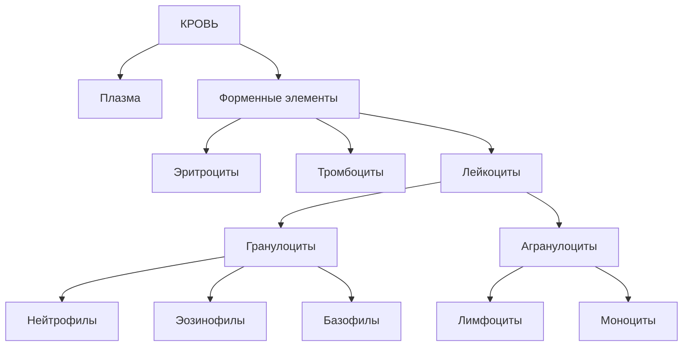

```quiz

{"subjectId":"977d78ca-7a58-4b0a-9e93-29d8e03f6946","title":"Кровь как ткань","questionIds":["8c1922f5-dd89-4f71-af30-5608e40e8454","fdf83b6d-ec68-450d-81b5-e52573294d1e","40a50617-c006-48f8-b83a-be300e095613"]}
```

## 2. Эритроциты — Erythrocyti

Эритроциты — высокодифференцированные **безъядерные постклеточные структуры**.

| Признак | Характеристика |
|---|---|
| Форма | двояковогнутый диск — дискоцит |
| Диаметр | 7,0–8,0 мкм |
| Толщина на периферии | 2,0–2,5 мкм |
| Толщина в центре | около 1,0 мкм |
| Ядро и органеллы | отсутствуют |
| Вода | около 60% |
| Сухой остаток | около 40% |
| Гемоглобин | около 95% сухого остатка |
| Жизнь | около 120 суток |

### Изменения

**Анизоцитоз** — изменение размеров: микроциты 8,0 мкм.

**Пойкилоцитоз** — изменение формы: эхиноциты, стоматоциты, сфероциты.

### Мембрана

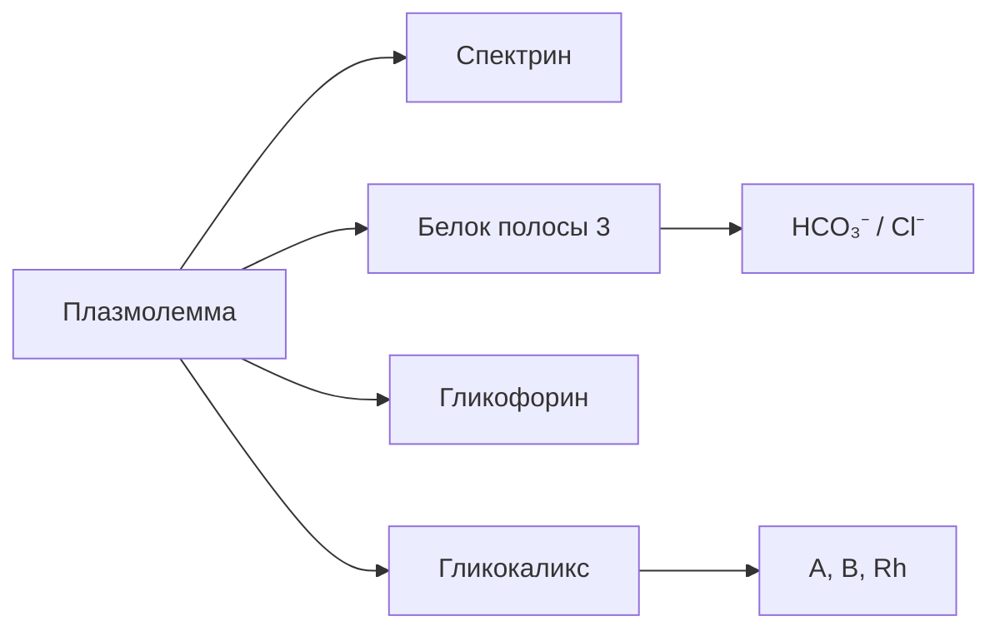

**Ретикулоциты** — молодые формы, 1–5% эритроцитов. Содержат остатки рРНК, рибосом и митохондрий; при суправитальной окраске бриллиантовым крезиловым голубым они дают зернисто-сетчатую субстанцию.

### Визуальная проверка: общий мазок крови

```image
{"trainerId":"feed-prep-9f7dc534b5"}
```

```image
{"trainerId":"feed-prep-a47e9dc83a"}
```

Сначала определи клетки самостоятельно, затем открой карточку изображения для названия и морфологических признаков. Повторный список этих же препаратов в конце лекции не нужен.

```quiz

{"subjectId":"977d78ca-7a58-4b0a-9e93-29d8e03f6946","title":"Эритроциты: морфология","questionIds":["6e7a5062-be40-4668-b445-b944181b74f2","bb9af8f2-4ca5-4c9a-bf6a-38e746e95d8c","83abf176-a5c9-48d7-83c8-03f761857775"]}
```

## 3. Тромбоциты — Thrombocyti

Тромбоциты — **безъядерные фрагменты цитоплазмы мегакариоцитов** красного костного мозга. Диаметр 2–3 мкм.

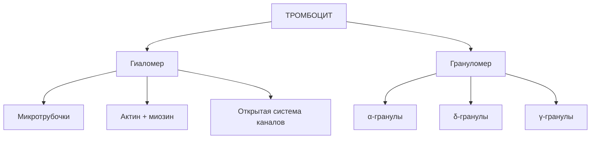

| Зона | Состав / значение |
|---|---|
| Гиаломер | краевой пучок микротрубочек, актин, миозин, открытая система каналов |
| α-гранулы | фибриноген, фактор Виллебранда, тромбопластин, факторы роста |
| δ-гранулы | серотонин, гистамин, Ca²⁺, АДФ, АТФ |
| γ-гранулы | лизосомы с гидролитическими ферментами |

**Функции:** гемостаз, свёртывание, ретракция сгустка, заживление сосудистой стенки. Жизнь 8–10 суток.

## 4. Лейкоциты

Лейкоциты имеют ядро и органеллы общего значения. Для практики сначала определи размер, затем ядро, затем зернистость.

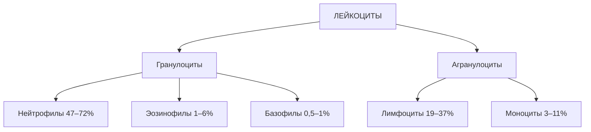

### Нейтрофилы — 47–72%

Размер 10–12 мкм.

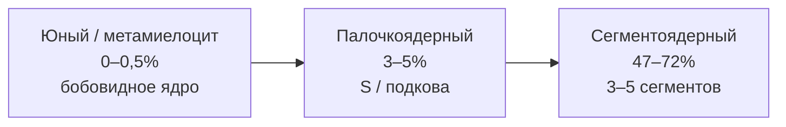

Специфические гранулы (80–90%) содержат щелочную фосфатазу, лактоферрин, лизоцим, фагоцитин. Азурофильные (10–20%) — первичные лизосомы с миелопероксидазой, кислой фосфатазой, протеазами.

**Функция:** микрофаги — фагоцитоз бактерий и повреждённых тканей, бактерицидные белки и активные формы кислорода.

**Сдвиг влево** — увеличение юных и палочкоядерных форм; в исходном конспекте связан с острым бактериальным воспалением / гнойным процессом.

### Эозинофилы — 1–6%

Размер 12–14 мкм. **Ядро строго из 2 сегментов («очки»).** Гранулы крупные, оксифильные, ярко-розовые.

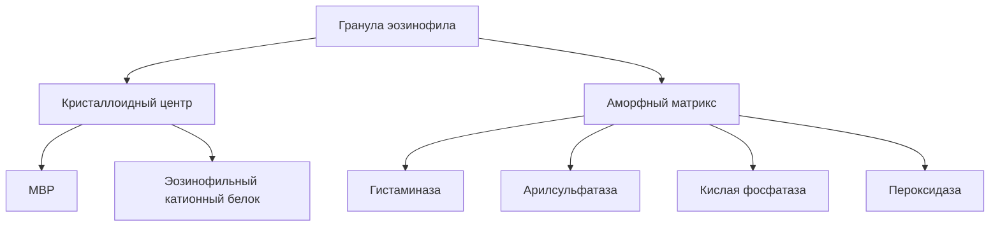

Функции: антипаразитарная защита; инактивация гистамина и участие в аллергических реакциях.

> **Узнавание:** 2 сегмента + крупные розовые гранулы = эозинофил.

### Базофилы — 0,5–1%

Размер 11–12 мкм. Ядро слабодольчатое, S-образное или овальное, часто скрыто крупными метахроматичными гранулами.

Гранулы: **гистамин, гепарин, серотонин, гистидиндекарбоксилаза**.

Функция: аллергические реакции немедленного типа. Гистамин повышает проницаемость сосудов; гепарин снижает свёртываемость.

### Лимфоциты — 19–37%

Круглые клетки с крупным округлым ядром, плотным гетерохроматином и узким ободком базофильной цитоплазмы.

| Группа | Размер | Доля |
|---|---:|---:|
| Малые | 10 мкм | отсутствуют или единичны |

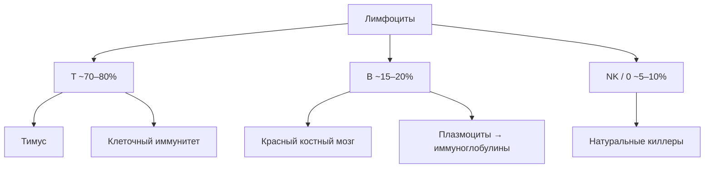

### Моноциты — 3–11%

Самые крупные клетки крови: **18–20 мкм**. Ядро бобовидное, подковообразное или инвагинированное, хроматин рыхлый. Цитоплазма широкая, дымчатая, серо-голубая.

Это клетки мононуклеарной фагоцитарной системы. В крови находятся 36–104 часа, затем мигрируют в ткани и превращаются в тканевые макрофаги: гистиоциты, клетки Купфера, остеокласты, альвеолярные макрофаги.

```quiz

{"subjectId":"977d78ca-7a58-4b0a-9e93-29d8e03f6946","title":"Форменные элементы: практическое распознавание","questionIds":["0ff57ab7-0357-43b9-b6c4-b9cd31176e6e","930d7ae8-6e6a-4c85-a018-e780a6b12033","f044f188-09b1-4e35-8d1c-c7addd16c027"]}
```

### Визуальная проверка: лейкоциты и тромбоциты

```image
{"trainerId":"feed-prep-a2feb3ec86"}
```

```image
{"trainerId":"feed-prep-bca30caf3b"}
```

```image
{"trainerId":"feed-prep-60e72c3e7e"}
```

Здесь достаточно одной связки: сравни размер и ядро лимфоцита/моноцита, затем отдельно найди мелкие тромбоциты. Эти изображения не повторяются отдельным списком ниже.

## 5. Гемограмма

| Показатель | Мужчины | Женщины | Новорождённые |
|---|---:|---:|---:|
| Эритроциты | 4,0–5,5 × 10¹²/л | 3,7–4,9 × 10¹²/л | 6,0–7,0 × 10¹²/л |
| Hb | 130–160 г/л | 120–140 г/л | 180–210 г/л |
| Ретикулоциты | 1–5% | 1–5% | до 10% |
| Тромбоциты | 180–320 × 10⁹/л | 180–320 × 10⁹/л | 200–400 × 10⁹/л |
| Лейкоциты | 4,0–9,0 × 10⁹/л | 4,0–9,0 × 10⁹/л | 10,0–30,0 × 10⁹/л |
| СОЭ | 4–8 мм/ч | 7–10 мм/ч | 0,5–2 мм/ч |

## 6. Лейкоцитарная формула

| Клетка | % | Абсолютно, ×10⁹/л |
|---|---:|---:|
| Базофилы | 0,5–1 | 0,01–0,065 |
| Эозинофилы | 1–6 | 0,02–0,3 |
| Нейтрофилы, юные | 0–0,5 | 0–0,04 |
| Нейтрофилы, палочкоядерные | 3–5 | 0,1–0,3 |
| Нейтрофилы, сегментоядерные | 47–72 | 2,0–5,5 |
| Лимфоциты | 19–37 | 1,2–3,0 |
| Моноциты | 3–11 | 0,09–0,6 |

## 7. Возрастные перекрёсты

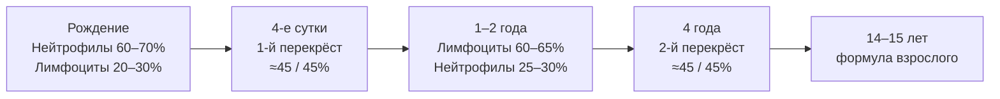

**Пять точек:** рождение → 4-е сутки → 1–2 года → 4 года → 14–15 лет.

```quiz

{"subjectId":"977d78ca-7a58-4b0a-9e93-29d8e03f6946","title":"Гемограмма и возрастные нормы","questionIds":["9dc2513a-c7bb-4c1f-845d-5d3439c00bd7","0b059070-8ffa-416a-ac46-a64a35d5321f","1fda50a0-5b52-43f2-afc6-39b2f1a67586"]}
```

### 7A. Возрастные нормы гемограммы — временная шкала

> **Важно:** этот блок собран по дополнению к Lecture 05, присланному для занятия. Числа и формулировки сохранены по исходному материалу. Если в нём приведены варианты нормы из разных источников, они показаны как варианты, а не молча сведены к одному числу.

Главная временная шкала для практической карточки — соотношение **нейтрофилов и лимфоцитов**:

| Возраст | Нейтрофилы | Лимфоциты | Кто преобладает |
|---|---:|---:|---|
| Новорождённый, 1-е сутки | 60–70% | 20–30% | Нейтрофилы |
| 4-е сутки — 1-й перекрёст | ≈45% | ≈45% | Равны |
| 1–2 года | 25–30% | 60–65% (до 70%) | Лимфоциты |
| 4 года — 2-й перекрёст | ≈45% | ≈45% | Равны |
| 14–15 лет и взрослые | 47–72% | 19–37% | Нейтрофилы |

**Правило карточки:** сначала смотри возраст, затем выбирай норму, и только после этого оценивай отклонение. Для ребёнка 1–2 лет лимфоциты около 60–65% в присланном материале относятся к физиологической норме.

### 7B. Лейкоцитарная формула по возрастам

| Показатель | 1-е сутки | 4-е сутки | 1–2 года | 4 года | 14–15 лет / взрослый |
|---|---:|---:|---:|---:|---:|
| Сегментоядерные нейтрофилы | 60–65% | 40–42% | 20–25% | 40–42% | 47–72% |
| Палочкоядерные | 3–5% | 3–5% | 3–5% | 3–5% | 3–5% |
| Юные | 0–1% | 0–0,5% | 0–0,5% | 0–0,5% | 0–0,5% (до 1% в одном из указанных источников) |
| Лимфоциты | 20–30% | 45% | 60–65% (до 70%) | 45% | 19–37% (20–35% в одном из указанных источников) |
| Моноциты | 3–11% | 3–11% | 3–11% | 3–11% | 3–11% (6–8% в одном из указанных источников) |
| Эозинофилы | 1–6% | 1–6% | 1–6% | 1–6% | 1–6% (0,5–5% в одном из указанных источников) |
| Базофилы | 0,5–1% | 0,5–1% | 0,5–1% | 0,5–1% | 0,5–1% (0–1% в одном из указанных источников) |

### 7C. Гемограмма по ключевым возрастным периодам

**Новорождённый, 0–14 дней**
- Эритроциты: **6,0–7,0 × 10¹²/л**.
- Hb: **180–210 г/л**; HbF около **80%** в присланном материале.
- Лейкоциты: **10,0–30,0 × 10⁹/л**.
- Ретикулоциты: до **10%**.
- Возможны анизоцитоз, макроцитоз и единичные ядросодержащие предшественники эритроцитов.

**10–14 сутки**
- Эритроциты: **4,0–5,0 × 10¹²/л**.
- Лейкоциты: **9,0–15,0 × 10⁹/л**.
- Первый физиологический перекрёст указан для **4-х суток**.

**Грудной возраст, 3–6 месяцев**
- В присланном материале описана физиологическая анемия: разрушение эритроцитов с HbF и замещение его HbA.
- Эритроциты: **3,5–4,5 × 10¹²/л**.
- Hb: **110–130 г/л**.

**1–2 года**
- Лимфоциты: **60–65% (до 70%)**.
- Нейтрофилы: **20–30%**.

**4 года**
- Второй физиологический перекрёст: нейтрофилы и лимфоциты около **45%**.

**14–15 лет и взрослые**
- Эритроциты: мужчины **4,0–5,5 × 10¹²/л**, женщины **3,7–4,9 × 10¹²/л**; отдельно в присланном материале указана лекционная величина для женщин **3,9–4,7 × 10¹²/л**.
- Hb: мужчины **130–160 г/л**, женщины **120–140 г/л**.
- Лейкоциты: **4,0–9,0 × 10⁹/л**; отдельно указан вариант **4,5–9,0 × 10⁹/л**.
- Тромбоциты: **180–320 × 10⁹/л**; отдельно указан вариант **250–300 × 10⁹/л**.
- Ретикулоциты: **1–5%**.
- СОЭ: мужчины **4–8 мм/ч**, женщины **7–10 мм/ч**.

### 7D. Экспресс-алгоритм возрастной карточки

1. Сначала смотри возраст пациента.
2. Выбирай норму именно для этого возраста.
3. Сравнивай показатель с соответствующим возрастным столбцом.
4. Только после этого делай вывод о повышении/снижении.

### 7E. Мини-тест: возрастная норма

```quiz

{"subjectId":"977d78ca-7a58-4b0a-9e93-29d8e03f6946","title":"Возрастные нормы гемограммы","questionIds":["0b059070-8ffa-416a-ac46-a64a35d5321f","1fda50a0-5b52-43f2-afc6-39b2f1a67586","9dc2513a-c7bb-4c1f-845d-5d3439c00bd7"]}
```quiz

Сначала реши мини-тест, затем возвращайся к таблице и проверь, **почему возраст меняет интерпретацию результата**.

## 8. Электронограмма: эозинофильный гранулоцит

**Алгоритм описания:**

1. **Название:** эозинофильный гранулоцит.
2. **Размер:** 12–14 мкм в мазке.
3. **Ядро:** 2 сегмента, «очки», тонкая перемычка; гетерохроматин под кариолеммой.
4. **Цитоплазма:** комплекс Гольджи, митохондрии, актиновые микрофиламенты, азурофильные и специфические гранулы.
5. **Специфические гранулы:** 0,5–1,5 мкм; электронно-плотный кристаллоидный центр + более светлый аморфный матрикс.
6. **Кристаллоид:** MBP и эозинофильный катионный белок.
7. **Матрикс:** гистаминаза, арилсульфатаза, кислая фосфатаза, пероксидаза.
8. **Рецепторы:** Fc-рецепторы к IgE/IgG/IgM; рецепторы C3/C4; рецепторы хемотаксиса к гистамину.

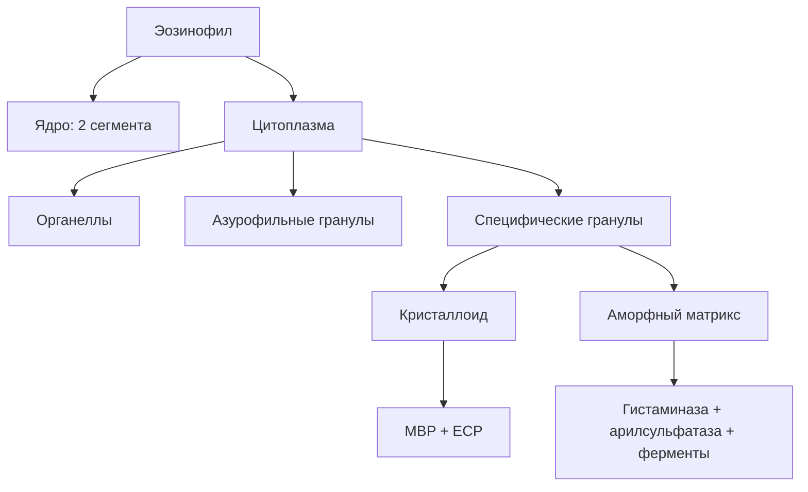

```quiz

{"subjectId":"977d78ca-7a58-4b0a-9e93-29d8e03f6946","title":"Электронограмма и морфологические признаки","questionIds":["930d7ae8-6e6a-4c85-a018-e780a6b12033","f044f188-09b1-4e35-8d1c-c7addd16c027","8c1922f5-dd89-4f71-af30-5608e40e8454"]}
```

## 9. Быстрое распознавание в мазке

| Клетка | Размер | Главный признак |
|---|---:|---|
| Сегментоядерный нейтрофил | 10–12 мкм | 3–5 сегментов + мелкая бледная зернистость |
| Палочкоядерный нейтрофил | 10–12 мкм | палочка / S / подкова без перетяжек |
| Юный нейтрофил | 12–14 мкм | бобовидное ядро |
| Эозинофил | 12–14 мкм | 2 сегмента + крупные розовые гранулы |
| Базофил | 11–12 мкм | крупные тёмно-фиолетовые гранулы |
| Лимфоцит | 7–10 мкм | тёмное ядро занимает почти всю клетку |
| Моноцит | 18–20 мкм | самая крупная клетка + бобовидное ядро |

> **Алгоритм:** размер → ядро → зернистость → клетка → функция.

## 10. Термины анализа

| Термин | Критерий из конспекта |
|---|---|
| Лейкоцитоз | >9,0 × 10⁹/л |
| Лейкопения | 72% |
| Нейтропения | 6% |
| Эозинопения | 1% |
| Лимфоцитоз | >37% |
| Лимфопения | 11% |

## 11. 4-столбчатая карточка

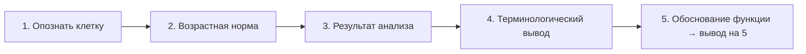

| Столбец | Что сделать |
|---|---|
| 1. Клетка | назвать клетку + морфологические признаки |
| 2. Норма | привести норму для возраста |
| 3. Анализ | назвать фактическое значение |
| 4. Вывод | лейкоцитоз, эозинофилия, сдвиг влево и т. д. |
| На «5» | связать изменение с функцией клетки |

## 12. Три типовых карточки

### Карточка №1 — взрослый, 30 лет

Лейкоциты 14,0 × 10⁹/л; палочкоядерные 12%; сегментоядерные 68%; лимфоциты 14%.

| Показатель | Норма | Результат | Вывод |
|---|---:|---:|---|
| Палочкоядерные | 3–5% | 12% | сдвиг влево |
| Лейкоциты | 4,0–9,0 × 10⁹/л | 14,0 | лейкоцитоз |

**Вывод на «5»:** острый воспалительный/гнойный процесс или острая бактериальная инфекция. Обоснование — функция нейтрофилов как микрофагов и увеличение выхода незрелых форм.

### Карточка №2 — ребёнок, 10 дней

Лейкоциты 11,0 × 10⁹/л; эозинофилы 14%; лимфоциты 58%; сегментоядерные 22%.

| Показатель | Норма / ориентир | Результат | Вывод |
|---|---:|---:|---|
| Эозинофилы | 1–6% | 14% | эозинофилия |
| Лимфоциты | возрастное повышение | 58% | возрастное направление формулы |

**Вывод на «5»:** аллергическая реакция или гельминтоз / паразитарная инвазия.

### Карточка №3 — взрослый, 45 лет

Лейкоциты 3,2 × 10⁹/л; лимфоциты 52%; сегментоядерные 38%.

| Показатель | Норма | Результат | Вывод |
|---|---:|---:|---|
| Лимфоциты | 19–37% | 52% | относительный лимфоцитоз |
| Сегментоядерные | 47–72% | 38% | нейтропения |
| Лейкоциты | 4,0–9,0 × 10⁹/л | 3,2 | лейкопения |

**Вывод на «5»:** вирусная инфекция или угнетение костномозгового кроветворения.

```quiz

{"subjectId":"977d78ca-7a58-4b0a-9e93-29d8e03f6946","title":"Итог блока: функции крови и вывод","questionIds":["714be43a-ae6a-4b70-b978-8501e325c418","e8a0cb48-c8e6-48a1-945b-b30df9a98ca5","40a50617-c006-48f8-b83a-be300e095613"]}
```

## 13A. Интерактивный тренажёр: проценты → ↑/↓ → мазок

> Сначала вспоминай учебные проценты из Лекции 5, затем определяй повышение/снижение и только после этого переходи к распознаванию клетки по мазку. Для независимой визуальной проверки доступны отдельные внешние изображения.\n\n```leukocyte
{"title":"Лейкоцитарная формула — тренажёр","mode":"mixed","sourceMode":"mixed","rounds":12}
```

## 13. Мини-проверка

- 2 сегмента + крупные розовые гранулы → **эозинофил**
- 3–5 сегментов + мелкая бледная зернистость → **сегментоядерный нейтрофил**
- S / палочка / подкова без сегментов → **палочкоядерный нейтрофил**
- 18–20 мкм + бобовидное ядро + дымчатая цитоплазма → **моноцит**
- крупное тёмное ядро + узкий ободок → **лимфоцит**
- крупные тёмно-фиолетовые гранулы → **базофил**
- >9,0 × 10⁹/л → **лейкоцитоз**
- 6% эозинофилов → **эозинофилия**
- >37% лимфоцитов у взрослого → **лимфоцитоз**
- увеличение палочкоядерных/юных → **сдвиг влево**

## 14. Итоговая карта

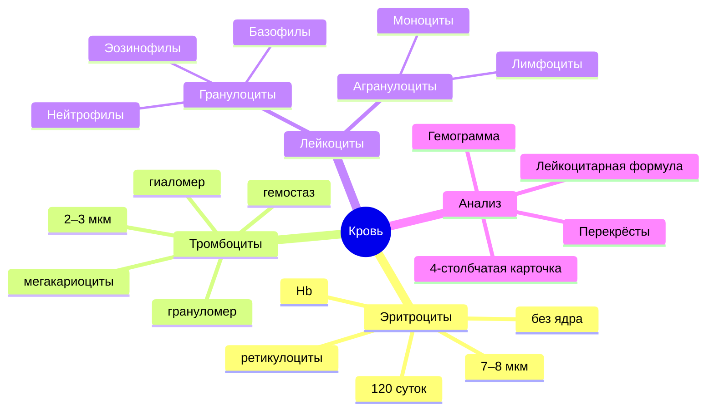

> **Главная цепочка для ответа:** **морфология → структура → функция → изменение анализа → термин → обоснованный вывод.**

### Что знать к практическому занятию

- состав и функции крови;
- морфологию эритроцитов и ретикулоцитов;
- строение и функции тромбоцитов;
- классификацию и морфологию лейкоцитов;
- гемограмму и лейкоцитарную формулу;
- возрастные перекрёсты;
- описание эозинофила на электронограмме;
- термины изменений лейкоцитарной формулы;
- алгоритм 4-столбчатой карточки.

> **Примечание:** предоставленный конспект подробно раскрывает кровь. Отдельного содержательного раздела о лимфе в нём нет, поэтому здесь не добавлен неподтверждённый материал.

## 15. Прямая связка: лекция → препарат → ЭМ → тест

Учебная цепочка теперь встроена в сам текст: **теория → связанный препарат → мини-тест → электронограмма/практическое распознавание → итоговый тест**.

Канонические препараты берутся из существующего trainer-контента и не дублируются отдельным каталогом внутри лекции. Общий вход: [Микропрепараты](/subjects/histology?tab=trainer).

Для полного банка: [тест «Гистология — общая: кровь»](/tests/preparation/29564479-ebb7-4c81-9d0d-4e5ca640d053).

Для документов и электронограмм: [Материалы](/subjects/histology?tab=materials).

## 16. Внешняя визуальная проверка

После основных блоков можно сделать независимую сверку по двум изображениям University of Utah WebPath. Это дополнительный источник, а не замена каноническим препаратам MEDBIOHIM.

```image
{"url":"https://webpath.med.utah.edu/jpeg5/HEME004.jpg","caption":"University of Utah WebPath — эозинофил с двудольчатым ядром и яркими гранулами. Используй как независимую проверку признаков."}
```

Между изображениями сначала самостоятельно назови клетку и объясни, какой морфологический признак дал тебе ответ.

```image
{"url":"https://webpath.med.utah.edu/jpeg5/HEME003.jpg","caption":"University of Utah WebPath — моноцит в периферической крови; сравни размер и форму ядра с мазком MEDBIOHIM."}
```

Источник серии: [University of Utah WebPath — Normal Histology](https://webpath.med.utah.edu/HISTHTML/NORMAL/NORMAL.html).

> Внешние фотографии нужны только для независимой проверки. Канонические изображения MEDBIOHIM открываются из встроенных карточек препарата и ведут в атлас/тренажёр.
