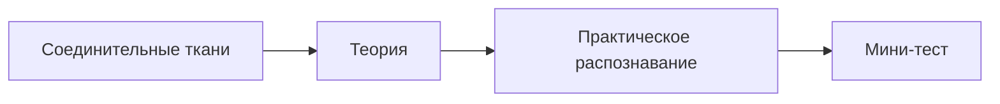

# Занятие 7. Собственно соединительные ткани (РВСТ, ткани со специальными свойствами, плотные)

> **Дисциплина:** Гистология, эмбриология, цитология (30.05.01 Медицинская биохимия).
> **Тема ДЗ (к 16.10):** собственно соединительные ткани.
> **Источники:** файлик «5. Соединительные ткани» · методичка «Общая гистология» (ДВГМУ), Темы 14–15 · Сборник тестовых заданий по общей гистологии (тема «Соединительные ткани», вопросы 1–33, с ключами).
> **Статус:** черновик для последующей интеграции на сайт.

---

## § 1. Домашнее задание (по заданию преподавателя)

1. Лекцию БЯ по теме учим; соответствующий раздел учебника читаем (Афанасьев/Юрина, гл. 8, разделы «РВСТ», «Ткани со специальными свойствами», «Плотные СТ»).
2. Написать файлик по соединительной ткани и выучить.
3. **Обязательно таблицу из файлов дополнить рисунками клеток (рисунки цветные, в соответствии с морфологией)** — см. § 3 (заполненная таблица) и указания к раскраске.

---

**✅ Проверь себя — тест на усвоение блока «§ 1. Домашнее задание (по заданию преподавателя)»**

```quiz
{"questionIds": ["c64690b1-67ea-4a65-ab2e-d63735940ce5", "420accb6-b45e-4901-a629-6dbba54324ab", "21d7fcae-edd6-429d-8dbd-9b8a1b111529", "e1318700-38ac-4a91-9394-1042058e3822", "64d856b2-5ae4-4ef7-890d-50991ce08acc", "6332e446-ef61-446a-9a9b-4f7fb1ecf6e7"], "subjectId": "977d78ca-7a58-4b0a-9e93-29d8e03f6946", "title": "Проверь себя · § 1. Домашнее задание (по заданию препод"}
```

## § 2. Теория (файлик «5. Соединительные ткани» — дословно)

**✅ Проверь себя — тест на усвоение блока «§ 2. Теория (файлик «5. Соединительные ткани» — дословно)»**

```quiz
{"questionIds": ["9ae34cad-d327-41a3-8e5f-ca45f75834fd", "1fd70e0d-24b8-43c7-97ff-2ffbd0ff8aa7", "5afeff1d-6fed-4fb2-8a02-f0c2f97ca0ed", "e5e31b6a-a298-4953-adde-1c5d12f35654", "069104f0-2072-411e-b2c0-c11747525c52", "66a65c1f-f384-4f1f-9e57-4619fc408268"], "subjectId": "977d78ca-7a58-4b0a-9e93-29d8e03f6946", "title": "Проверь себя · § 2. Теория (файлик «5. Соединительные т"}
```

### Классификация соединительных тканей

```
Соединительные ткани
├─ Кровь и лимфа
├─ Собственно соединительные ткани
│   ├─ Волокнистые: рыхлая | плотные (неоформленная | оформленная)
│   └─ Ткани со специальными свойствами: жировая · ретикулярная · слизистая · пигментная
└─ Скелетные: хрящевые (гиалиновая, эластическая, волокнистая) ·
   костные (пластинчатая, ретикулофиброзная, дентин и цемент зуба)
```

**✅ Проверь себя — тест на усвоение блока «Классификация соединительных тканей»**

```quiz
{"questionIds": ["ba8f9f29-cdf2-434a-893b-825d3d47abd5", "1e288bc7-a6bd-44cc-a94f-4a40eb837ab5", "8023a2fc-01e2-40ea-bbcf-77a40c342b11", "ed735007-f936-4bde-b730-895bbd4109f7", "682a6b16-f462-4be5-a8b1-242b04c1e47a", "71b7e0f0-75fb-4da1-af31-a4b089860f52"], "subjectId": "977d78ca-7a58-4b0a-9e93-29d8e03f6946", "title": "Проверь себя · Классификация соединительных тканей"}
```

### Общая характеристика соединительных тканей

1. Развиваются из **мезенхимы**.
2. **Никогда не лежат на поверхности** — «ткани внутренней среды».
3. Состоят из клеток и межклеточного вещества; **преобладает межклеточное вещество**.
4. Клетки **аполярны** (в отличие от эпителиоцитов).
5. Межклеточное вещество = **аморфное вещество + волокна** (коллагеновые, эластические, ретикулярные).
6. Основные функции — **опорная и трофическая**.

**✅ Проверь себя — тест на усвоение блока «Общая характеристика соединительных тканей»**

```quiz
{"questionIds": ["7d22187d-14ee-4817-960c-11bcff1c210e", "9b3a3318-649b-41dc-bda0-dfb98dca9c49", "0c2a3fec-1ed7-4515-b191-c1e016b522e4", "2079cef9-7a8f-4355-ba47-6764c6b8bb8c", "a6e0ae27-928d-455c-8021-3c94527471b8", "a6f89fa8-3b13-406b-b887-181906f9133d"], "subjectId": "977d78ca-7a58-4b0a-9e93-29d8e03f6946", "title": "Проверь себя · Общая характеристика соединительных ткан"}
```

### Строение межклеточного вещества

| Компонент | Строение | Окраска | Функции |
|---|---|---|---|
| **Аморфное вещество** | Коллоидный раствор золе- или гелеобразной консистенции. Вода + неорганические и органические вещества; органические — низкомолекулярные и высокомолекулярные: белки и **гликозаминогликаны (ГАГ)** — высокомолекулярные углеводные полимеры: **гиалуроновая кислота, хондроитин-сульфаты, гепарин** и др. | При большом содержании ГАГ — базофильная; часто окрашиваются **метахроматично** (в цвет, отличный от цвета красителя) | Регуляция проницаемости межклеточного вещества (гиалуронидаза, витамин С и др.) |
| **Коллагеновые волокна** | Самые толстые (толщина 3–5 мкм), **не ветвятся**, волнообразный ход; состоят из более тонких волоконец — **фибрилл** с характерной поперечной исчерченностью. Прочность на разрыв. Белок — **коллаген** | **Оксифильно; эозином в розовый** | Механическая прочность |
| **Эластические волокна** | Тонкие (до 1 мкм), **ветвятся под острым углом**, непрочные, но растягиваются и возвращаются в исходное состояние | **Орсеином в кирпично-красный** | Способность к деформации |
| **Ретикулярные волокна** | Самые тонкие (0,1–0,2 мкм), **ветвятся под прямым углом**, адсорбируют углеводы и липиды | **Азотнокислым серебром в чёрный** | Опорная функция (например, для клеток кроветворных органов) |

**✅ Проверь себя — тест на усвоение блока «Строение межклеточного вещества»**

```quiz
{"questionIds": ["cd90f62e-5602-4a54-b10d-6066fc453f94", "c2f45dd1-d153-48a7-be16-d35fa6f5b3e3", "16958a14-e82e-456c-b372-23cffef33052", "3d7c6bac-3e56-4b8c-9ae5-635e1bde1b50", "969f384e-0b28-4acc-ab59-220e4880792b", "ef81778f-0a42-4503-b85b-58643cb527e6"], "subjectId": "977d78ca-7a58-4b0a-9e93-29d8e03f6946", "title": "Проверь себя · Строение межклеточного вещества"}
```

### Морфофункциональная характеристика клеток РВСТ (таблица файлика — ЗАПОЛНЕНА)

*(В файлике графы «форма/размер» и «функция» пустые — заполнено по учебнику и методичке.)*

| Клетка | Форма, размер | Цитоплазма (световая / электронная) | **Функция клетки** |
|---|---|---|---|
| **Фибробласт** | Крупные, отростчатые, нечёткие контуры | Базофильная, гранул нет / **ГрЭПС, комплекс Гольджи** | Синтез компонентов межклеточного вещества (белков коллагена и эластина, ГАГ) — главный «строитель» соединительной ткани; участие в заживлении ран |
| **Фиброцит** | Меньше, веретеновидные, узкий ободок цитоплазмы | Базофильная, гранул нет / ГрЭПС и Гольджи развиты **хуже** | Зрелая форма; поддержание структуры ткани (метаболически малоактивна) |
| **Макрофаг (гистиоцит)** | Крупные, отростчатые, чёткие контуры | Базофильная, много гранул и пузырьков — «пенистая» / **множество лизосом** (первичных, вторичных, остаточных тел) | **Фагоцитоз** (микроорганизмы, погибшие клетки, межклеточное вещество), участие в иммунных реакциях (презентация антигена), секреция БАВ (интерлейкин-1 и др.) |
| **Тучная клетка (тканевой базофил, лаброцит, мастоцит)** | Крупные, округлые/овальные | Базофильная, множество гранул — базофильно и **метахроматично** / комплекс Гольджи и ЭПС; секреторные гранулы с гепарином и гистамином | Регуляторная: **гепарин — антикоагулянт**, **гистамин — ↑проницаемости сосудов** (аллергические реакции); регуляция местного гомеостаза |
| **Плазматическая клетка (плазмоцит)** | Овальная/округлая; ядро эксцентрично, гетерохроматин в виде «спиц в колесе» | Интенсивно базофильная; возле ядра «светлый дворик» / **ГрЭПС по всей цитоплазме**, кроме «светлого дворика» (там Гольджи и центриоли) | **Выработка антител (иммуноглобулинов)** — гуморальный иммунитет; развиваются из В-лимфоцитов |
| **Жировая клетка (адипоцит, липоцит)** | Округлая; ядро плотное, сплющено, смещено к периферии | Почти вся цитоплазма — одна капля жира (при гематоксилин-эозине вымывается и не окрашивается) / глЭПС, комплекс Гольджи | Депо жира: трофическая, теплоизоляция, депо воды; бурые адипоциты — терморегуляция |
| **Пигментная клетка (пигментоцит, меланоцит)** | Отростчатые | Слабо базофильная; множество гранул с **меланином** / свободные рибосомы | Защитная (от УФО): пигмент поглощает солнечные лучи |
| **Ретикулярная клетка** | Крупные, отростчатые, образуют синцитий | Оксифильная, гранулы единичные / митохондрии, лизосомы, ЭПС | Строма кроветворных органов: создают микроокружение (трофическое, опорное, защитное), определяют путь дифференцировки кроветворных клеток |
| **Адвентициальная клетка** | Малоотростчатые, вдоль сосудов | Слабо базофильная, гранул нет / органеллы слабо развиты | Малодифференцированные камбиальные клетки; дифференцируются в фибробласты, адипоциты, гладкие миоциты |
| **Перицит** | Отростчатая; ядро небольшое, плотное | Слабо базофильная / органеллы слабо, лучше — **сократительные филаменты** | Сокращение  —  регуляция просвета капилляров; окружают капилляры снаружи |

> **Логика дифферонов (кто от кого происходит):** фибробласты/фиброциты/миофибробласты/фиброкласты — дифферон фибробластов (из мезенхимы); макрофаги — из **моноцитов** крови; плазмоциты — из **В-лимфоцитов**; тучные клетки — из мезенхимных предшественников; пигментоциты — из **нервного гребня**.

**✅ Проверь себя — тест на усвоение блока «Морфофункциональная характеристика клеток РВСТ (таблица файл»**

```quiz
{"questionIds": ["ac42d415-e164-43bf-95ea-eb1c4eb28dfb", "cec17d60-3331-4a51-b89e-87785df8591d", "ebb865b9-414c-4bca-a202-6e7ec835b09c", "c044f827-1f50-4b1c-a52c-37ef95459844"], "subjectId": "977d78ca-7a58-4b0a-9e93-29d8e03f6946", "title": "Проверь себя · Морфофункциональная характеристика клето"}
```

### Соединительные ткани со специальными свойствами

| Ткань | Местоположение | Описание | Функции |
|---|---|---|---|
| **Жировая белая** | Подкожно-жировая клетчатка, вокруг органов | Скопления липоцитов дольками, разделены прослойками РВСТ | 1. Трофическая 2. Механическая |
| **Жировая бурая** | У новорожденных: шея, между лопатками, по ходу крупных сосудов | Клетки полигональные, ядро в центре, множество мелких липидных капель, окружённых митохондриями | 1. Терморегуляторная 2. Выработка эндогенной воды |
| **Ретикулярная** | Строма кроветворных органов (красный костный мозг, лимфоузел и др.) | Ретикулярные клетки и ретикулярные волокна — сеть с развивающимися клетками крови | Микроокружение для клеток крови: трофическая, опорная, защитная, определение пути дифференцировки |
| **Слизистая** | Только в эмбриональном периоде — пупочный канатик | Мало клеток и волокон; преобладает аморфное вещество, богатое ГАГ (гиалуроновая кислота) связывает воду — гелеобразная консистенция («вартонов студень») | Механическая защита — предохраняет сосуды пуповины от сдавления при перекручивании |
| **Пигментная** | Ареола соска молочной железы, перианальная область, мошонка, радужка | Скопления пигментных клеток | Защитная (от УФО) |

**✅ Проверь себя — тест на усвоение блока «Соединительные ткани со специальными свойствами»**

```quiz
{"questionIds": ["7bf8fe4f-f267-45e5-a13f-8960fb427c9e", "9c0cf4c0-df99-47d3-a452-3015fbc1c220", "30db4879-5fcf-4f91-b92e-a0ec08181a96", "e1e70e0b-210b-447e-812d-e57149febfa5"], "subjectId": "977d78ca-7a58-4b0a-9e93-29d8e03f6946", "title": "Проверь себя · Соединительные ткани со специальными сво"}
```

### Плотная соединительная ткань

Коллагеновые волокна формируют **пучки** (отличие от рыхлой: в межклеточном веществе преобладают волокна, формирующие пучки).

- **Плотная неоформленная** — пучки лежат неупорядоченно, хаотично (глубокие слои дермы, десна, твёрдое нёбо).
- **Плотная оформленная** — пучки упорядочены, одно направление (сухожилия, связки, фиброзные мембраны: капсулы органов, надкостница, надхрящница, сухожильные центры диафрагмы, белочная оболочка семенника и яичника, склера, твёрдая мозговая оболочка).

**Строение сухожилия:** пучки коллагеновых волокон **I порядка** — разделены **фиброцитами**; пучки **II порядка** — разделены **эндотенонием** (РВСТ); пучки **III порядка** — разделены **перитенонием** (РВСТ).

---

**✅ Проверь себя — тест на усвоение блока «Плотная соединительная ткань»**

```quiz
{"questionIds": ["6408e0d8-20f4-4886-9ff8-d70d7afeaf8b", "3794c2b1-164c-47d9-bee3-959c357325e9", "c39a9ed9-7b85-4fbd-832e-78838fb8ed58", "83fefb23-c291-4e35-a2d5-a756b5ad4e97"], "subjectId": "977d78ca-7a58-4b0a-9e93-29d8e03f6946", "title": "Проверь себя · Плотная соединительная ткань"}
```

## § 3. Задание «дополнить таблицу рисунками» — как рисовать клетки (цветные, по морфологии)

Рисовать каждую клетку при световой микроскопии; раскраска:

- **Фибробласт** — крупная отростчатая клетка, контуры нечёткие; цитоплазма — светло-фиолетовая (базофильная), ядро светлое крупное с ядрышками.
- **Макрофаг** — отростчатая, чёткие края; цитоплазма «пенистая» — розово-сиреневая с гранулами и пузырьками (показать вакуоли), ядро тёмное бобовидное.
- **Тучная клетка** — округлая, крупная; цитоплазма заполнена крупными гранулами: часть — фиолетовые (базофильные), часть — другого цвета (метахромазия, например коричневые/красные); показать дегрануляцию (гранулы вне клетки).
- **Плазмоцит** — овальная; ядро эксцентричное с гетерохроматином «спицами в колесе» (фиолетовые комочки по ободку ядра); цитоплазма интенсивно синяя (базофильная) + белый «светлый дворик» у ядра.
- **Адипоцит** — «перстневидная»: большой белый (неокрашенный) круг — жировая капля; узкий ободок цитоплазмы на периферии + сплющенное ядро.
- **Пигментоцит** — отростчатая; цитоплазма заполнена коричнево-чёрными зёрнами меланина (ядро не закрашивать).
- **Ретикулярная клетка** — крупная отростчатая, связанная отростками с другими (синцитий), между ними лимфоциты (маленькие тёмные точки).

**✅ Проверь себя — тест на усвоение блока «§ 3. Задание «дополнить таблицу рисунками» — как рисовать кл»**

```quiz
{"questionIds": ["70800ced-612b-477c-9655-62cc422cd464", "fd07cfba-06a6-4fef-8c0f-a276d8e50381", "d397689f-d2db-477e-bcd1-0b54c239a10b", "743b6e1c-2184-467a-82af-090b69181924"], "subjectId": "977d78ca-7a58-4b0a-9e93-29d8e03f6946", "title": "Проверь себя · § 3. Задание «дополнить таблицу рисункам"}
```

## § 3а. Атласные рисунки к теме (Кузнецов С.Л. и др., 2002)

```image
{"url": "/library/lectures/gistologiya/atlas/kuzn_06-rvst.png", "caption": "Атлас, с. 74. Рис. 97. Рыхлая волокнистая соединительная ткань"}
```

```image
{"url": "/library/lectures/gistologiya/atlas/kuzn_06-kollagenovye-volokna.png", "caption": "Атлас, с. 77. Рис. 99. Строение коллагеновых волокон"}
```

```image
{"url": "/library/lectures/gistologiya/atlas/kuzn_06-suhozhilie.png", "caption": "Атлас, с. 79. Плотная оформленная СТ: продольный срез сухожилия"}
```

```image
{"url": "/library/lectures/gistologiya/atlas/kuzn_06-spec-svojstva.png", "caption": "Атлас, с. 80. 9.3. Соединительные ткани со специальными свойствами"}
```

---

**✅ Проверь себя — тест на усвоение блока «§ 3а. Атласные рисунки к теме (Кузнецов С.Л. и др., 2002)»**

```quiz
{"questionIds": ["1e200d35-d3c2-4175-8468-241ea6323f53", "118a1a4d-8e64-45e6-85cc-adf6d7693b23", "b386afeb-b049-4185-b92f-b8cb8e81929d", "4fd347b1-df07-4e8b-bb9a-5ca973a93e1f"], "subjectId": "977d78ca-7a58-4b0a-9e93-29d8e03f6946", "title": "Проверь себя · § 3а. Атласные рисунки к теме (Кузнецов "}
```

## § 4. Препараты к занятию (методичка, Темы 14–15 — зарисовать)

1. **РВСТ (нижняя поверхность языка), гематоксилин-эозин.** Сверху МПНЭ (I) на базальной мембране (БМ), под ней РВСТ (II): ядра клеток (1) — дифферон фибробластов, макрофаги, плазмоциты, тучные, адвентициальные, адипоциты, эндотелиоциты, перициты, пигментные. Преобладает **межклеточное вещество (2)**: коллагеновые волокна (3) разных направлений + слабо окрашенное аморфное вещество (4). Сосуды (5).
2. **Фибробласты в культуре тканей, железный гематоксилин.** Крупные отросчатые клетки (1), базофильная цитоплазма (2) с развитой ГрЭПС; крупное светлое ядро (3) с ядрышками (4).
3. **Эластические волокна и тканевые базофилы (сальник), гематоксилин + орсеин.** Сеть эластических волокон (1) красновато-коричневых, ветвятся под острым углом (треугольные площадки (2)); крупные тканевые базофилы (3) с гранулами (4); часть гранул — метахромазия (гепарин); явление **дегрануляции** (гранулы вне клетки).
4. **Ретикулярная ткань (лимфоузел), гематоксилин-эозин.** Корковое (тёмное) и мозговое (светлое) вещество; ретикулярные клетки (1) отростчатые, образуют синцитий (2); лимфоциты (3); межклеточное вещество (4) с ретикулярными волокнами (при данной окраске не выявляются — аргентофильные).
5. **Жировая ткань (кожа с волосом), гематоксилин-эозин.** Адипоциты (2) перстневидной формы; уплощённые ядра (3) и цитоплазма (4) оттеснены на периферию; жировая капля вымылась спиртами — клетка «пустая».
6. **Пигментная ткань (кожа аксолотля), без окраски.** Меланоциты (1) в 2–3 слоя, немногочисленные разветвлённые отростки (2), цитоплазма (3) с коричнево-чёрными зёрнами меланина (4); часть зёрен внеклеточно.
7. **Сухожилие (продольное сечение), гематоксилин-эозин.** Пучки I порядка (I) параллельные, волнообразные, разделены фиброцитами (1) с вытянутыми ядрами; пучки II порядка (II) — разделены эндотенонием (2, РВСТ) с сосудами (3); пучки III порядка — с перитенонием.

---

**✅ Проверь себя — тест на усвоение блока «§ 4. Препараты к занятию (методичка, Темы 14–15 — зарисовать»**

```quiz
{"questionIds": ["b22ad869-7fb8-4dbe-91a3-5e741a0f9f3d", "2be72826-1449-428a-a793-ab53730f3b24", "0b9a4f10-4261-458b-aef0-61531a38caa4", "0dfbc429-d7ca-47d5-90e9-e341cc40ae3d", "2483268e-1e7e-4c10-a98b-0e36aa6ac892", "6384c86f-9291-4f46-a5ab-09448bba9cda"], "subjectId": "977d78ca-7a58-4b0a-9e93-29d8e03f6946", "title": "Проверь себя · § 4. Препараты к занятию (методичка, Тем"}
```

## § 5. Контрольно-обучающие задачи (методичка — с разбором)

1. Сравните диффероны клеток РВСТ (фибробластов, макрофагов, плазмоцитов, тканевых базофилов). *(Фибробласты и тучные клетки — из мезенхимы; макрофаги — из моноцитов крови (СКК  —  моноцит  —  макрофаг); плазмоциты — из В-лимфоцитов (СКК  —  В-лимфоцит  —  плазмоцит).)*
2. Какие ткани образуют внутреннюю среду организма? *(Кровь, лимфа, РВСТ + ткани внутренней среды вообще (все соединительные).)*
3. Морфофункциональные отличия макрофагов от фибробластов? *(Макрофаг: чёткие контуры, «пенистая» цитоплазма, много лизосом — фагоцитоз; фибробласт: нечёткие контуры, развиты ГрЭПС и Гольджи — синтез межклеточного вещества.)*
4. Отличия коллагеновых и эластических волокон? *(Коллагеновые: толстые (3–5 мкм), не ветвятся, прочны на разрыв, эозином розовые; эластические: тонкие (до 1 мкм), ветвятся под острым углом, растягиваются, орсеин кирпично-красный.)*
5. Типы коллагена и их тканевая принадлежность? *(I — кость, кожа, сухожилия; II — хрящ; III — ретикулярные волокна, сосуды; IV — базальные мембраны и др. — по учебнику.)*
6. Какие клетки СТ и крови и в какой последовательности участвуют в воспалительной реакции? *(Тучные клетки (гистамин  —  расширение сосудов, отёк)  —  нейтрофилы (фагоцитоз бактерий)  —  моноциты  —  макрофаги (очистка очага); далее фибробласты (заживление).)*
7. Какие клетки участвуют в реакциях иммунитета? *(В-лимфоциты  —  плазмоциты (антитела); Т-лимфоциты (киллеры, хелперы); макрофаги (презентация антигена); тучные клетки (аллергические реакции).)*
8. Перечислите клетки макрофагической системы. *(См. урок 05, § 2: фиксированные и свободные макрофаги.)*
9. Структурные и функциональные отличия бурой и белой жировой ткани? *(Белая: одна большая капля, ядро на периферии — трофика/депо; бурая: много мелких капель, ядро в центре, много митохондрий — терморегуляция (у новорожденных), выработка эндогенной воды.)*
10. Рядом с тучными клетками много внеклеточных гранул. Какие вещества выделялись и как называется процесс? *(Гепарин и гистамин; дегрануляция.)*

---

**✅ Проверь себя — тест на усвоение блока «§ 5. Контрольно-обучающие задачи (методичка — с разбором)»**

```quiz
{"questionIds": ["3bf267de-f31a-4fbb-be9b-797e27d7e7b5", "67bc8a63-16ac-4e0c-8bd7-1cf4d7f6abee", "fd79cd8d-e371-473b-90f5-7d013a60a90b", "abe53911-ead0-41ab-9d46-d2a920ac4fad", "2405bf41-f85c-4c82-97e2-3a0c0e55605d", "5bf65116-0d76-440c-898b-67dc19c2acb6"], "subjectId": "977d78ca-7a58-4b0a-9e93-29d8e03f6946", "title": "Проверь себя · § 5. Контрольно-обучающие задачи (методи"}
```

## § 6. Тестовые задания для самоконтроля (сборник «Общая гистология», тема «Соединительные ткани», вопросы 1–33; ключ в скобках)

1. Рыхлая соединительная ткань отделяется от эпителиальной: **базальной мембраной** (4)
2. Синтез коллагена происходит в: **гранулярном эндоплазматическом ретикулуме фибробластов** (3)
3. Синтез гликозоаминогликанов происходит в: **гладком ЭПР и комплексе Гольджи** (3)
4. В аморфном веществе РСТ среди ГАГ преобладает: **гиалуроновая кислота** (1)
5. Макрофаги соединительной ткани — производные: **моноцитов** (5)
6. Включения адипоцитов окрашиваются: **суданом** (3)
7. Три вида волокон в межклеточном веществе СТ: **коллагеновые, ретикулиновые, эластические** (2)
8. К СТ со специальными свойствами относятся: **ретикулярная и жировая** (2)
9. Малодифференцированные клетки РСТ, сопровождающие капилляры: **адвентициальные** (1)
10. К клеткам рыхлой соединительной ткани относятся: **фибробласты** (1)
11. В РСТ по объёму доминируют: **аморфное вещество** (3)
12. Главный продуцент компонентов аморфного вещества и белков волокон: **фибробласты** (1)
13. В фибробластах особенно развиты: **комплекс Гольджи и эндоплазматический ретикулум** (4)
14. Макрофаги РСТ происходят из: **моноцитов** (3)
15. Плазматические клетки происходят из: **В-лимфоцитов** (2)
16. В плазматических клетках наиболее развита: **гранулярная эндоплазматическая сеть** (5)
17. Для тучных клеток характерно: **наличие гранул в цитоплазме** (5)
18. В гранулах тучных клеток содержится: **гепарин, гистамин** (3)
19. Плазматические клетки вырабатывают и секретируют: **гамма-глобулин** (3)
20. Пигментные клетки РСТ происходят из: **нервного гребня** (4)
21. Клетки, вырабатывающие гепарин и гистамин: **тучные** (5)
22. Ретикулярные волокна хорошо выявляются: **азотнокислым серебром** (4)
23. Эластические волокна хорошо выявляются: **орсеином** (3)
24. Тучные клетки содержат в цитоплазме много: **гранул** (4)
25. Механическая прочность СТ обеспечивается: **коллагеновыми волокнами** (2)
26. Специфично для аморфного вещества СТ: **гликозоаминогликаны** (5)
27. Главные белки волокон СТ: **коллаген, эластин** (2)
28. Плотная СТ отличается от РСТ: **преобладанием волокон** (1)
29. Из плотной оформленной СТ построены: **сухожилия** (1)
30. В сухожилии пучки I порядка разделены: **фиброцитами** (2)
31. В сухожилии пучки II порядка разделены: **эндотенонием** (3)
32. Наиболее распространённые клетки плотной СТ: **фибробласты, фиброциты** (2)
33. Основной структурный компонент сухожилий: **коллагеновые волокна** (5)

> *(Тесты 34–73 по хрящевым и костным тканям — в уроке 07.)*

<hr>

**✅ Проверь себя — тест на усвоение блока «§ 6. Тестовые задания для самоконтроля (сборник «Общая гисто»**

```quiz
{"questionIds": ["ce4dff76-ad4a-472f-ad4a-f2944cd7e3f0", "97fd560c-bb49-4ac6-8fc6-354dcb7d4947", "886d62dc-9925-4c1a-be48-9afc3ce61e40", "bb697a21-2080-4da7-87b4-5bae5401fb2d"], "subjectId": "977d78ca-7a58-4b0a-9e93-29d8e03f6946", "title": "Проверь себя · § 6. Тестовые задания для самоконтроля ("}
```

## Проверка по теме

```quiz
{"questionIds": ["ac42d415-e164-43bf-95ea-eb1c4eb28dfb", "cec17d60-3331-4a51-b89e-87785df8591d", "ebb865b9-414c-4bca-a202-6e7ec835b09c", "c044f827-1f50-4b1c-a52c-37ef95459844", "3bf267de-f31a-4fbb-be9b-797e27d7e7b5", "67bc8a63-16ac-4e0c-8bd7-1cf4d7f6abee", "fd79cd8d-e371-473b-90f5-7d013a60a90b", "cd90f62e-5602-4a54-b10d-6066fc453f94"], "subjectId": "977d78ca-7a58-4b0a-9e93-29d8e03f6946", "title": "Тест по теме (8 вопросов)"}
```
Полный банк — [260 вопросов](/tests?open=643c220a-0e6f-44ef-a1b9-010c9f597989).

**✅ Проверь себя — тест на усвоение блока «Проверка по теме»**

```quiz
{"questionIds": ["2ec27ff0-b3a8-4f33-b110-12e17aacabc3", "a83284ca-6cc9-4a2d-b1a2-10b0ffd0f815", "c54ba9a0-03fa-4c25-913d-ce3259df9bae", "5d0074ff-ef5c-4c74-9abc-eace1e1d4b58"], "subjectId": "977d78ca-7a58-4b0a-9e93-29d8e03f6946", "title": "Проверь себя · Проверка по теме"}
```

## Дополнение: Соединительные ткани: клетки и межклеточное вещество (объединено)

<!-- MBH:MERGED:FROM histology-mbh-study-connective-core -->

Для соединительных тканей характерно преобладание межклеточного вещества над клетками в разной степени. Матрикс включает основное аморфное вещество и волокна: коллагеновые, эластические и ретикулярные.

- Фибробласты синтезируют компоненты матрикса; фиброциты — более спокойная форма клеток соединительной ткани.
- Макрофаги фагоцитируют частицы и участвуют в иммунных реакциях.
- Тучные клетки содержат медиаторы воспаления.
- Плазматические клетки синтезируют антитела.
- Адипоциты накапливают липиды и участвуют в эндокринной регуляции.
- Лейкоциты мигрируют из крови в ткань при иммунных и воспалительных реакциях.

Коллагеновые волокна обеспечивают прочность на растяжение; эластические — обратимое растяжение; ретикулярные формируют тонкую опорную сеть. Основное вещество содержит воду, ионы, гликозаминогликаны, протеогликаны и адгезивные гликопротеины.

Рыхлая волокнистая ткань содержит клетки и волокна разных типов и часто располагается под эпителием. Плотная оформленная ткань имеет параллельные пучки коллагена (например, сухожилие); плотная неоформленная — разнонаправленные пучки (например, глубокие слои дермы). Ретикулярная ткань образует строму ряда кроветворных и лимфоидных органов; жировая ткань бывает белой и бурой.

Назовите тип ткани, оцените соотношение клеток и матрикса, определите преобладающие волокна, перечислите характерные клетки и объясните функцию ткани с учётом локализации.

Какая клетка синтезирует коллаген? Чем плотная оформленная ткань отличается от неоформленной? Какова роль ретикулярных волокон?

## Дополнение: Неделя 6–7 · Лекция 6/практика · Соединительные ткани (объединено)

<!-- MBH:MERGED:FROM lec-hist-connective -->

Соединительные и хрящевые ткани Полная лекция MEDBIOHIM. Текст собран из соответствующих схем и таблиц из Гистология.zip . Лекция не заменяет первоисточник: спорные или отсутствующие сведения не додумываются. Как работать с лекцией Сначала изучите морфологические признаки. Затем свяжите строение с функцией. После этого закрепите материал по микропрепаратам и электронограммам в соответствующем разделе предмета. В конце проверьте себя тестами и экзаменационными вопросами. 5.Соединительные ткани Соединительные ткани Классификация соединительных тканей Общая характеристика соединительных тканей Развиваются из мезенхимы Никогда не лежат на поверхности, располагаются «внутри» организма, поэтому их называют «ткани внутренней среды» Состоят из клеток и межклеточного вещества, преобладает межклеточное вещество Клетки – аполярны (в отличие от эпителиоцитов) Межклеточное вещество состоит из аморфного вещества и волокон (коллагеновых, эластических и ретикулярных) Основные функции – опорная и трофическая Строение межклеточного вещества Дополните таблицу Морфофункциональная характеристика клеточных элементов соединительной ткани Соединительные ткани со специальными свойствами Плотная соединительная ткань Коллагеновые волокна формируют пучки. Если пучки лежат неупорядоченно (хаотично) – Плотная СТ называется – неоформленная (находится в глубоких слоях дермы, десны и твердого нёба) Если пучки лежат упорядоченно – Плотная СТ называется – оформленная (находится в сухожилиях, связках, фиброзных мембранах: капсулах органов, надкостнице, надхрящнице, сухожильных центрах диафрагмы, белочной оболочке семенника и яичника, склере, твердой мозговой оболочке). Строение сухожилия: пучки коллагеновых волокон I порядка – разделены фиброцитами пучки коллагеновых волокон II порядка – разделены эндотенонием (РВСТ) пучки коллагеновых волокон III порядка – разделены перитенонием (РВСТ) 6.Хрящевые ткани Хрящевые ткани Общая характеристика ткани Классификация и местоположение хрящевых тканей Общий план строения хряща как органа (на примере гиалинового) Надхрящница – 2 слоя: наружный фиброзный (ПОВСТ) и внутренний хондрогенный (хондробласты и их предшественники) Собственно хрящ: Зона молодых хондроцитов (хондроциты веретеновидной формы лежат поодиночке, длинная ось параллельно поверхности, межклеточное вещество окрашено оксифильно, т.к. преобладают коллагеновые волокна) Зона зрелых хондроцитов (хондроциты округлой формы, располагаются изогенными группами по 2-8 клеток, межклеточное вещество окрашено базофильно за счет накопления ГАГ, волокна не видны, т.к. пропитаны ГАГ) Алгоритм ответа на занятии Назвать объект и его принадлежность. Описать строение и диагностические признаки. Указать отличия от сходных объектов. Связать морфологию с функцией. Для препарата завершить ответ локализацией и диагностикой. Связь с практикой После лекции переходите к микропрепаратам и тренажёру , материалам и электронограммам и тестам . <!-- MEDBIOHIM-LECTURE-TEMPLATE-V1 -->


---

## Практический блок по эталону Лекции 5

Схема занятия: теория → распознавание препарата → контроль вопросами. Блоки ниже используют только канонические материалы текущей темы.



```image
{"trainerId":"feed-prep-ca632ba774","caption":"Ретикулярная ткань"}
```

```image
{"trainerId":"feed-prep-03d5e052f0","caption":"Соед.тк. Фибробласты"}
```

### Контроль после блока

```quiz
{
  "subjectId": "977d78ca-7a58-4b0a-9e93-29d8e03f6946",
  "title": "Проверь себя · Соединительные ткани",
  "questionIds": [
    "60d0b5a6-a8ef-4f23-87cc-62008aec998e",
    "7e21b023-c1cd-40fb-a473-3e3785862a5f",
    "8dc593fa-09ae-4da3-96c0-0a080e4316e4"
  ]
}
```

После этого блока вернись к связанным материалам лекции и сравни морфологические признаки на реальном препарате с теорией.
