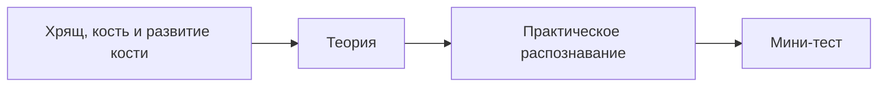

# Занятие 8. Скелетные соединительные ткани: хрящевые и костные

> **Дисциплина:** Гистология, эмбриология, цитология (30.05.01 Медицинская биохимия).
> **Тема ДЗ (к 23.10):** скелетные соединительные ткани — кости и хрящи.
> **Источники:** файлики «6. Хрящевые ткани», «7. Костные ткани» · методичка «Общая гистология» (ДВГМУ), Темы 16, 17–18 · Сборник тестовых заданий по общей гистологии (тема «Соединительные ткани», вопросы 34–73, с ключами).
> **Статус:** черновик для последующей интеграции на сайт.

---

## § 1. Домашнее задание (по заданию преподавателя)

1. Лекции БЯ по темам учим; соответствующие разделы учебника читаем (Афанасьев/Юрина, гл. 8: «Плотные соединительные ткани. Хрящевые ткани», «Костные ткани»).
2. Написать файлики по **костным и хрящевым тканям** и выучить.
3. **Готовиться к тесту по теме** (см. § 5 — тестовые вопросы с ключами).

---

**✅ Проверь себя — тест на усвоение блока «§ 1. Домашнее задание (по заданию преподавателя)»**

```quiz
{"questionIds": ["c64690b1-67ea-4a65-ab2e-d63735940ce5", "9ae34cad-d327-41a3-8e5f-ca45f75834fd", "1fd70e0d-24b8-43c7-97ff-2ffbd0ff8aa7", "5afeff1d-6fed-4fb2-8a02-f0c2f97ca0ed", "e5e31b6a-a298-4953-adde-1c5d12f35654", "069104f0-2072-411e-b2c0-c11747525c52"], "subjectId": "977d78ca-7a58-4b0a-9e93-29d8e03f6946", "title": "Проверь себя · § 1. Домашнее задание (по заданию препод"}
```

## § 2. Хрящевые ткани (файлик «6. Хрящевые ткани» — дословно)

**✅ Проверь себя — тест на усвоение блока «§ 2. Хрящевые ткани (файлик «6. Хрящевые ткани» — дословно)»**

```quiz
{"questionIds": ["21d7fcae-edd6-429d-8dbd-9b8a1b111529", "ebb865b9-414c-4bca-a202-6e7ec835b09c", "3bf267de-f31a-4fbb-be9b-797e27d7e7b5", "67bc8a63-16ac-4e0c-8bd7-1cf4d7f6abee"], "subjectId": "977d78ca-7a58-4b0a-9e93-29d8e03f6946", "title": "Проверь себя · § 2. Хрящевые ткани (файлик «6. Хрящевые"}
```

### Общая характеристика

| Компонент | Содержание |
|---|---|
| Химический состав | **Вода 50–80% · органические вещества 15–20% · неорганические вещества 5–8%** |
| Межклеточное вещество | волокна (коллагеновые, эластические); аморфное вещество — преобладают **ГАГ**, которые связывают и удерживают воду |
| Клетки | **Хондробласты**: могут делиться, мелкие, уплощённые, лежат в надхрящнице. **Хондроциты**: I типа — мелкие, большое ядро (высокое ядерно-цитоплазматическое соотношение), лежат поодиночке, могут делиться, вырабатывают белки волокон (зона молодого хряща); II типа — крупные, ядро меньше, вырабатывают больше ГАГ; III типа — крупные, ядро ещё меньше, функции снижены. Хондроциты II и III типа расположены в зоне зрелого хряща и формируют **изогенные группы** |
| Рост хряща | **Аппозиционный** — наложение, за счёт деления хондробластов в надхрящнице. **Интерстициальный** — за счёт деления хондроцитов в изогенных группах и выработки ими межклеточного вещества (возможен, т.к. много воды и межклеточное вещество податливое) |

**✅ Проверь себя — тест на усвоение блока «Общая характеристика»**

```quiz
{"questionIds": ["fd79cd8d-e371-473b-90f5-7d013a60a90b", "cd90f62e-5602-4a54-b10d-6066fc453f94", "c2f45dd1-d153-48a7-be16-d35fa6f5b3e3", "2405bf41-f85c-4c82-97e2-3a0c0e55605d", "16958a14-e82e-456c-b372-23cffef33052", "3c0fe781-8387-4daa-957b-c9330355d3ef"], "subjectId": "977d78ca-7a58-4b0a-9e93-29d8e03f6946", "title": "Проверь себя · Общая характеристика"}
```

### Классификация и местоположение

| Вид | Местоположение |
|---|---|
| **Гиалиновая** | воздухоносные пути; соединение рёбер с грудиной; суставные поверхности костей; модели трубчатых костей в эмбриогенезе; **метаэпифизарные пластинки роста** (до 20–25 лет) |
| **Эластическая** | мелкие хрящи гортани; надгортанник; ушная раковина; наружный слуховой проход |
| **Волокнистая** | полуподвижные сочленения: лобковый симфиз, межпозвонковые диски; соединения связок с гиалиновым хрящом; мениски суставов; круглая связка бедра |

**✅ Проверь себя — тест на усвоение блока «Классификация и местоположение»**

```quiz
{"questionIds": ["2079cef9-7a8f-4355-ba47-6764c6b8bb8c", "c39a9ed9-7b85-4fbd-832e-78838fb8ed58", "5bf65116-0d76-440c-898b-67dc19c2acb6", "10669b7f-fd26-4712-8f1f-bbba24496989"], "subjectId": "977d78ca-7a58-4b0a-9e93-29d8e03f6946", "title": "Проверь себя · Классификация и местоположение"}
```

### Общий план строения хряща как органа (на примере гиалинового)

- **Надхрящница** — 2 слоя: наружный **фиброзный** (ПОВСТ) и внутренний **хондрогенный** (хондробласты и их предшественники).
- **Собственно хрящ**: **зона молодых хондроцитов** (хондроциты веретеновидной формы лежат поодиночке, длинная ось параллельно поверхности; межклеточное вещество окрашено **оксифильно** — преобладают коллагеновые волокна) и **зона зрелых хондроцитов** (хондроциты округлой формы, **изогенные группы по 2–8 клеток**; межклеточное вещество **базофильно** — накопление ГАГ; волокна не видны, пропитаны ГАГ).

> **Логика окраски хряща:** молодая зона — много коллагена (оксифильно), зрелая — много ГАГ (базофильно, местами метахроматично). В гиалиновом хряще волокна на препарате не видны — их показатель преломления равен аморфному веществу. Эластический хрящ — видна сеть эластических волокон (орсеин). Волокнистый — грубые пучки коллагеновых волокон. Суставные поверхности не имеют надхрящницы — питание за счёт **синовиальной жидкости**.

---

**✅ Проверь себя — тест на усвоение блока «Общий план строения хряща как органа (на примере гиалинового»**

```quiz
{"questionIds": ["7d22187d-14ee-4817-960c-11bcff1c210e", "4a6b6de5-2d4c-4b86-925e-5b37a4c7a793", "7428bcc1-a649-426a-a62f-6728051fb9db", "dc98f90d-ba9c-4b6e-84f2-019e96cad776"], "subjectId": "977d78ca-7a58-4b0a-9e93-29d8e03f6946", "title": "Проверь себя · Общий план строения хряща как органа (на"}
```

## § 3. Костные ткани (файлик «7. Костные ткани» — дословно)

**✅ Проверь себя — тест на усвоение блока «§ 3. Костные ткани (файлик «7. Костные ткани» — дословно)»**

```quiz
{"questionIds": ["dd88bfc1-a602-444e-b637-4b77a992cb26", "ff2d2c38-0b36-495f-a448-f7a38a25c43d", "83fefb23-c291-4e35-a2d5-a756b5ad4e97", "1e200d35-d3c2-4175-8468-241ea6323f53"], "subjectId": "977d78ca-7a58-4b0a-9e93-29d8e03f6946", "title": "Проверь себя · § 3. Костные ткани (файлик «7. Костные т"}
```

### Граф логической структуры темы

| Компонент | Содержание |
|---|---|
| **Химический состав** | **минеральные вещества 70% · органические 20% · вода 10%** |
| Классификация | **ретикулофиброзная** (грубоволокнистая) · **пластинчатая** (компактное и губчатое вещество трубчатых и плоских костей) · **дентин и цемент зуба** |
| Местоположение ретикулофиброзной | швы черепа; места сращения тазовых костей; места прикрепления сухожилий к костям (бугорки и бугристости); кости зародыша; места сращения переломов |
| Развитие | **эмбриональный остеогистогенез — прямой** (из мезенхимы): стадии остеогенного островка  —  остеоидная  —  минерализации  —  периостальная (замена на пластинчатую). **Постэмбриональный — непрямой** (на месте хряща): перихондрального окостенения  —  эндохондрального окостенения  —  периостальная (замена на пластинчатую) |

**✅ Проверь себя — тест на усвоение блока «Граф логической структуры темы»**

```quiz
{"questionIds": ["abe53911-ead0-41ab-9d46-d2a920ac4fad", "c54ba9a0-03fa-4c25-913d-ce3259df9bae", "5d0074ff-ef5c-4c74-9abc-eace1e1d4b58", "c45b1088-e864-423a-9fdf-481b18084c4d", "6d12a376-79f6-43be-befd-9d6ffb45da6a", "272ab941-d729-40b7-bf8a-48cb7cbc3b79"], "subjectId": "977d78ca-7a58-4b0a-9e93-29d8e03f6946", "title": "Проверь себя · Граф логической структуры темы"}
```

### Трофика костной ткани

Кровь  —  кровеносные сосуды  —  каналы (**прободающие** и **центральные**)  —  тканевая жидкость  —  **лакунарно-канальцевая система** (лакуны с телами остеоцитов + костные канальцы с их отростками).

**✅ Проверь себя — тест на усвоение блока «Трофика костной ткани»**

```quiz
{"questionIds": ["ba8f9f29-cdf2-434a-893b-825d3d47abd5", "bb697a21-2080-4da7-87b4-5bae5401fb2d", "a83284ca-6cc9-4a2d-b1a2-10b0ffd0f815", "b358ce0f-c9c1-43b7-92f9-ccc6da2693c9", "382747ea-3f5c-4586-bf9c-01d51b995c92", "7ef640cd-e14d-4d10-aa3e-02e9d28f0b5d"], "subjectId": "977d78ca-7a58-4b0a-9e93-29d8e03f6946", "title": "Проверь себя · Трофика костной ткани"}
```

### Строение диафиза трубчатой кости

- **Надкостница (периост)**: 1) наружный (фиброзный) слой — ПОВСТ с сосудами; 2) внутренний (остеогенный) слой — **остеобласты и их предшественники**.
- **Компактное вещество**: слой **наружных общих пластинок** (незамкнутые полые цилиндры по периметру); слой **остеонов** — пластинки остеонов + **вставочные пластинки**; слой **внутренних общих пластинок**.
- **Эндост** — РВСТ с остеобластами и их предшественниками, выстилает костномозговой канал.

**Остеон** — структурно-функциональная единица компактного вещества: **канал остеона (центральный, Гаверсов)** с сосудом + концентрические пластинки остеона вокруг него; граница остеона — **спайная линия**; соседние остеоны соединяются **прободающими каналами**.

**Клетки костной ткани (дифферон):** **остеобласты** — синтезируют межклеточное вещество (коллаген, хондроитинсульфаты); форма от цилиндрической (активные) до уплощённой (неактивные); цитоплазма **базофильна** (развитая ГрЭПС). **Остеоциты** — замурованные в межклеточное вещество (лакуны), многоотростчатые, отростки в костных канальцах  —  лакунарно-канальцевая система (трофика). **Остеокласты** — крупные **многоядерные**, разрушают кость и хрящ; развиваются из **моноцитов**.

**✅ Проверь себя — тест на усвоение блока «Строение диафиза трубчатой кости»**

```quiz
{"questionIds": ["9b1cb225-15a8-4a80-85bf-7b3a8af4a1a5", "4fd347b1-df07-4e8b-bb9a-5ca973a93e1f", "97fd560c-bb49-4ac6-8fc6-354dcb7d4947", "886d62dc-9925-4c1a-be48-9afc3ce61e40"], "subjectId": "977d78ca-7a58-4b0a-9e93-29d8e03f6946", "title": "Проверь себя · Строение диафиза трубчатой кости"}
```

### Факторы, влияющие на состояние костной ткани

Пищевой рацион (продукты, богатые кальцием, белком, витаминами **С, D, A**); витамины С, D, A; гормоны — **соматотропный гормон** (рост), кальцитонин, паратирин, половые гормоны, тироксин; механическая нагрузка, **пьезоэлектрический эффект**.

**✅ Проверь себя — тест на усвоение блока «Факторы, влияющие на состояние костной ткани»**

```quiz
{"questionIds": ["9b3a3318-649b-41dc-bda0-dfb98dca9c49", "0c2a3fec-1ed7-4515-b191-c1e016b522e4", "7ee8d4c5-22ac-4098-a21c-b835fa8e58b0", "a6f89fa8-3b13-406b-b887-181906f9133d", "524570b9-ac82-491d-b6b7-0c7b52aad109", "641d4065-2458-49cb-933c-3c6c3dd7f2cc"], "subjectId": "977d78ca-7a58-4b0a-9e93-29d8e03f6946", "title": "Проверь себя · Факторы, влияющие на состояние костной т"}
```

### Рост костей

- **В длину** — за счёт **метаэпифизарной пластинки роста**. Три слоя: пограничный  —  слой столбчатых клеток  —  слой пузырчатых клеток.
- **В толщину (аппозиционный)** — за счёт **остеогенного слоя надкостницы**.

> **Логика окостенения (непрямой остеогистогенез):** модель кости — из гиалинового хряща; 1) **перихондральное окостенение** — из надхрящницы вокруг диафиза образуется **костная манжетка**; 2) **эндохондральное окостенение** — внутри хряща диафиза (хондроциты погибают, очаги окостенения — костно-хрящевые балки); 3) **периостальная** — замена ретикулофиброзной кости манжетки на пластинчатую. Хрящевые эпифизы окостеневают позже; между эпифизом и диафизом — метаэпифизарная пластинка роста (до 20–25 лет).

---

**✅ Проверь себя — тест на усвоение блока «Рост костей»**

```quiz
{"questionIds": ["e1318700-38ac-4a91-9394-1042058e3822", "64d856b2-5ae4-4ef7-890d-50991ce08acc", "294ec7df-f85f-441e-944d-a7c82a3905fb", "11cd1807-f515-4849-a7e4-1328e5ea315f"], "subjectId": "977d78ca-7a58-4b0a-9e93-29d8e03f6946", "title": "Проверь себя · Рост костей"}
```

## § 3а. Атласные рисунки к теме (Кузнецов С.Л. и др., 2002)

```image
{"url": "/library/lectures/gistologiya/atlas/kuzn_07-tema10-skeletnye-st.png", "caption": "Атлас, с. 81. Тема 10. Скелетные соединительные ткани (раздел атласа)"}
```

```image
{"url": "/library/lectures/gistologiya/atlas/kuzn_07-gialinovyj-hryash.png", "caption": "Атлас, с. 82. Рис. 106. Гиалиновая хрящевая ткань (поперечный срез стенки трахеи)"}
```

```image
{"url": "/library/lectures/gistologiya/atlas/kuzn_07-kostnaya-tkan.png", "caption": "Атлас, с. 84. 10.2. Костные ткани"}
```

```image
{"url": "/library/lectures/gistologiya/atlas/kuzn_07-plastinchastaya-kost.png", "caption": "Атлас, с. 85. Рис. 111. Пластинчатая костная ткань"}
```

```image
{"url": "/library/lectures/gistologiya/atlas/kuzn_07-razvitie-kosti-hryash.png", "caption": "Атлас, с. 87. Рис. 113. Развитие кости на месте хряща"}
```

```image
{"url": "/library/lectures/gistologiya/atlas/kuzn_07-razvitie-kosti-mezehima.png", "caption": "Атлас, с. 88. Развитие кости: область неминерализованного костного матрикса (остеоид)"}
```

---

**✅ Проверь себя — тест на усвоение блока «§ 3а. Атласные рисунки к теме (Кузнецов С.Л. и др., 2002)»**

```quiz
{"questionIds": ["3d7c6bac-3e56-4b8c-9ae5-635e1bde1b50", "969f384e-0b28-4acc-ab59-220e4880792b", "ef81778f-0a42-4503-b85b-58643cb527e6", "a0bd53c3-904f-4b9c-aac5-7bc30a50240c"], "subjectId": "977d78ca-7a58-4b0a-9e93-29d8e03f6946", "title": "Проверь себя · § 3а. Атласные рисунки к теме (Кузнецов "}
```

## § 4. Препараты к занятию (методичка, Темы 16, 17–18 — зарисовать)

1. **Гиалиновый хрящ (ребро кролика), гематоксилин-эозин.** Надхрящница (I): наружный волокнистый слой (Iа) — оксифильные коллагеновые волокна (1), фиброциты (2), сосуды (3); внутренний хондрогенный (Iб) — прехондробласты и хондробласты (4). Зона молодого хряща (II) — хондроциты (5) без изогенных групп, вещество оксифильно. Зона зрелого хряща (III) — изогенные группы (6), хондроциты окружены оксифильной капсулой (7); вещество базофильно; волокна не видны (пропитаны аморфным веществом).
2. **Эластический хрящ (ушная раковина), орсеин + гематоксилин.** Зона молодого хряща (II); в зоне зрелого хряща (III) изогенные группы (2) столбиками по 2–4, перпендикулярно надхрящнице; сеть эластических волокон (4) красновато-коричневых + светлое аморфное вещество (5).
3. **Волокнистый хрящ (межпозвонковый диск), гематоксилин-эозин.** Фиброзное кольцо: пучки коллагеновых волокон (1) циркулярно; между ними хондроциты (2) поодиночке и изогенные группы цепочками (3); в центре — студенистое **пульпозное ядро** (4) (ГАГ, протеогликаны, хондроциты).
4. **Трубчатая кость (поперечный срез диафиза), тионин с пикриновой кислотой.** Надкостница (А): наружный (а) и внутренний (б) слои с остеобластами (1). Компактное вещество (Б): слой наружных общих пластинок (I); **остеонный слой (II)** — остеоны (2) с центральным каналом (3) и концентрическими пластинками (4), между ними вставочные пластинки (5), спайная линия (6); прободающий канал (7); слой внутренних общих пластинок (III); эндост (В). При большом увеличении — остеоциты (8) в лакунах и костные канальцы с отростками (9).
5. **Развитие кости на месте мезенхимы — остеоидная стадия (закладка нижней челюсти), гематоксилин-эозин.** Мезенхимные клетки (1), остеогенный островок (2), остеоид (3) — оксифилен (коллаген); остеобласты (4) на поверхности остеоида (активные 4а цилиндрические, неактивные 4б уплощённые); внутри остеоида — остеоциты (5); остеокласты (6) крупные многоядерные (с оксифильной 6а и базофильной 6б цитоплазмой); кровеносные сосуды (7) — обязательное условие прямого остеогистогенеза (O₂  —  дифференцировка мезенхимных клеток в остеогенные).
6. **Развитие кости на месте хряща (продольный срез зачатка трубчатой кости), гематоксилин-эозин.** Хрящевой эпифиз (I) и диафиз (II); костная манжетка (1) — перихондральное окостенение; надкостница (2), надхрящница (3) (отсутствует на суставных поверхностях); костномозговая полость (4); очаги эндохондрального окостенения — костно-хрящевые балки (5); метаэпифизарная пластинка роста (6) с зонами: пограничной (7), столбчатых клеток (8), пузырчатых клеток (9).

---

**✅ Проверь себя — тест на усвоение блока «§ 4. Препараты к занятию (методичка, Темы 16, 17–18 — зарисо»**

```quiz
{"questionIds": ["b22ad869-7fb8-4dbe-91a3-5e741a0f9f3d", "2be72826-1449-428a-a793-ab53730f3b24", "0b9a4f10-4261-458b-aef0-61531a38caa4", "0dfbc429-d7ca-47d5-90e9-e341cc40ae3d", "2483268e-1e7e-4c10-a98b-0e36aa6ac892", "6384c86f-9291-4f46-a5ab-09448bba9cda"], "subjectId": "977d78ca-7a58-4b0a-9e93-29d8e03f6946", "title": "Проверь себя · § 4. Препараты к занятию (методичка, Тем"}
```

## § 5. Контрольно-обучающие задачи (методичка — с разбором)

1. Как отличить пластинчатую костную ткань от грубоволокнистой, если волокна не окрашены? *(По расположению: пластинчатая — костное вещество в виде пластинок (остеоны, общие пластинки); грубоволокнистая — пучки коллагеновых волокон идут в разных направлениях, остеонов нет.)*
2. Как называется соединительнотканная пластинка, покрывающая: а) костную манжетку; б) хрящевой зачаток? *(а — первичная надкостница (периост); б — надхрящница.)*
3. За счёт чего рост трубчатой кости в длину? *(Метаэпифизарной пластинки роста: хондроциты зоны столбчатых клеток делятся, зона пузырчатых клеток гибнет и замещается костью.)*
4. За счёт чего рост кости в толщину? *(Аппозиционный рост — за счёт остеогенного слоя надкостницы.)*
5. За счёт чего образуются вставочные пластинки? *(Из остатков разрушенных остеонов при перестройке кости; процесс — ремодуляция/перестройка костной ткани.)*
6. Из каких источников образуются остеобласты при регенерации кости? *(Остеогенных клеток надкостницы (периоста), эндоста, мезенхимы каналов.)*
7. Последствия обширной отслойки периоста? *(Гибель наружных слоёв кости: трофика наружных пластинок идёт из сосудов периоста; нарушается аппозиционный рост и регенерация — некроз участка кости.)*

---

**✅ Проверь себя — тест на усвоение блока «§ 5. Контрольно-обучающие задачи (методичка — с разбором)»**

```quiz
{"questionIds": ["740fa9bd-67b6-4dba-85ac-f74babdc5ade", "0a2696a4-b36f-4719-9951-cd2392053082", "ac9a98e5-2360-4c0b-a56b-06baed31d238", "20353fdb-8c4e-44d3-af5a-f7e8d8445487"], "subjectId": "977d78ca-7a58-4b0a-9e93-29d8e03f6946", "title": "Проверь себя · § 5. Контрольно-обучающие задачи (методи"}
```

## § 6. Тестовые задания для самоконтроля (сборник «Общая гистология», тема «Соединительные ткани», вопросы 34–73; ключ в скобках)

**✅ Проверь себя — тест на усвоение блока «§ 6. Тестовые задания для самоконтроля (сборник «Общая гисто»**

```quiz
{"questionIds": ["47451aa8-5c5c-406f-9956-9312be82e233", "7a1e0ce4-41fd-4a5e-9c1c-48a10984083a", "0f347ac2-240c-4675-8cb9-f626d3bb571e", "23366de3-77f7-45b6-98be-83564441a0e2"], "subjectId": "977d78ca-7a58-4b0a-9e93-29d8e03f6946", "title": "Проверь себя · § 6. Тестовые задания для самоконтроля ("}
```

### Хрящевые ткани (34–42)

34. Различают следующие виды хряща: **гиалиновый, волокнистый, эластический** (1)
35. Хрящ ушной раковины — это хрящ: **эластический** (1)
36. Наиболее распространённый у человека хрящ: **гиалиновый** (2)
37. Наиболее плотное расположение волокон — в хряще: **волокнистом** (3)
38. Среди ГАГ в хрящевой ткани преобладают: **хондроитин-сульфаты** (4)
39. Суставные поверхности костей образованы хрящом: **гиалиновым** (1)
40. Межпозвонковые диски построены из хряща: **волокнистого** (1)
41. Группы клеток хрящевой ткани в общей полости называются: **изогенными** (3)
42. Непосредственный предшественник хондроцитов: **хондробласты** (4)

**✅ Проверь себя — тест на усвоение блока «Хрящевые ткани (34–42)»**

```quiz
{"questionIds": ["ac42d415-e164-43bf-95ea-eb1c4eb28dfb", "cec17d60-3331-4a51-b89e-87785df8591d", "c044f827-1f50-4b1c-a52c-37ef95459844", "e1e70e0b-210b-447e-812d-e57149febfa5", "3794c2b1-164c-47d9-bee3-959c357325e9", "118a1a4d-8e64-45e6-85cc-adf6d7693b23"], "subjectId": "977d78ca-7a58-4b0a-9e93-29d8e03f6946", "title": "Проверь себя · Хрящевые ткани (34–42)"}
```

### Костные ткани (43–73)

43. Источник развития костной ткани в эмбриогенезе: **мезенхима** (2)
44. По функциям остеобласты близки к: **хондробластам, фибробластам** (2)
45. Питание суставного хряща — в основном за счёт: **синовиальной жидкости** (5)
46. Питание хряща органов дыхания — за счёт: **сосудов надхрящницы** (2)
47. Для костной ткани специфичны клетки: **остеобласты, остеоциты, остеокласты** (2)
48. В межклеточном веществе костной ткани расположены волокна: **коллагеновые** (4)
49. Остеокласты развиваются из: **моноцитов** (5)
50. Для остеобластов характерно развитие органелл: **комплекса Гольджи и эндоплазматической сети** (3)
51. Остеобласты синтезируют и выделяют: **коллаген и хондроитинсульфаты** (2)
52. Для остеокластов характерно: **многоядерность** (4)
53. Остеоциты имеют форму: **многоотростчатую** (1)
54. Наружный слой надкостницы образован тканью: **плотной неоформленной соединительной** (3)
55. Внутренний слой надкостницы содержит много клеток: **остеобластов и их предшественников** (2)
56. В диафизе под надкостницей расположен слой: **наружных общих пластинок** (1)
57. Рост кости в толщину — за счёт: **периоста** (2)
58. Рост кости в длину — за счёт: **метаэпифизарной пластинки** (5)
59. При развитии кости на месте хряща источник развития: **мезенхима** (3)
60. Важнейшие эндокринные факторы, стимулирующие рост костей: **гормон роста и половые гормоны** (1)
61. Структурная единица диафизов: **остеоны** (2)
62. Остеоциты располагаются в: **костных лакунах** (5)
63. Остеобласты характеризуются: **базофилией цитоплазмы** (3)
64. Вставочные пластинки — это: **остатки разрушенных остеонов** (5)
65. Минеральные вещества в костной ткани составляют: **60–70%** (5)
66. Среди органических веществ костной ткани наиболее высокая концентрация: **коллагена** (2)
67. Среди ГАГ в костной ткани преобладают: **хондроитинсульфаты** (3)
68. Основная функция остеокластов: **разрушение кости и хряща** (4)
69. Грубоволокнистая и пластинчатая костная ткань отличаются: **характером расположения коллагеновых волокон** (3)
70. Непосредственный предшественник остеоцитов: **остеобласты** (2)
71. Прямой остеогенез — развитие костной ткани из: **мезенхимы** (2)
72. Модель длинной трубчатой кости сначала образуется из: **гиалиновой хрящевой** ткани (5)
73. Формирование костных пластинок остеона происходит вокруг: **кровеносного сосуда** (3)

**✅ Проверь себя — тест на усвоение блока «Костные ткани (43–73)»**

```quiz
{"questionIds": ["cf77eb63-b709-45fd-975e-a3530754b4bb", "a7e4711d-9c04-4900-ae9c-116798985cd6", "62d81d68-2fae-4484-8499-0740072e8467", "7befbca1-d38b-4079-8c6a-7e7e4505f79e", "3ae3617e-19ae-4b3c-89a4-a5af20f264f1", "1c1206ba-4d09-4c64-be94-dc3939faa54a"], "subjectId": "977d78ca-7a58-4b0a-9e93-29d8e03f6946", "title": "Проверь себя · Костные ткани (43–73)"}
```

### Дополнительные тесты методички (Темы 16, 17–18)

1. В эмбриогенезе хрящевые ткани развиваются из: **мезенхимы** (3)
2. Базофилия межклеточного вещества зоны зрелого хряща объясняется преобладанием: **гликозаминогликанов** (2)
3. Аппозиционный рост гиалинового хряща обеспечивают клетки надхрящницы: **хондробласты** (3)
4. Эластические волокна преобладают в хрящевой ткани: **ушных раковин** (4)
5. Обызвествлению не подвергается хрящевая ткань: **эластическая** (2)

1. Вторая стадия прямого остеогистогенеза: **остеоидная стадия** (3)
2. На минеральные вещества в межклеточном веществе костной ткани приходится: **70%** (4)
3. Ретикулофиброзная костная ткань присутствует везде, кроме: **диафизов трубчатых костей** (5)
4. В диафизах вставочные пластинки расположены в слое: **остеонном** (3)
5. Гормон, преимущественно влияющий на рост трубчатых костей в длину: **соматотропин** (3)

> **Логика к типичным «ловушкам» теста:** питание суставного хряща — синовиальная жидкость (там нет надхрящницы!), питание остальных хрящей — сосуды надхрящницы; кость растёт в длину только за счёт метаэпифизарной пластинки, в толщину — только периост; остеокласты — из моноцитов (макрофагическая система!), а не из остеобластов; пластинчатая кость отличается от грубоволокнистой именно расположением коллагеновых волокон (в пластинках, не химическим составом и не клетками); остеон строится вокруг сосуда.

<hr>

**✅ Проверь себя — тест на усвоение блока «Дополнительные тесты методички (Темы 16, 17–18)»**

```quiz
{"questionIds": ["d397689f-d2db-477e-bcd1-0b54c239a10b", "c3f43e5c-3238-4ce5-b192-713a8c365323", "756943e0-e4d2-43b2-9267-c44c4562a2cb", "324e79c9-84e7-485e-8bc4-65960fabbae2"], "subjectId": "977d78ca-7a58-4b0a-9e93-29d8e03f6946", "title": "Проверь себя · Дополнительные тесты методички (Темы 16,"}
```

## Проверка по теме

```quiz
{"questionIds": ["ac42d415-e164-43bf-95ea-eb1c4eb28dfb", "cec17d60-3331-4a51-b89e-87785df8591d", "ebb865b9-414c-4bca-a202-6e7ec835b09c", "c044f827-1f50-4b1c-a52c-37ef95459844", "3bf267de-f31a-4fbb-be9b-797e27d7e7b5", "67bc8a63-16ac-4e0c-8bd7-1cf4d7f6abee", "fd79cd8d-e371-473b-90f5-7d013a60a90b", "cd90f62e-5602-4a54-b10d-6066fc453f94"], "subjectId": "977d78ca-7a58-4b0a-9e93-29d8e03f6946", "title": "Тест по теме (8 вопросов)"}
```
Полный банк — [260 вопросов](/tests?open=643c220a-0e6f-44ef-a1b9-010c9f597989).

**✅ Проверь себя — тест на усвоение блока «Проверка по теме»**

```quiz
{"questionIds": ["2ec27ff0-b3a8-4f33-b110-12e17aacabc3", "6b8def55-0b13-4f75-9f0a-4fa778dfeb20", "c738577d-dc83-435a-96e5-b70aa382670a", "7c4d94c9-1f13-4fa0-aae4-af1cf4381960"], "subjectId": "977d78ca-7a58-4b0a-9e93-29d8e03f6946", "title": "Проверь себя · Проверка по теме"}
```

## Дополнение: Неделя 7–8 · Лекция 7/практика · Хрящ, кость и развитие кости (объединено)

<!-- MBH:MERGED:FROM lec-hist-bone_muscle -->

Костные и мышечные ткани Полная лекция MEDBIOHIM. Текст собран из соответствующих схем и таблиц из Гистология.zip . Лекция не заменяет первоисточник: спорные или отсутствующие сведения не додумываются. Как работать с лекцией Сначала изучите морфологические признаки. Затем свяжите строение с функцией. После этого закрепите материал по микропрепаратам и электронограммам в соответствующем разделе предмета. В конце проверьте себя тестами и экзаменационными вопросами. 7.Костные ткани Граф логической структуры темы «Костные ткани» Трофика костной ткани Строение диафиза Факторы, влияющие на состояние костной ткани Пищевой рацион – продукты, богатые кальцием, белком, витаминами С, D, A. Витамины С, D, A. Гормоны – соматотропный гормон (гормон роста), кальцитонин, паратирин, половые гормоны, тироксин и др. Механическая нагрузка, пьезоэлектрический эффект. Рост костей: Рост трубчатой кости в длину – за счет метаэпифизарной пластинки роста. 3 слоя в метаэпифизарной пластинке: пограничный слой столбчатых клеток слой пузырчатых клеток Рост кости в толщину (аппозиционный) – за счет остеогенного слоя надкостницы. 8.Мышечные ткани Мышечные ткани Общая характеристика мышечных тканей Способность к сокращению максимально выражена Удлиненная форма структурно-функциональных единиц Ядра овальной или вытянутой формы Интенсивно оксифильная цитоплазма Из органелл общего назначения наиболее развиты: - митохондрии – аэробное окисление и вырботка АТФ - гладкая ЭПС – депо ионов кальция - гранулярная ЭПС – синтез сократительных белков Из органелл специального назначения наиболее развиты: - миофибриллы, состоящие из сократительных белков актина и миозина Из включений лучше всего развиты: - трофические – гликоген и липиды – окисляются с выделением энергии, которая используется на образование АТФ - пигментные – связанные с тканевым дыханием – миоглобин (аккумулирует О2 при расслаблении, освобождает О2 при сокращении, обеспечивая аэробное окисление) - пигментные – не связанные с тканевым дыханием – липофусцин (пигмент старения) Хорошее кровоснабжение и иннервация Прослойки РВСТ с кровеносными сосудами (функция – трофика): - вокруг структурно-функциональных единиц – эндомизий - вокруг пучков структурно-функциональных единиц – перимизий Заполните таблицу Нарисовать схему строения саркомера и сделать обозначения Саркомер – структурно-функциональная единица миофибриллы, участок её между двумя телофрагмами (Z-линии на ЭГ). Алгоритм ответа на занятии Назвать объект и его принадлежность. Описать строение и диагностические признаки. Указать отличия от сходных объектов. Связать морфологию с функцией. Для препарата завершить ответ локализацией и диагностикой. Связь с практикой После лекции переходите к микропрепаратам и тренажёру , материалам и электронограммам и тестам . <!-- MEDBIOHIM-LECTURE-TEMPLATE-V1 -->


---

## Практический блок по эталону Лекции 5

Схема занятия: теория → распознавание препарата → контроль вопросами. Блоки ниже используют только канонические материалы текущей темы.



```image
{"trainerId":"feed-prep-be5aa9a6f4","caption":"Гиалиновый хрящ"}
```

```image
{"trainerId":"feed-prep-3b500d1e4c","caption":"Развитие кости на месте мезенхимы"}
```

### Контроль после блока

```quiz
{
  "subjectId": "977d78ca-7a58-4b0a-9e93-29d8e03f6946",
  "title": "Проверь себя · Хрящ, кость и развитие кости",
  "questionIds": [
    "155df9f6-84f9-4d7c-889b-2e12ac43fa05",
    "1ce38c9f-a51c-418a-8408-905cdd1f51b5",
    "3acea6a4-256c-4b58-8987-5e4070a313e2"
  ]
}
```

После этого блока вернись к связанным материалам лекции и сравни морфологические признаки на реальном препарате с теорией.
