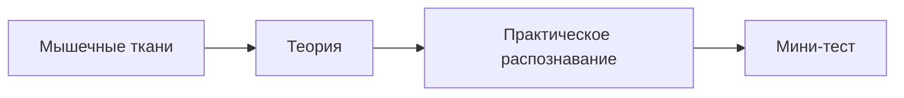

# Занятие 9. Мышечные ткани

> **Дисциплина:** Гистология, эмбриология, цитология (30.05.01 Медицинская биохимия).
> **Тема ДЗ:** Мышечные ткани.
> **Источники:** файлик «8. Мышечные ткани» (включая анимированный рисунок саркомера — расслабленный и сокращённый варианты) · методичка «Общая гистология» (ДВГМУ), Тема 19–20 · учебник Афанасьева/Юриной, гл. 10 · Сборник тестовых заданий по общей гистологии (тема «Мышечные ткани», 1–48, с ключами) · электронограммы «Саркомер и сарколемма», «Вставочный диск», «Миокард желудочка сердца» (сканирующая).
> **Статус:** черновик для последующей интеграции на сайт. Электронограммы — в `assets/elektronogrammy/`.

---

## § 1. Домашнее задание (по заданию преподавателя)

1. Лекцию БЯ по теме учим; соответствующий раздел учебника читаем (Афанасьев/Юрина, гл. 10 «Мышечные ткани»).
2. Написать файлик по мышечным тканям и выучить.
3. **Нарисовать рисунок «Саркомер»** — он есть в самом файлике и отдельно, там двигающаяся картинка: **расслабленный и сокращённый варианты** (см. § 3).

---

**✅ Проверь себя — тест на усвоение блока «§ 1. Домашнее задание (по заданию преподавателя)»**

```quiz
{"questionIds": ["c64690b1-67ea-4a65-ab2e-d63735940ce5", "e590f565-fff8-4aa8-b35b-db2a263ecc87", "86e8587e-5962-4a9d-a558-285987c37cbe", "21d7fcae-edd6-429d-8dbd-9b8a1b111529"], "subjectId": "977d78ca-7a58-4b0a-9e93-29d8e03f6946", "title": "Проверь себя · § 1. Домашнее задание (по заданию препод"}
```

## § 2. Теория (файлик «8. Мышечные ткани» — дословно, таблица заполнена)

**✅ Проверь себя — тест на усвоение блока «§ 2. Теория (файлик «8. Мышечные ткани» — дословно, таблица »**

```quiz
{"questionIds": ["ac42d415-e164-43bf-95ea-eb1c4eb28dfb", "cec17d60-3331-4a51-b89e-87785df8591d", "ebb865b9-414c-4bca-a202-6e7ec835b09c", "c044f827-1f50-4b1c-a52c-37ef95459844"], "subjectId": "977d78ca-7a58-4b0a-9e93-29d8e03f6946", "title": "Проверь себя · § 2. Теория (файлик «8. Мышечные ткани» "}
```

### Общая характеристика мышечных тканей

1. Способность к **сокращению** максимально выражена.
2. Удлинённая форма структурно-функциональных единиц.
3. Ядра овальной или вытянутой формы.
4. Интенсивно **оксифильная** цитоплазма.
5. Из органелл общего назначения наиболее развиты:
   - **митохондрии** — аэробное окисление и выработка АТФ;
   - **гладкая ЭПС** — депо ионов кальция.
6. Из органелл специального назначения наиболее развиты: **миофибриллы**, состоящие из сократительных белков актина и миозина.
7. Из включений лучше всего развиты:
   - **трофические** — гликоген и липиды — окисляются с выделением энергии, используемой на образование АТФ;
   - **пигментные, связанные с тканевым дыханием** — **миоглобин** (аккумулирует O₂ при расслаблении, освобождает O₂ при сокращении, обеспечивая аэробное окисление);
   - **пигментные, не связанные с тканевым дыханием** — **липофусцин** (пигмент старения).
8. Хорошее кровоснабжение и иннервация.
9. Прослойки РВСТ с кровеносными сосудами (функция — трофика): вокруг структурно-функциональных единиц — **эндомизий**, вокруг пучков структурно-функциональных единиц — **перимизий**. (Соединительнотканная оболочка всей мышцы — **эпимизий**.)

**✅ Проверь себя — тест на усвоение блока «Общая характеристика мышечных тканей»**

```quiz
{"questionIds": ["ba8f9f29-cdf2-434a-893b-825d3d47abd5", "43a82cdc-9504-46c4-9ee9-960096840842", "cf77eb63-b709-45fd-975e-a3530754b4bb", "e5e31b6a-a298-4953-adde-1c5d12f35654", "2079cef9-7a8f-4355-ba47-6764c6b8bb8c", "605d8b4a-af55-43a3-a1e1-204456463fe9"], "subjectId": "977d78ca-7a58-4b0a-9e93-29d8e03f6946", "title": "Проверь себя · Общая характеристика мышечных тканей"}
```

### Классификация мышечных тканей (таблица файлика — ЗАПОЛНЕНА)

| Признак | **Поперечнополосатая скелетная** (соматического происхождения) | **Поперечнополосатая сердечная** (целомического происхождения) | **Гладкая** (мезенхимного) | **Гладкая** (эпидермального) | **Гладкая** (нейрального) |
|---|---|---|---|---|---|
| **Источник развития** | миотомы сомитов (мезодерма) | висцеральный листок спланхнотома (мезодерма) | мезенхима | эктодерма | нервная трубка (нейральный зачаток) |
| **Локализация в организме** | скелетные мышцы, язык, глотка, диафрагма, глазные мышцы, верхняя треть пищевода | миокард | стенки полых органов (ЖКТ, матка, мочевой пузырь), сосуды | концевые отделы слюнных, молочных, потовых желез | мышцы радужки глаза (сфинктер и дилататор зрачка) |
| **Структурно-функциональная единица** | **мышечное волокно (миосимпласт + миосателлитоциты)** | **кардиомиоцит** | **гладкий миоцит** | **миоэпителиоцит** (звёздчатой формы, окружает концевые отделы желез) | **миоцит нейрального происхождения** |
| **Исчерченные миофибриллы** | + | + | − (актиновые и миозиновые филаменты есть, но без саркомерной организации) | − | − |
| **Иннервация** | соматическая (двигательные нервные окончания — нервно-мышечный синапс), сокращения произвольные | вегетативная (внутриорганная), обладает **автоматией** | вегетативная, сокращения непроизвольные | вегетативная | вегетативная |
| **Регенерация** | Физиологическая: гипертрофия миосимпласта. Репаративная: гипертрофия миосимпласта + **деление миосателлитоцитов** с последующим их слиянием | Физиологическая: внутриклеточный механизм (гипертрофия кардиомиоцитов). Репаративная: **заместительная** (за счёт соединительной ткани — рубец) | Физиологическая и репаративная — по **смешанному механизму**: клеточному (митоз) и внутриклеточному (гипертрофия) | деление миоэпителиоцитов | деление миоцитов (ограниченно) |

*(В файлике столбцы «Источник развития», «Локализация», «СФЕ», «Наличие исчерченных миофибрилл», «Иннервация» пустые — заполнено по учебнику и методичке.)*

> **Логика «два типа поперечнополосатых»: по гистогенезу их два — соматические (скелетная, из миотомов) и целомические (сердечная, из висцерального листка спланхнотома). Гладкие — три гистогенетических типа: мезенхимные, эпидермальные (миоэпителиоциты), нейральные.**

---

**✅ Проверь себя — тест на усвоение блока «Классификация мышечных тканей (таблица файлика — ЗАПОЛНЕНА)»**

```quiz
{"questionIds": ["7c4d94c9-1f13-4fa0-aae4-af1cf4381960", "2ec27ff0-b3a8-4f33-b110-12e17aacabc3", "72446b82-d1a5-4f73-afdb-8729b0a36eb5", "3bf267de-f31a-4fbb-be9b-797e27d7e7b5"], "subjectId": "977d78ca-7a58-4b0a-9e93-29d8e03f6946", "title": "Проверь себя · Классификация мышечных тканей (таблица ф"}
```

## § 3. Саркомер (нарисовать по анимации: расслабленный и сокращённый варианты)

🔬 Интерактив: [Мышечное сокращение](https://lab.neofamily.ru/muscle-contraction/)

**Саркомер** — структурно-функциональная единица **миофибриллы** (не мышцы и не волокна!), участок её **между двумя телофрагмами (Z-линиями на электронограмме)**.

```image
{"url": "/library/lectures/gistologiya/elektronogrammy/sarkomer-animaciya.gif", "caption": "Анимация саркомера: расслабленный и сокращённый варианты (файлик «8. Мышечные ткани саркомер.gif»)"}
```

**«Формула саркомера»: ½I + A + ½I**

| Структура | Из чего образована |
|---|---|
| **Телофрагма (Z-линия)** | белковые структуры, к которым крепятся **актиновые** филаменты соседних саркомеров |
| **I-диск (изотропный, светлый)** | **только тонкие актиновые филаменты** (два ½I от соседних саркомеров) |
| **А-диск (анизотропный, тёмный)** | **толстые миозиновые филаменты**; краевые части — **зона перекрытия** (миозин + актин), центр — светлая **Н-полоска** (только миозин) |
| **М-линия (мезофрагма)** | в центре Н-полоски; закрепление миозиновых филаментов |
| **Актомиозиновые мостики** | поперечные мостики миозина, связывающие филаменты при сокращении |

**Гистофизиология сокращения (по анимации и учебнику):**

1. Импульс  —  плазмолемма миосимпласта  —  **Т-трубочки** (глубокие каналообразные впячивания цитолеммы на уровне телофрагм).
2. Сигнал на **саркоплазматический ретикулум (гладкая ЭПС — депо ионов Ca²⁺)**  —  выброс Ca²⁺ в саркоплазму.
3. Ca²⁺ взаимодействует с **регуляторными белками тропонином и тропомиозином**  —  открываются активные центры актина.
4. Головки миозина (обладают **АТФ-азной активностью**) образуют **актомиозиновые мостики**  —  встречное скольжение актиновых и миозиновых нитей.
5. **Результат сокращения:** саркомер укорачивается — **уменьшаются I-диски и Н-полоски; ширина А-диска НЕ меняется** (длины филаментов не меняются!). В анимации сравни: расслабленный саркомер — широкая Н-полоска и I-диски; сокращённый — I-диски и Н-полоска узкие, актиновые нити подтянуты к центру.
6. Расслабление: Ca²⁺ откачивается обратно в глЭПС.

> **Логика для тестов:** саркомер — СФЕ **миофибриллы**; мышечное волокно — СФЕ **скелетной мышечной ткани**; кардиомиоцит — СФЕ **сердечной**; гладкий миоцит — СФЕ **гладкой**. Толщина миофибриллы — ~1 мкм. Толщина телофрагм на продольном срезе кардиомиоцита — ~100 нм. Функциональные волокна (цепочки кардиомиоцитов) — 50–60 мкм.

---

**✅ Проверь себя — тест на усвоение блока «§ 3. Саркомер (нарисовать по анимации: расслабленный и сокра»**

```quiz
{"questionIds": ["9de33a18-678a-49de-8604-44d06c09267f", "67bc8a63-16ac-4e0c-8bd7-1cf4d7f6abee", "fd79cd8d-e371-473b-90f5-7d013a60a90b", "cd90f62e-5602-4a54-b10d-6066fc453f94"], "subjectId": "977d78ca-7a58-4b0a-9e93-29d8e03f6946", "title": "Проверь себя · § 3. Саркомер (нарисовать по анимации: р"}
```

## § 4. Электронограммы

**✅ Проверь себя — тест на усвоение блока «§ 4. Электронограммы»**

```quiz
{"questionIds": ["16958a14-e82e-456c-b372-23cffef33052", "c2f45dd1-d153-48a7-be16-d35fa6f5b3e3", "abe53911-ead0-41ab-9d46-d2a920ac4fad", "2405bf41-f85c-4c82-97e2-3a0c0e55605d"], "subjectId": "977d78ca-7a58-4b0a-9e93-29d8e03f6946", "title": "Проверь себя · § 4. Электронограммы"}
```

### Электронограмма. Саркомер и сарколемма

```image
{"url": "/library/lectures/gistologiya/elektronogrammy/15-sarkomer-sarkolemma.png", "caption": "Электронограмма. Саркомер и сарколемма"}
```

**А — продольный срез саркомера; Б — поперечный срез саркомера на уровне зоны перекрытия А-диска; В — сарколемма.**

На продольном срезе (А): две соседние телофрагмы — **Z-линии (12)**, между ними — саркомер. Рядом с телофрагмами — половинки соседних **I-дисков (1)**, образованные тонкими **актиновыми филаментами (5)**. **А-диск** образован толстыми **миозиновыми филаментами (4)**; между ними располагаются актиновые филаменты, не достигающие центральной части А-диска, где формируется светлая **Н-полоска (3)**. Часть А-диска, содержащая и актиновые, и миозиновые филаменты — **зона перекрытия (2)**. Между филаментами — **актомиозиновые мостики (6)**. Формула: **½I + A + ½I**.

На поперечном срезе (Б): **миозиновые филаменты (7)**, **актиновые филаменты (8)**, **актомиозиновые мостики (9)**. **Вокруг одного миозинового филамента располагаются обычно 6 актиновых.**

На микрофотографии (В): **сарколемма** состоит из 2 листков — **плазмолеммы миосимпласта (10)** и **базальной мембраны (11)**.

**✅ Проверь себя — тест на усвоение блока «Электронограмма. Саркомер и сарколемма»**

```quiz
{"questionIds": ["e1e70e0b-210b-447e-812d-e57149febfa5", "3794c2b1-164c-47d9-bee3-959c357325e9", "c39a9ed9-7b85-4fbd-832e-78838fb8ed58", "5bf65116-0d76-440c-898b-67dc19c2acb6"], "subjectId": "977d78ca-7a58-4b0a-9e93-29d8e03f6946", "title": "Проверь себя · Электронограмма. Саркомер и сарколемма"}
```

### Электронограмма. Вставочный диск между кардиомиоцитами

```image
{"url": "/library/lectures/gistologiya/elektronogrammy/16-vstavochnyj-disk.png", "caption": "Электронограмма. Вставочный диск между кардиомиоцитами"}
```

Участок контакта двух соседних кардиомиоцитов. Плазмолеммы кардиомиоцитов (1) образуют регулярные выросты и углубления — **интердигитации** (механическое соединение). Механическую функцию также выполняет **десмосома (2)**. **Нексусы (3)** обеспечивают функциональное объединение кардиомиоцитов — перемещение ионов и передачу сократительного импульса. В цитоплазме — **митохондрии (4)** и **миофибриллы (5)**. В соседних клетках актиновые филаменты вплетаются в плазмолемму строго друг напротив друга (дополнительное механическое объединение).

**✅ Проверь себя — тест на усвоение блока «Электронограмма. Вставочный диск между кардиомиоцитами»**

```quiz
{"questionIds": ["1e200d35-d3c2-4175-8468-241ea6323f53", "10669b7f-fd26-4712-8f1f-bbba24496989", "dc98f90d-ba9c-4b6e-84f2-019e96cad776", "dd88bfc1-a602-444e-b637-4b77a992cb26"], "subjectId": "977d78ca-7a58-4b0a-9e93-29d8e03f6946", "title": "Проверь себя · Электронограмма. Вставочный диск между к"}
```

### Электронограмма. Кардиомиоциты желудочка (сканирующая)

```image
{"url": "/library/lectures/gistologiya/elektronogrammy/17-miokard-skan.png", "caption": "Электронограмма. Кардиомиоциты желудочка сердца (сканирующая)"}
```

Сканирующая электронная микроскопия даёт объёмное изображение. **Кардиомиоциты (1)** контактируют друг с другом в области **вставочных дисков (2)**. Многие кардиомиоциты имеют **разветвления (4)**, за счёт которых отдельные функциональные волокна анастомозируют друг с другом, формируя трёхмерную сеть. Пространство между кардиомиоцитами практически целиком занято **кровеносными капиллярами (3)**.

**Теория для «5»: три главные морфологические отличия сердечной от скелетной мышечной ткани** — (1) клеточное строение (кардиомиоциты) вместо миосимпласта, (2) **центральное** положение ядер (у скелетной — под сарколеммой), (3) **вставочные диски** + анастомозы/разветвления, формирующие функциональную сеть; + обилие околоядерного **липофусцина**.

---

**✅ Проверь себя — тест на усвоение блока «Электронограмма. Кардиомиоциты желудочка (сканирующая)»**

```quiz
{"questionIds": ["ff2d2c38-0b36-495f-a448-f7a38a25c43d", "3c0fe781-8387-4daa-957b-c9330355d3ef", "24cc2c4f-e97e-48b3-bb2f-879b0c1b9cf2", "e9e83cf6-e02a-420b-8ef3-37c69f772bd5"], "subjectId": "977d78ca-7a58-4b0a-9e93-29d8e03f6946", "title": "Проверь себя · Электронограмма. Кардиомиоциты желудочка"}
```

## § 4а. Атласные рисунки к теме (Кузнецов С.Л. и др., 2002)

```image
{"url": "/library/lectures/gistologiya/atlas/kuzn_08-skeletnaya-myt.png", "caption": "Атлас, с. 90. Тема 11. Мышечные ткани (скелетная мышечная ткань)"}
```

```image
{"url": "/library/lectures/gistologiya/atlas/kuzn_08-sarkomer.png", "caption": "Атлас, с. 93. Рис. 117. Тонкая структура саркомера"}
```

```image
{"url": "/library/lectures/gistologiya/atlas/kuzn_08-membrany-volokna.png", "caption": "Атлас, с. 94. Рис. 118. Мембраны мышечного волокна (схема)"}
```

```image
{"url": "/library/lectures/gistologiya/atlas/kuzn_08-myshca-kak-organ.png", "caption": "Атлас, с. 96. Рис. 121. Мышца как орган"}
```

```image
{"url": "/library/lectures/gistologiya/atlas/kuzn_08-regeneraciya.png", "caption": "Атлас, с. 97. Рис. 123. Регенерация скелетной мышечной ткани"}
```

```image
{"url": "/library/lectures/gistologiya/atlas/kuzn_08-gladkaya-myt.png", "caption": "Атлас, с. 98. Рис. 125. Гладкая мышечная ткань (схемы)"}
```

---

**✅ Проверь себя — тест на усвоение блока «§ 4а. Атласные рисунки к теме (Кузнецов С.Л. и др., 2002)»**

```quiz
{"questionIds": ["22ed9ce7-97a4-4485-ab7a-46af56f9a287", "83fefb23-c291-4e35-a2d5-a756b5ad4e97", "743b6e1c-2184-467a-82af-090b69181924", "118a1a4d-8e64-45e6-85cc-adf6d7693b23"], "subjectId": "977d78ca-7a58-4b0a-9e93-29d8e03f6946", "title": "Проверь себя · § 4а. Атласные рисунки к теме (Кузнецов "}
```

## § 5. Препараты к занятию (методичка, Тема 19–20 — зарисовать)

1. **Поперечнополосатая мышечная ткань (язык), железный гематоксилин.** Продольное (А) и поперечное (В) сечения волокон. Сарколемма (Iа), периферические палочковидные ядра миосимпласта (2), миофибриллы (3) с тёмными (4) и светлыми (5) дисками; поперечные сечения миофибрилл (6); волокна, богатые (7) и бедные (8) миофибриллами; **эндомизий (9)** между волокнами и **перимизий (10)** вокруг пучка — РВСТ.
2. **Мышечная ткань сердца (миокард), железный гематоксилин или гематоксилин-эозин.** Кардиомиоциты (1) с поперечной исчерченностью (2) — поперечнополосатые миофибриллы (3). Отличия от скелетной: раздвоение кардиомиоцитов и анастомозы (4); центральное положение ядер (5); **вставочные диски (6)**; околоядерный липофусцин (8); эндомизий (9) — РВСТ с сосудами (10).
3. **Гладкая мышечная ткань (мочевой пузырь), гематоксилин-эозин.** Пучки/пласты клеток ярко оксифильные. Продольный разрез (А): веретенообразные гладкие миоциты (1) с палочковидными ядрами; между ними — светлый **эндомизий (2)**. Поперечный разрез (Б): сечения миоцитов (3) разного диаметра (круглые ядра видны только в сечениях с наибольшим диаметром!); пучок (4) окружён **перимизием (5)**.

---

**✅ Проверь себя — тест на усвоение блока «§ 5. Препараты к занятию (методичка, Тема 19–20 — зарисовать»**

```quiz
{"questionIds": ["b22ad869-7fb8-4dbe-91a3-5e741a0f9f3d", "2be72826-1449-428a-a793-ab53730f3b24", "0b9a4f10-4261-458b-aef0-61531a38caa4", "0dfbc429-d7ca-47d5-90e9-e341cc40ae3d", "069104f0-2072-411e-b2c0-c11747525c52", "2483268e-1e7e-4c10-a98b-0e36aa6ac892"], "subjectId": "977d78ca-7a58-4b0a-9e93-29d8e03f6946", "title": "Проверь себя · § 5. Препараты к занятию (методичка, Тем"}
```

## § 6. Контрольно-обучающие задачи (методичка — с разбором)

1. Назовите 3 основные морфологические отличия сердечной и скелетной мышечных тканей. *(Клеточное строение vs миосимпласт; центральные ядра vs периферические; вставочные диски и анастомозы.)*
2. Определите разновидность п/п мышечных волокон, которых: а) много миоглобина, митохондрий и мало миофибрилл; б) мало миоглобина, но много миофибрилл. *(а — красные; б — белые.)*
3. Что является источником регенерации п/п мышечной ткани, и какие стадии репаративного гистогенеза при этом наблюдаются? *(Миосателлитоциты — камбиальные клетки под сарколеммой: деление  —  дифференцировка в миобласты  —  слияние с миосимпластом/друг с другом.)*
4. Какой вид мышечных волокон (белые или красные) формируется при занятиях тяжёлой атлетикой? *(Белые — быстрые, гликолитические: много миофибрилл, мало миоглобина/митохондрий.)*
5. Какие изменения в скелетной мускулатуре у больного на длительном постельном режиме? *(Атрофия — уменьшение объёма миосимпластов, преимущественно за счёт миофибрилл (гиподинамия  —  обратимая атрофия); красные волокна страдают от гипоксии меньше.)*
6. В условиях гипоксии белые волокна первыми испытывают недостаток кислорода. Чем объяснить? *(Мало миоглобина — внутреннего депо кислорода — и мало митохондрий (аэробного окисления); работают гликолитически.)*
7. Во время аппендэктомии разрезали мышцы. Как произойдёт регенерация соматической мускулатуры после наложения швов? *(Репаративная регенерация: деление миосателлитоцитов  —  миобласты  —  слияние в мышечные волокна + гипертрофия уцелевших миосимпластов; при больших дефектах — заместительная рубцовая.)*
8. Судмедэксперту доставили кусочек мышечной ткани с исчерченными миофибриллами. Соматическая или сердечная? *(И та, и другая исчерчены; различить по строению: у сердечной — кардиомиоциты с центральными ядрами и вставочными дисками, у соматической — миосимпласт с периферическими ядрами.)*

---

**✅ Проверь себя — тест на усвоение блока «§ 6. Контрольно-обучающие задачи (методичка — с разбором)»**

```quiz
{"questionIds": ["5b29215d-bd67-4f67-9586-451bf0dc4138", "886d62dc-9925-4c1a-be48-9afc3ce61e40", "c54ba9a0-03fa-4c25-913d-ce3259df9bae", "277fe91e-8c5d-4365-bb49-9207c02245b1", "e1318700-38ac-4a91-9394-1042058e3822", "64d856b2-5ae4-4ef7-890d-50991ce08acc"], "subjectId": "977d78ca-7a58-4b0a-9e93-29d8e03f6946", "title": "Проверь себя · § 6. Контрольно-обучающие задачи (методи"}
```

## § 7. Тестовые задания для самоконтроля (сборник «Общая гистология», тема «Мышечные ткани», 1–48; ключ в скобках)

1. Скелетная мышечная ткань развивается из: **клеток миотома** (5)
2. Источник развития сердечной мышечной ткани: **целомическая выстилка висцерального листка спланхнотома** (3)
3. Структурно-функциональная единица скелетной мышечной ткани: **мышечное волокно** (2)
4. Специальные органеллы мышечной ткани: **миофибриллами** (4)
5. Основные сократительные белки миофибрилл: **актин и миозин** (2)
6. Депонирование Ca²⁺ в скелетных волокнах — в основном в: **агранулярной ЭПС** (3)
7. Саркомер — участок миофибриллы между: **двумя телофрагмами** (4)
8. В состав толстых миофиламентов входит белок: **миозин** (1)
9. Телофрагмы на продольном срезе кардиомиоцита — линиями толщиной: **около 100 нм** (3)
10. В области контактов кардиомиоцитов образуются: **вставочные диски** (5)
11. Структурно-функциональная единица сердечной мышечной ткани: **кардиомиоцит** (3)
12. Структурно-функциональная единица гладкой мышечной ткани мезенхимального происхождения: **гладкий миоцит** (4)
13. Гладкие мышечные ткани подразделяются на три гистогенетических типа: **мезенхимные, эпидермальные, нейральные** (2)
14. Каждый гладкий миоцит окружён: **базальной мембраной** (2)
15. Гладкомышечные клетки контактируют между собой с помощью: **нексусов** (3)
16. В слюнных и молочных железах вокруг концевых отделов — сократительные клетки: **миоэпителиальные** (5)
17. Характерная форма гладкого миоцита: **веретеновидная** (4)
18. Перимизий между пучками гладких миоцитов образован: **рыхлой волокнистой соединительной тканью** (1)
19. Соединительнотканная структура, окружающая мышцу целиком: **эпимизий** (4)
20. Миоэпителиальные клетки имеют: **звёздчатую форму** (2)
21. В п/п мышечных тканях наиболее развиты органеллы общего назначения: **митохондрии и гладкая ЭПС** (1)
22. Камбиальные клетки скелетной мышечной ткани: **миосателлитоциты** (2)
23. Сарколемма образована: **базальной мембраной и плазмолеммой** (2)
24. Вместо термина «цитоплазма» у симпластического волокна — «**саркоплазма**» (3)
25. Гладкая ЭПС скелетных волокон — депо: **ионов кальция** (2)
26. Тонкие филаменты построены из белка: **актина** (4)
27. Структурно-функциональная единица исчерченной миофибриллы: **саркомер** (3)
28. Сокращение саркомера — встречное скольжение нитей: **актиновых и миозиновых** (1)
29. Участок саркомера с нитями миозина и актина: **А-диска** (5)
30. Участок, содержащий только нити актина: **I-диск** (4)
31. При сокращении саркомера уменьшаются: **I-диски и Н-полосы** (1)
32. Каналообразные впячивания цитолеммы на уровне телофрагм: **Т-трубочками** (3)
33. Лишены специальных органелл клетки: **миосателлитоциты** (2)
34. Источники развития элементов скелетной мышечной ткани: **клетки миотомов** (2)
35. Источники развития сердечной мышечной ткани — симметричные участки: **висцерального листка спланхнотома** (4)
36. Прослойки РСТ между волокнами скелетной мышцы: **эндомизий** (2)
37. Для всех мышечных тканей характерно наличие специализированных органелл: **миофибрилл** (4)
38. Функциональные волокна (цепочки кардиомиоцитов) толщиной: **50–60 мкм** (5)
39. Соединительнотканная структура вокруг волокна сердечной мышцы: **эндомизий** (3)
40. Ионы кальция взаимодействуют с регуляторными белками: **тропонином и тропомиозином** (2)
41. Скелетную и сердечную мышечные ткани объединяет наличие: **исчерченных миофибрилл** (3)
42. Два гистогенетических типа п/п мышечных тканей: **целомические и соматические** (2)
43. Для закрепления нитей актина и миозина служат: **телофрагмы и мезофрагмы** (1)
44. Миофибриллы представляют собой: **органеллы специального назначения** (3)
45. Белок с АТФ-азной активностью: **миозин** (4)
46. Образование миосимпласта в эмбриогенезе — слияние: **миобластов** (4)
47. Репаративная регенерация скелетной мышечной ткани — за счёт деления: **миосателлитоцитов** (1)
48. Толщина одной миофибриллы: **около 1 мкм** (3)

> **Логика к «ловушкам»: саркомер — СФЕ миофибриллы (не волокна!); миофибриллы есть у ВСЕХ мышечных тканей (у гладких — неисчерченные актиновые/миозиновые филаменты); при сокращении А-диск не уменьшается — уменьшаются I-диски и Н-полоса; сердечная ткань — из висцерального (не париетального!) листка спланхнотома; камбиальные клетки скелетной ткани — миосателлитоциты, а сердечная ткань почти не регенерирует (только гипертрофия/рубец); миоэпителиоциты — звёздчатой формы, из эктодермы, окружают концевые отделы желез.**

<hr>

**✅ Проверь себя — тест на усвоение блока «§ 7. Тестовые задания для самоконтроля (сборник «Общая гисто»**

```quiz
{"questionIds": ["a6e0ae27-928d-455c-8021-3c94527471b8", "b386afeb-b049-4185-b92f-b8cb8e81929d", "4fd347b1-df07-4e8b-bb9a-5ca973a93e1f", "97fd560c-bb49-4ac6-8fc6-354dcb7d4947"], "subjectId": "977d78ca-7a58-4b0a-9e93-29d8e03f6946", "title": "Проверь себя · § 7. Тестовые задания для самоконтроля ("}
```

## Проверка по теме

```quiz
{"questionIds": ["ac42d415-e164-43bf-95ea-eb1c4eb28dfb", "cec17d60-3331-4a51-b89e-87785df8591d", "ebb865b9-414c-4bca-a202-6e7ec835b09c", "c044f827-1f50-4b1c-a52c-37ef95459844", "3bf267de-f31a-4fbb-be9b-797e27d7e7b5", "67bc8a63-16ac-4e0c-8bd7-1cf4d7f6abee", "fd79cd8d-e371-473b-90f5-7d013a60a90b", "cd90f62e-5602-4a54-b10d-6066fc453f94"], "subjectId": "977d78ca-7a58-4b0a-9e93-29d8e03f6946", "title": "Тест по теме (8 вопросов)"}
```
Полный банк — [260 вопросов](/tests?open=643c220a-0e6f-44ef-a1b9-010c9f597989).

**✅ Проверь себя — тест на усвоение блока «Проверка по теме»**

```quiz
{"questionIds": ["8501ff79-0088-49a1-8e81-be4c7fc55483", "294ec7df-f85f-441e-944d-a7c82a3905fb", "bb697a21-2080-4da7-87b4-5bae5401fb2d", "11cd1807-f515-4849-a7e4-1328e5ea315f"], "subjectId": "977d78ca-7a58-4b0a-9e93-29d8e03f6946", "title": "Проверь себя · Проверка по теме"}
```

## Дополнение: Мышечные ткани: три типа и их различия (объединено)

<!-- MBH:MERGED:FROM histology-mbh-study-muscle-core -->

**Скелетная поперечнополосатая ткань.** Длинные многоядерные мышечные волокна; ядра обычно расположены периферически; поперечная исчерченность связана с упорядочением саркомеров. Сокращение преимущественно произвольное.

**Сердечная поперечнополосатая ткань.** Кардиомиоциты обычно имеют одно центральное ядро (иногда два), ветвятся и соединяются вставочными дисками. Сокращение непроизвольное; клетки функционально связаны электрически и механически.

**Гладкая мышечная ткань.** Веретеновидные одноядерные клетки без видимой поперечной исчерченности. Располагается, в частности, в стенках полых органов и сосудов; обеспечивает длительные и регулируемые сокращения.

Саркомер — участок миофибриллы между Z-линиями. Тонкие актиновые и толстые миозиновые филаменты организованы в повторяющуюся структуру. При сокращении филаменты скользят относительно друг друга; сами филаменты существенно не укорачиваются.

- Параллельные длинные волокна, периферические ядра и исчерченность — скелетная мышца.
- Ветвящиеся клетки, центральные ядра и вставочные диски — сердечная мышца.
- Пучки веретеновидных клеток с центральными вытянутыми ядрами — гладкая мышца.

Какие признаки позволяют отличить кардиомиоцит от скелетного мышечного волокна? Что такое саркомер? Почему гладкая мышца не выглядит поперечнополосатой при обычной световой микроскопии?

## Дополнение: Неделя 8–9 · Лекция 8/практика · Мышечные ткани (объединено)

<!-- MBH:MERGED:FROM lec-hist-plan-08-20261008 -->

Костные и мышечные ткани Полная лекция MEDBIOHIM. Текст собран из соответствующих схем и таблиц из Гистология.zip . Лекция не заменяет первоисточник: спорные или отсутствующие сведения не додумываются. Как работать с лекцией Сначала изучите морфологические признаки. Затем свяжите строение с функцией. После этого закрепите материал по микропрепаратам и электронограммам в соответствующем разделе предмета. В конце проверьте себя тестами и экзаменационными вопросами. 7.Костные ткани Граф логической структуры темы «Костные ткани» Трофика костной ткани Строение диафиза Факторы, влияющие на состояние костной ткани Пищевой рацион – продукты, богатые кальцием, белком, витаминами С, D, A. Витамины С, D, A. Гормоны – соматотропный гормон (гормон роста), кальцитонин, паратирин, половые гормоны, тироксин и др. Механическая нагрузка, пьезоэлектрический эффект. Рост костей: Рост трубчатой кости в длину – за счет метаэпифизарной пластинки роста. 3 слоя в метаэпифизарной пластинке: пограничный слой столбчатых клеток слой пузырчатых клеток Рост кости в толщину (аппозиционный) – за счет остеогенного слоя надкостницы. 8.Мышечные ткани Мышечные ткани Общая характеристика мышечных тканей Способность к сокращению максимально выражена Удлиненная форма структурно-функциональных единиц Ядра овальной или вытянутой формы Интенсивно оксифильная цитоплазма Из органелл общего назначения наиболее развиты: - митохондрии – аэробное окисление и вырботка АТФ - гладкая ЭПС – депо ионов кальция - гранулярная ЭПС – синтез сократительных белков Из органелл специального назначения наиболее развиты: - миофибриллы, состоящие из сократительных белков актина и миозина Из включений лучше всего развиты: - трофические – гликоген и липиды – окисляются с выделением энергии, которая используется на образование АТФ - пигментные – связанные с тканевым дыханием – миоглобин (аккумулирует О2 при расслаблении, освобождает О2 при сокращении, обеспечивая аэробное окисление) - пигментные – не связанные с тканевым дыханием – липофусцин (пигмент старения) Хорошее кровоснабжение и иннервация Прослойки РВСТ с кровеносными сосудами (функция – трофика): - вокруг структурно-функциональных единиц – эндомизий - вокруг пучков структурно-функциональных единиц – перимизий Заполните таблицу Нарисовать схему строения саркомера и сделать обозначения Саркомер – структурно-функциональная единица миофибриллы, участок её между двумя телофрагмами (Z-линии на ЭГ). Алгоритм ответа на занятии Назвать объект и его принадлежность. Описать строение и диагностические признаки. Указать отличия от сходных объектов. Связать морфологию с функцией. Для препарата завершить ответ локализацией и диагностикой. Связь с практикой После лекции переходите к микропрепаратам и тренажёру , материалам и электронограммам и тестам . <!-- MEDBIOHIM-LECTURE-TEMPLATE-V1 -->


---

## Практический блок по эталону Лекции 5

Схема занятия: теория → распознавание препарата → контроль вопросами. Блоки ниже используют только канонические материалы текущей темы.



```image
{"trainerId":"feed-prep-8dddaad9dc","caption":"Артерия мышечного типа"}
```

```image
{"trainerId":"feed-prep-b26968a511","caption":"Мышечная тк. Гл. мыш. ткань"}
```

### Контроль после блока

```quiz
{
  "subjectId": "977d78ca-7a58-4b0a-9e93-29d8e03f6946",
  "title": "Проверь себя · Мышечные ткани",
  "questionIds": [
    "34202ea2-afb3-499c-8c45-75a2cb26d67b",
    "367ed7ab-51f3-4d2e-8590-8571dd4c54a6",
    "464d1816-fa47-4bc9-9a3c-f5fd4e5c680c"
  ]
}
```

После этого блока вернись к связанным материалам лекции и сравни морфологические признаки на реальном препарате с теорией.
