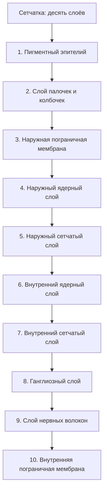

```base
**Анализатор** — система, предназначенная для восприятия, кодирования, передачи, анализа и хранения информации.
**Части анализатора** — периферическая (органы чувств: восприятие и кодирование), промежуточная (проводящие пути и подкорковые центры: передача и начало обработки), центральная (участки коры больших полушарий: анализ, хранение, формирование ощущений).
**Органы чувств 1-го типа** — зрительный и обонятельный; содержат нейросенсорные рецепторные клетки, развивающиеся из нервной трубки.
**Органы чувств 2-го типа** — слуховой, вестибулярный, вкусовой; содержат сенсоэпителиальные рецепторные клетки из эктодермы.
**Органы чувств 3-го типа** — проприоцептивная, кожная и висцеральная чувствительность; содержат свободные и несвободные рецепторные нервные окончания.
**Глаз** — периферическая часть зрительного анализатора; три оболочки: фиброзная (роговица, склера), сосудистая (радужка, цилиарное тело, собственно сосудистая оболочка), сетчатая (слепая и зрительная части).
```

### 12.1. Анализаторы: общая характеристика


Анализаторы — системы, предназначенные для восприятия, кодирования, передачи, анализа и хранения информации. Три части анализатора:

1. **Периферическая** (органы чувств) — восприятие и кодирование. Содержит рецепторные клетки, имеющие в своём составе вытянутые участки, «антенны», в которых локализуются специфические рецепторные белки;
2. **Промежуточная** (проводящие пути и подкорковые центры) — передача и начало обработки информации;
3. **Центральная** (участки коры больших полушарий) — анализ и хранение, формирование ощущений.

Классификация органов чувств по строению и функции рецепторной части — три типа (см. base-блок).

Зрительный и обонятельный анализаторы относятся к **первому типу**:

- их рецепторные клетки — **нейросенсорные**, то есть настоящие нейроны, развивающиеся из нервной трубки;
- в отличие от органов 2-го типа (вторично чувствующих), они сами генерируют нервный импульс;
- у органов 3-го типа рецепторами служат нервные окончания, а не клетки.

Знать к занятию (цели кафедры): гистологическое строение органов зрения и обоняния; субмикроскопическое строение нейросенсорных клеток; различать оболочки глаза и слои сетчатки; находить клетки обонятельного эпителия; объяснить назначение каждого аппарата глаза и проследить путь зрительного импульса от фоторецептора до коры.

### 12.2. Источники развития органа зрения

```image
{"trainerId":"feed-prep-3fb5c04858","caption":"Препарат. Развитие глаза: глазной бокал, хрусталиковый пузырёк, глазной стебелёк"}
```

```base
**Эктодерма** — хрусталик, передний эпителий роговицы, эпителий конъюнктивы.
**Нервная трубка** — глазной бокал: глазной стебелёк → n. opticus; внутренняя стенка → 2–10 слои сетчатки; наружная стенка → 1-й слой сетчатки (пигментный эпителий); мышцы радужки.
**Мезенхима** — фиброзная оболочка, сосудистая оболочка, стекловидное тело.
```

```image
{"url": "/library/lectures/histology/hist-12-zrenie-obonyanie/figs/fig1-razvitie-glaza.jpg", "caption": "Препарат №52. Развитие глаза: глазной бокал, хрусталиковый пузырёк, глазной стебелёк"}
```

На препарате развивающегося глаза видны:

- головной мозг зародыша, соединённый с **глазным стебельком**;
- **глазной бокал** с тонкой наружной стенкой, толстой внутренней стенкой и располагающейся между ними **щелью глазного бокала**;
- в углублении бокала — **хрусталиковый пузырёк** с утолщённой задней стенкой;
- в формирующейся роговице — соединительнотканная основа (8) и передний эпителий эктодермального происхождения;
- остальные оболочки ещё не оформлены и представлены мезенхимой.

Проверочная задача кафедры: если у эмбриона удалить глазной бокал, возможно ли дальнейшее развитие хрусталика?

- хрусталик развивается из эктодермы, но под **индуцирующим влиянием** глазного бокала;
- без бокала индукция не происходит — полноценный хрусталик не формируется;
- вывод: развитие хрусталика невозможно без глазного бокала, несмотря на эктодермальное происхождение самой закладки.

### 12.3. Оболочки и аппараты глаза

**Оболочки глаза:**

1. **Фиброзная** — наружная, плотная волокнистая соединительная ткань; отделы: **роговица** (передняя, прозрачная) и **склера**;
2. **Сосудистая** — средняя, содержит кровеносные сосуды и большое количество пигментных клеток; отделы: **радужка**, **цилиарное (ресничное) тело** (в толще — цилиарная мышца), **собственно сосудистая оболочка**;
3. **Сетчатая (сетчатка)** — внутренняя; отделы: **слепая часть** (передний отдел) и **зрительная часть** (задний отдел с фоторецепторами).

Слепая часть сетчатки выстилает заднюю поверхность радужки и цилиарного тела; зрительная часть (pars optica) лежит на задней стенке глазного яблока и содержит фоторецепторы. Граница между ними — зубчатая линия (ora serrata).

**Аппараты глаза:**

```base
**Диоптрический (преломляющий) аппарат** — роговица, жидкость передней камеры, хрусталик, стекловидное тело.
**Аккомодационный аппарат** — мышцы радужки, ресничное (цилиарное) тело с цилиарной мышцей, ресничный (циннов) поясок (круговая связка хрусталика), хрусталик; обеспечивает фокусировку глаза и приспособление к различным условиям освещения.
**Световоспринимающий аппарат** — сетчатка (слой пигментный + слой палочек и колбочек + остальные слои).
```

**«Угол» глаза** — участок перехода склеры в роговицу; здесь расположены структуры, относящиеся к диоптрическому и аккомодационному аппаратам.

**Структуры радужки и цилиарного тела** (кратко, по учебнику):

- **радужка** — отросток сосудистой оболочки; в переднем эпителии радужки лежат мышцы: **мышца-сфинктер зрачка** (суживает зрачок, парасимпатическая иннервация) и **мышца-дилататор** (расширяет зрачок, симпатическая иннервация); пигментные клетки радужки определяют цвет глаз;
- **цилиарное (ресничное) тело** — выработка внутриглазной жидкости (водянистой влаги) отростчатыми цилиоэпителиальными клетками + **цилиарная мышца**: при её сокращении расслабляется ресничный поясок, хрусталик становится более выпуклым — глаз настраивается на близкие предметы (аккомодация);
- **собственно сосудистая оболочка (хориоидея)** — рыхлая соединительная ткань с большим количеством сосудов и пигментных клеток; питает наружные слои сетчатки.

Что рассмотреть на препарате «Угол глаза» (окраска г/э):

- **диоптрический аппарат**: роговица (1), жидкость передней камеры (2), хрусталик (3), стекловидное тело (4);
- **сосудистую оболочку**: цилиарное тело (5) с расположенной в его толще цилиарной мышцей (6); радужку (7); собственно сосудистую оболочку (8) с кровеносными сосудами и большим количеством пигментных клеток;
- **аккомодационный аппарат**: слабоокрашенную круговую связку хрусталика — ресничный поясок (9), натянутую между хрусталиком и цилиарным телом.

С возрастом сократительная способность цилиарной мышцы снижается — аккомодационная функция глаза ухудшается (пресбиопия).

### 12.4. Роговица

Роговица — прозрачная передняя часть фиброзной оболочки. Слои при большом увеличении (окраска гематоксилином и эозином):

1. **передний эпителий** — многослойный плоский неороговевающий, эктодермального происхождения; лежит на толстой **передней пограничной мембране** (боуменовой);
2. **передняя пограничная мембрана**;
3. **собственное вещество роговицы** — плотная волокнистая соединительнотканная пластинка; основной объём роговицы;
4. **задняя пограничная мембрана** (десцеметова);
5. **задний эпителий (эндотелий)** — однослойный плоский.

Знать источники развития всех оболочек глаза (задача кафедры) — см. раздел 12.2:

- передний эпителий роговицы и эпителий конъюнктивы — эктодерма;
- собственное вещество роговицы и склера — мезенхима;
- сосудистая оболочка (радужка, цилиарное тело, хориоидея) — мезенхима;
- мышцы радужки — нервная трубка;
- 1-й слой сетчатки — наружная стенка глазного бокала; слои 2–10 — внутренняя стенка.

Прозрачность роговицы обусловлена правильным строением собственного вещества и отсутствием кровеносных сосудов; питание — из влаги передней камеры и краевой сосудистой сети.

Поэтому при травме глаза (перфорации) нельзя накладывать повязку из впитывающего материала:

- роговица бессосудистая и проницаемая — влага передней камеры может быстро оттекать в повязку;
- падение внутриглазного давления и деформация глаза приводят к дополнительному повреждению структур.

### 12.5. Сетчатка



```image
{"trainerId":"feed-prep-9e28c23f6f","caption":"Препарат. Сетчатка глаза: оболочки задней стенки глаза и слои сетчатки (г.-э.)"}
```

```image
{"trainerId":"feed-prep-464d16b59f","caption":"Препарат. Сетчатка глаза, большое увеличение: пигментный эпителий, ядерные и сетчатые слои"}
```

```image
{"trainerId":"feed-em-402e952e4b","caption":"Электронограмма. Дендриты палочковых нейронов сетчатки: наружный сегмент с дисками, шейка, внутренний сегмент"}
```

Задняя стенка глазного яблока при малом увеличении:

- волокнистая **склера** (наружная);
- под ней пигментированная **сосудистая оболочка**;
- самая внутренняя оболочка — **сетчатка**, отличающаяся большим числом округлых ядер.

```image
{"url": "/library/lectures/histology/hist-12-zrenie-obonyanie/figs/fig2-zadnyaya-stenka-glaza-setchatka.jpg", "caption": "Препарат №51. Задняя стенка глаза: склера, сосудистая оболочка и слои сетчатки (г.-э.)"}
```

Как работать с препаратом «Сетчатка (задняя стенка глаза)» (окраска г/э): расположить препарат так, чтобы волокнистая склера была сверху; при большом увеличении изучить слои сетчатки последовательно, от пигментного эпителия на границе с сосудистой оболочкой до внутренней пограничной мембраны на границе со стекловидным телом.

**Слои зрительной части сетчатки (10), отнаружи к внутри:**

```base
1. **Пигментный слой** — 1-й слой сетчатки (из наружной стенки глазного бокала); зёрна меланина в отростках клеток частично смещаются в слой палочек и колбочек (световая адаптация).
2. **Слой палочек и колбочек** — дендриты (периферические отростки) фоторецепторных нейронов; наружные сегменты палочек содержат диски с родопсином (сумеречное зрение), колбочек — йодопсин (дневное и цветовое зрение).
3. **Наружная пограничная глиальная мембрана.**
4. **Наружный ядерный слой** — ядросодержащие части палочек и колбочек.
5. **Наружный сетчатый слой** — синаптические связи клеток наружного и внутреннего ядерных слоёв.
6. **Внутренний ядерный слой** — тела биполярных, горизонтальных и амакриновых клеток.
7. **Внутренний сетчатый слой** — аксоны клеток внутреннего ядерного слоя и дендриты ганглиозных клеток.
8. **Ганглиозный слой** — крупные редко расположенные мультиполярные ганглиозные нейроны.
9. **Слой нервных волокон** — нейриты ганглиозных клеток, формирующие зрительный нерв.
10. **Внутренняя пограничная глиальная мембрана** — образована анастомозирующими отростками поддерживающих глиоцитов; отделяет сетчатку от стекловидного тела.
```

На электронограмме дендрита палочкового нейрона различают наружный и внутренний сегменты: в наружном — мембраны дисков, цитоплазма, микротрубочки реснички, переходящие через шейку к базальному тельцу; во внутреннем — скопление митохондрий.

**Сравнение палочек и колбочек:**

| Признак | Палочки | Колбочки |
| --- | --- | --- |
| Количество | ~130 млн | ~7 млн |
| Зрительный пигмент | родопсин | йодопсин (3 типа) |
| Функция | сумеречное (чёрно-белое) зрение | дневное и цветовое зрение |
| Локализация | преобладают на периферии сетчатки | преобладают в центре (жёлтое пятно, fovea) |
| Светочувствительность | высокая | ниже, но разрешение выше |

**Проводящий путь зрительного анализатора:**

I. Периферическая часть — сетчатка:

- **1-й нейрон** — палочка и колбочка (слои 2–5 сетчатки);
- **2-й нейрон** — биполярный нейрон (слои 5–7);
- **3-й нейрон** — мультиполярный ганглиозный нейрон (слои 7–9); его нейриты → зрительный нерв;
- вспомогательные нейроны: горизонтальные и амакриновые клетки осуществляют латеральное торможение внутри сетчатки.

В центре зрительной части сетчатки расположено **жёлтое пятно (macula lutea)** с центральной ямкой (fovea centralis): здесь только колбочки, а остальные слои смещены — наивысшая острота зрения; именно поэтому человек смотрит на предмет, поворачивая глаз так, чтобы его изображение попало на ямку.

II. Промежуточная часть:

- зрительный нерв → зрительный перекрест (хиазма) → зрительный тракт → подкорковые центры;
- **4-й нейрон** — латеральное коленчатое тело; верхние бугры четверохолмия; подушка зрительного бугра;

III. Центральная часть:

- **5-й нейрон** — кора больших полушарий по краям шпорной борозды — зрительная область коры.

Человек перестал видеть в сумерках — нарушена функция **палочек**:

- родопсин разрушается на свету и восстанавливается в темноте;
- синтез родопсина требует витамина A.

Отслойка сетчатки — разрыв связи между пигментным слоем (1-й слой) и слоями 2–10 (внутренними), которые питаются от сосудистой оболочки; приводит к гибели фоторецепторов и потере зрения в отслойенной области.

**Сущность отслойки и её последствия** (задача кафедры): между пигментным эпителием и остальными слоями в норме существует плотный контакт, необходимый для питания фоторецепторов и фагоцитоза отработанных дисков наружных сегментов; при отслойке питание нарушается — фоторецепторы гибнут, зрение в этой области утрачивается.

### 12.6. Обонятельный анализатор

Периферическая часть — **обонятельная выстилка** слизистой оболочки носовой полости. В её эпителии лежат **обонятельные биполярные нейросенсорные рецепторные нейроны** (1-й нейрон):

- периферические отростки (дендриты) выходят на поверхность эпителия и несут «антенны» — специализированные реснички с обонятельными рецепторными белками;
- центральные отростки (аксоны) через решётчатую кость идут к обонятельным луковицам.

Кроме рецепторных нейронов в обонятельной выстилке есть опорные (поддерживающие) эпителиоциты и базальные клетки — источник обновления эпителия.

**Проводящий путь обонятельного анализатора:**

```base
**Периферическая часть** — слизистая оболочка носовой полости; 1-й нейрон — обонятельные биполярные рецепторные нейроны.
**Промежуточная часть** — 2-й нейрон: нейроны обонятельных луковиц; 3-й нейрон: нейроны обонятельного треугольника; 4-й нейрон: нейроны миндалевидного тела (подкорковый центр).
**Центральная часть** — корковая зона обонятельного анализатора: крючок парагиппокампальной извилины, гиппокамп.
```

Обоняние связано с лимбической системой — этим объясняется тесная связь запахов с памятью и эмоциями.

Обонятельные рецепторные клетки относят к нейросенсорным (1-й тип органов чувств), так как:

- они развиваются из нервной трубки;
- сами генерируют нервный импульс;
- это единственные нейроны человека, контактирующие напрямую с внешней средой и способные к обновлению.

### 12.7. Препараты, электронограммы и схемы занятия

По методичке кафедры на препаратах нужно уметь:

1. **Развивающийся глаз** (срез головы эмбриона, окраска г/э) — головной мозг, глазной стебелёк, глазной бокал (тонкая наружная стенка, толстая внутренняя стенка, щель бокала), хрусталиковый пузырёк с утолщённой задней стенкой, формирующаяся роговица с соединительнотканной основой и передним эпителием, мезенхима будущих оболочек;
2. **«Угол» глаза** (г/э) — диоптрический аппарат (роговица, влага передней камеры, хрусталик, стекловидное тело), цилиарное тело с цилиарной мышцей, радужка, собственно сосудистая оболочка, ресничный поясок;
3. **Роговица** (г/э) — передний эпителий, передняя пограничная мембрана, собственное вещество, задняя пограничная мембрана, задний эпителий (эндотелий);
4. **Сетчатка** (г/э) — все оболочки задней стенки и десять слоёв сетчатки;
5. **Электронограмма** — дендрит палочкового нейрона: наружный сегмент с мембранными дисками, шейка с микротрубочками реснички, базальное тельце, внутренний сегмент со скоплением митохондрий.

Схемы в тетрадь (файл «12. Зрительный и обонятельный анализаторы»):

- части анализатора и три типа органов чувств;
- источники развития глаза (эктодерма, нервная трубка, мезенхима);
- оболочки глаза и аппараты (диоптрический, аккомодационный, световоспринимающий);
- десять слоёв сетчатки;
- проводящие пути зрительного и обонятельного анализаторов (все нейроны до коры).

## ✅ Мини-тест · занятие 12

Вопросы из банка по теме занятия. Полный тест занятия с проверкой — [занятие 12](/subjects/histology/lesson/12). Мини-тест не повторяет полный тест занятия целиком: часть вопросов — из расширенного банка темы.

```quiz
{"questionIds":["95804f2d-bacf-4604-ac13-d3a1ca209a1b","d29d91b4-920c-476f-82c7-3c40ce54903e","2da70a8d-3ed3-47f8-911e-3e9dd6d76aaf","c12a0001-0000-4000-8000-000000000001","c12a0001-0000-4000-8000-000000000002","c12a0001-0000-4000-8000-000000000003"],"subjectId":"977d78ca-7a58-4b0a-9e93-29d8e03f6946","title":"Мини-тест · занятие 12 (6 вопросов)"}
```

## Контрольные вопросы

1. Определение анализатора и три части анализатора.
2. Классификация органов чувств по строению и функции рецепторной части (три типа) с примерами.
3. Источники развития органа зрения: вклад эктодермы, нервной трубки и мезенхимы.
4. Что развивается из наружной и внутренней стенок глазного бокала?
5. Возможно ли развитие хрусталика при удалении глазного бокала у эмбриона и почему?
6. Оболочки глаза и их отделы.
7. Диоптрический и аккомодационный аппараты глаза: состав структур.
8. Пять слоёв роговицы; почему роговица прозрачна и почему при её перфорации нельзя накладывать впитывающую повязку.
9. Перечислите десять слоёв сетчатки по порядку.
10. Из каких клеток сетчатки сформирован зрительный нерв?
11. Какие нейроны зрительного пути образуют проводящий путь от сетчатки до коры (1–5-й нейроны)?
12. Чем палочки отличаются от колбочек по строению и функции?
13. Функция пигментного эпителия сетчатки (фотопротекция, световая адаптация).
14. Проводящий путь обонятельного анализатора: все нейроны и корковая зона.
15. Почему обонятельные рецепторные клетки относят к нейросенсорным, а вкусовые — к сенсоэпителиальным?
16. С чем связана потеря сумеречного зрения и что такое отслойка сетчатки?
17. Что такое жёлтое пятно и почему острота зрения максимальна в центральной ямке?
18. Какими мышцами и какой иннервацией регулируется ширина зрачка?

## Дальше по теме — не потеряйся

- **Лекции** — [все лекции по гистологии](/subjects/histology?tab=lectures): следующее занятие — «Органы слуха, равновесия, вкуса»
- **ДЗ и контрольные вопросы** — там же, вкладка «Вопросы»
- **Тесты по теме** — [вкладка «Тесты»](/subjects/histology?tab=tests)
