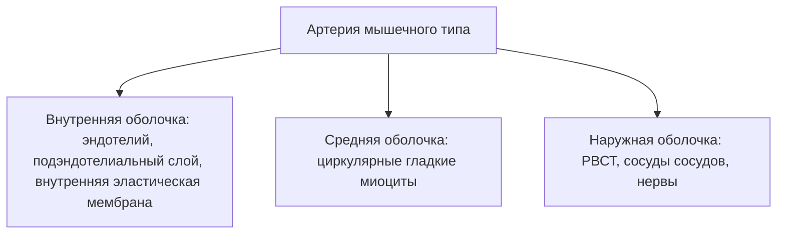

```base
**Сердечно-сосудистая система** — кровеносная система (артерии, микроциркуляторное русло, вены), сердце и лимфатическая система (лимфатические капилляры, внутри- и внеорганные лимфатические сосуды, лимфатические стволы, лимфоидные органы).
**Общий план стенки сосуда** — три оболочки: внутренняя (intima), средняя (media), наружная (adventitia); строение зависит от гемодинамических условий.
**Типы артерий** — эластического, смешанного (мышечно-эластического) и мышечного типа; тип определяется соотношением эластического каркаса и гладкомышечной ткани в средней оболочке.
**Три типа капилляров** — соматического типа (сплошная эндотелиальная выстилка и базальная мембрана), фенестрированного типа (эндотелий с окнами-фенестрами), перфорированного (прерывистого) типа (просветы в эндотелии и базальной мембране).
**Кардиомиоциты** — сократительные, проводящие (пейсмекерные, переходные, волокна Пуркинье) и секреторные (выработка предсердного натрийуретического фактора).
```

### 14.1. Общий план строения сердечно-сосудистой системы

Сердечно-сосудистая система включает:

1. **кровеносную систему** — артерии (эластического, смешанного, мышечного типов), микроциркуляторное русло (артериолы, капилляры, венулы, артериоло-венулярные анастомозы), вены (мышечного и безмышечного типа);
2. **сердце** — эндокард, миокард, эпикард;
3. **лимфатическую систему** — лимфатические капилляры, внутриорганные и внеорганные лимфатические сосуды, лимфатические стволы, лимфоидные органы.

Общий принцип строения сосудистой стенки — три оболочки, но их тканевой состав определяется **гемодинамическими условиями**:

- в артериях давление и скорость потока высоки — мощный эластический каркас и мышечная оболочка;
- в венах давление низкое — тонкая средняя, широкая адвентиция, клапаны;
- в сердце давление наивысшее — трёхслойная стенка с мощным миокардом.

```base
**Внутренняя оболочка (intima)** — эндотелиальный слой (однослойный плоский эпителий), подэндотелиальный слой (РВСТ); в артериях мышечного типа — внутренняя эластическая мембрана.
**Средняя оболочка (media)** — гладкомышечная ткань с эластическими волокнами/мембранами; соотношение мышечных и эластических элементов определяет тип артерии.
**Наружная оболочка (adventitia)** — рыхлая волокнистая соединительная ткань с сосудами сосудов (vasa vasorum), нервными стволиками и жировой тканью.
```

**Эндотелий** — однослойный плоский эпителий, выстилающий просвет всех сосудов и камер сердца. Функции эндотелия (гистофизиология по целям занятия):

- тромборезистентность — не даёт крови сворачиваться на своей поверхности;
- регуляция тонуса сосуда (вещества эндотелия);
- транспорт веществ между кровью и тканями;
- барьерная функция.

Эмбрионально сердце и сосуды развиваются из мезенхимы; мышцы, клапаны и проводящая система сердца — из мезенхимы и миоэпикардиальной пластинки.

Что должен уметь студент (цели кафедры): различать сердечно-сосудистую систему по строению органов; находить оболочки сосудов и сердца; объяснить гистофизиологию эндотелия, субэндотелиального слоя, эластических волокон, гладкомышечной ткани; знать источники развития сердца; нарисовать схему «Три типа капилляров».

### 14.2. Микроциркуляторное русло

```image
{"trainerId":"feed-prep-c7a7794d53","caption":"Препарат. Мелкие сосуды: артериола, капилляры и венула на одном срезе"}
```

```image
{"trainerId":"feed-em-1d6bc4ee9f","caption":"Электронограмма. Пиноцитоз в эндотелиальных клетках капилляра"}
```

**Артериолы** — мелкие артерии диаметром до 0,1 мм; стенка:

- эндотелий;
- тонкая внутренняя эластическая мембрана;
- средняя оболочка из 1–2 слоёв гладких миоцитов;
- тонкая адвентиция.

```image
{"url": "/library/lectures/histology/hist-14-serdechno-sosudistaya/figs/fig1-arteriola-i-venula.jpg", "caption": "Препарат. Мелкие сосуды микроциркуляторного русла: артериола и венула с эритроцитами в просвете (г.-э.)"}
```

Артериолы — «краны» микроциркуляторного русла: меняя тонус, регулируют приток крови в капилляры и уровень давления.

**Капилляры** — тончайшие сосуды (диаметр 5–11 мкм); стенка образована эндотелиоцитами на базальной мембране, вокруг — перициты. Три типа капилляров:

1. **соматического типа** — сплошной эндотелий и сплошная базальная мембрана; наименее проницаемы (мышцы, лёгкие, ЦНС, кожа);
2. **фенестрированного типа** — в эндотелии есть окна-фенестры (поры), затянутые диафрагмой; базальная мембрана сплошная (железы, почки, эндокринные органы, кишечник);
3. **перфорированного (прерывистого) типа** — есть просветы и в эндотелии, и в базальной мембране; наибольшая проницаемость (синусоидные капилляры печени, красного костного мозга, селезёнки).

Практическая привязка типов капилляров к органам:

- сплошной (соматический) — там, где нужен строгий барьер: нервная ткань, мышечная ткань, лёгкие;
- фенестрированный — там, где активный транспорт и секреция: эндокринные железы, почечные клубочки, кишечные ворсинки;
- перфорированный — там, где форменные элементы покидают или входят в кровоток: красный костный мозг, селезёнка, печень.

Задача кафедры: нарисовать схему «Три типа капилляров» (по Ю.И. Афанасьеву) — поперечные срезы стенок всех трёх типов.

**Венулы** — посткапиллярные, собирательные, мышечные; стенка тонкая; место выхода форменных элементов в ткани при воспалении и миграции лимфоцитов.

**Артериоло-венулярные анастомозы (АВА)** — прямые соединения артериолы и венулы:

- истинные АВА — со сфинктерами из гладких миоцитов;
- АВА через короткие капилляры.

Функции:

- сбрасывают кровь в обход капиллярного русла;
- участвуют в терморегуляции и регуляции кровенаполнения органов.

### 14.3. Артерии



```image
{"trainerId":"feed-prep-6736da285a","caption":"Препарат. Аорта: окончатые эластические мембраны в средней оболочке (г.-э.)"}
```

```image
{"trainerId":"feed-prep-867c9e401e","caption":"Препарат. Мелкие сосуды: стенка артериолы и сопровождающей венулы"}
```

**Артерии эластического типа** (аорта, лёгочная артерия) — крупные сосуды вблизи сердца:

- внутренняя оболочка тонкая: эндотелий + подэндотелиальный слой;
- **средняя оболочка** доминирует: в ней лежат **окончатые эластические мембраны** — полупрозрачные фестончатые пластинки (у аорты около 40–50–70), расположенные между гладкомышечными клетками;
- наружная оболочка — РВСТ с сосудами, нервными стволиками и жировой тканью;
- эластический каркас позволяет стенке растягиваться при систоле и сглаживать пульс, поддерживая непрерывность потока (аорта — «компрессионная камера»).

```image
{"url": "/library/lectures/histology/hist-14-serdechno-sosudistaya/figs/fig2-aorta.jpg", "caption": "Препарат. Аорта — артерия эластического типа: многочисленные окончатые эластические мембраны в средней оболочке (г.-э.)"}
```

**Артерии смешанного (мышечно-эластического) типа** (сонная, подключичная и др.):

- средняя оболочка содержит примерно поровну гладкомышечных клеток и эластических мембран.

**Артерии мышечного типа** (большинство артерий среднего и малого калибра) — стенка толстая, просвет зияющий, внутренний край фестончатый:

- **внутренняя оболочка**: эндотелиальный слой (однослойный плоский эпителий), очень тонкий подэндотелиальный слой (РВСТ); между внутренней и средней оболочками — **внутренняя эластическая мембрана**, имеющая фестончатый вид и при окраске г/э почти прозрачная (блестит и опалесцирует при повороте микровинта);
- **средняя оболочка**: преимущественно циркулярно расположенные гладкие миоциты — обеспечивают регуляцию давления и кровотока;
- между средней и наружной оболочками — **наружная эластическая мембрана**;
- **наружная (адвентициальная) оболочка**: РВСТ с сосудами и нервными стволиками.

```image
{"url": "/library/lectures/histology/hist-14-serdechno-sosudistaya/figs/fig3-arteriya-myshechnogo-tipa.jpg", "caption": "Препарат. Артерия мышечного типа: фестончатая внутренняя эластическая мембрана и гладкомиоцитная средняя оболочка (г.-э.)"}
```

```base
**Окончатые эластические мембраны** — характерны для артерий эластического типа (аорта): их много, они распределены по всей средней оболочке.
**Внутренняя и наружная эластические мембраны** — характерны для артерий мышечного типа: по одной мембране на границах средней оболочки.
**Отличие артерии и вены при равном диаметре** — стенка артерии значительно толще за счёт средней оболочки; у артерии мышечного типа есть внутренняя (и наружная) эластическая мембрана; просвет артерии зияет, вены спавшийся; у вены самой широкой является наружная оболочка.
```

### 14.4. Вены

**Вены мышечного типа** — внутренняя оболочка: эндотелий и тонкий подэндотелиальный слой; средняя: циркулярные гладкие миоциты (на продольном срезе миоциты имеют длинные палочковидные ядра); наружная — самая широкая, РВСТ с сосудами сосудов и нервными стволиками. По количеству миоцитов делятся на:

- вены **с малым** числом миоцитов (верхняя полая, вены верхних конечностей);
- вены **со средним** числом миоцитов;
- вены **с большим** числом миоцитов (нижняя полая, вены нижних конечностей).

У вен среднего и крупного калибра есть **клапаны** — парные складки внутренней оболочки с эндотелием, направляющие ток крови к сердцу (их основа — соединительная ткань).

**Вены безмышечного типа** (вены твёрдой и мягкой мозговых оболочек, сетчатки, костей, селезёнки, плаценты):

- стенка состоит только из эндотелия с подэндотелиальным слоем;
- сращена с окружающей тканью и не спадается.

Гемодинамика объясняет различия:

- в вене давление низкое и кровь течёт медленно против силы тяжести — нужен мышечный тонус (в мышечных венах) и клапаны;
- в артерии давление пульсирующее и высокое — нужны эластические мембраны и мощная средняя оболочка.

### 14.5. Сердце


```image
{"trainerId":"feed-prep-5d82bd7bf7","caption":"Препарат. Сердце: эндокард, миокард, эпикард (г.-э.)"}
```

```image
{"trainerId":"feed-em-e9680b3eab","caption":"Электронограмма. Миокард желудочка: кардиомиоциты, вставочные диски, миофибриллы"}
```

**Оболочки сердца:**

1. **Эндокард** — внутренняя, самая тонкая оболочка; четыре слоя:
   - эндотелиальный слой (однослойный плоский эпителий);
   - субэндотелиальный слой (РВСТ);
   - мышечно-эластический слой (эластические волокна и гладкие миоциты);
   - наружный соединительнотканный слой (РВСТ, окрашивается ярче из-за большого содержания коллагеновых волокон).

   Из эндокарда построены **клапаны сердца** — складки эндокарда с плотным соединительнотканным каркасом; основная функция клапанов — однонаправленный ток крови;
2. **Миокард** — средняя, самая широкая оболочка; пучки поперечно- и продольно-расположенных кардиомиоцитов:
   - кардиомиоциты имеют центрально расположенные ядра, боковые ветвления-анастомозы и поперечную исчерченность;
   - прочно контактируя друг с другом в области **вставочных дисков**, образуют функциональные волокна;
   - между пучками кардиомиоцитов — РВСТ с многочисленными кровеносными сосудами и нервными волокнами (перимизий);
3. **Эпикард** — серозная оболочка: собственная пластинка (плотная оформленная волокнистая соединительная ткань) и однослойный плоский эпителий — **мезотелий**; между миокардом и эпикардом — прослойка жировой ткани, содержащая кровеносные сосуды и нервные стволики.

```image
{"url": "/library/lectures/histology/hist-14-serdechno-sosudistaya/figs/fig4-stenka-serdca.jpg", "caption": "Препарат. Стенка сердца: пучки кардиомиоцитов миокарда в двух взаимно перпендикулярных направлениях (г.-э.)"}
```

**Кардиомиоциты:**

- **сократительные** — основная масса; обеспечивают нагнетательную функцию (работу сердца как насоса);
- **проводящие** — **пейсмекерные** (генерируют ритм, синусно-предсердный узел), **переходные**, **волокна Пуркинье** — все вместе образуют проводящую систему сердца:
  - светлые большого диаметра образования под эндокардом;
  - отличаются от сократительных меньшим количеством миофибрилл, эксцентричным расположением ядер и обилием саркоплазмы, в которой находится большое количество включений, прежде всего гликогена;
- **секреторные** — вырабатывают **предсердный натрийуретический фактор** (усиливает выделение почками натрия и воды, снижает артериальное давление).

Отличия сердечной мышечной ткани от скелетной:

- центральное ядро (у скелетного волокна — ядра на периферии);
- анастомозы ветвлений кардиомиоцитов;
- вставочные диски;
- автономность ритма (пейсмекерные клетки).

```base
**Проводящая система сердца** — синусно-предсердный узел (водитель ритма) → предсердно-желудочковый узел → предсердно-желудочковый пучок (пучок Гиса) → ножки пучка → волокна Пуркинье; обеспечивает последовательное сокращение предсердий и желудочков.
```

Возрастные изменения сердца и сосудов:

- уплотнение соединительнотканного каркаса эндокарда и стенок сосудов;
- отложение липидов в интиме артерий (атеросклероз);
- уменьшение числа сократительных кардиомиоцитов;
- снижение эластичности эластических мембран аорты.

### 14.7. Препараты и схемы занятия

По методичке кафедры на препаратах нужно уметь:

1. **Сердце** (г/э) — ориентировать эндокардом вверх, эпикардом вниз; найти четыре слоя эндокарда; миокард из пучков кардиомиоцитов с центральными ядрами, анастомозами, вставочными дисками; перимизий; жировую прослойку с сосудами и нервными стволиками; эпикард (собственная пластинка + мезотелий); отметить отличия сердечной мышечной ткани от скелетной (вставочные диски, центральные ядра, анастомозы);
2. **Проводящие кардиомиоциты (волокна Пуркинье)** (г/э) — светлые большого диаметра образования под эндокардом; меньше миофибрилл, эксцентричные ядра, обилие саркоплазмы с включениями (гликоген); зарисовать пучок волокон Пуркинье в препарат «Сердце»;
3. **Аорта** (г/э и орсеин) — внутренняя оболочка (эндотелий, подэндотелиальный слой), средняя с окончатыми эластическими мембранами между гладкомышечными клетками, наружная (РВСТ с сосудами, нервами, жиром);
4. **Артерия мышечного типа** (г/э) — толстая стенка, зияющий просвет, фестончатый внутренний край; внутренняя эластическая мембрана (прозрачная, опалесцирует при повороте микровинта), средняя из циркулярных миоцитов, наружная эластическая мембрана, адвентиция;
5. **Вена мышечного типа** (г/э) — спавшийся просвет, гладкий внутренний край; тонкая средняя оболочка; самая широкая адвентиция с сосудами сосудов;
6. **Сосудисто-нервный пучок** (г/э) — артерия (А), вена (В) и нерв (Н) на одном срезе; отличить их по морфологическим признакам.

Схемы в тетрадь (файл «14. Сердечно-сосудистая система»):

- классификация кровеносной системы: артерии (эластического, смешанного, мышечного типа), микроциркуляторное русло (артериолы, капилляры трёх типов, венулы, АВА), вены, сердце, лимфатическая система;
- слои стенок артерии мышечного типа и вены мышечного типа;
- три типа капилляров (по Афанасьеву);
- оболочки сердца и виды кардиомиоцитов.

Полезные ассоциации для диагностики препаратов:

- увидели окончатые эластические мембраны по всей средней оболочке — это аорта (артерия эластического типа);
- увидели внутреннюю эластическую мембрану как отдельную блестящую полоску — это артерия мышечного типа;
- увидели спавшийся просвет и толстую адвентицию — это вена;
- увидели светлые широкие волокна под эндокардом — это волокна Пуркинье;
- увидели мезотелий поверх капсулы — это эпикард (или капсула селезёнки — не путать по остальным признакам).

### 14.6. Лимфатическая система

**Лимфатические капилляры** — начинаются слепо в тканях; стенка из одного слоя эндотелиоцитов, базальная мембрана отсутствует или прерывиста; просветы шире, чем у кровеносных капилляров — способствуют дренированию межклеточной жидкости, белков и клеток (в т.ч. при воспалении).

**Внутри- и внеорганные лимфатические сосуды** — стенка сходна с венами (эндотелий, тонкая средняя, широкая адвентиция); внутриорганные — безмышечного или маломышечного типа; внеорганные — мышечного типа со створками клапанов.

**Лимфатические стволы и протоки** собирают лимфу; через грудной проток и правый лимфатический проток она возвращается в кровоток. По пути лимфы лежат **лимфоидные органы** (лимфоузлы, селезёнка и др.) — подробнее в занятии 17.

Возрастные особенности: у новорождённых стенки сосудов тонкие, эластических элементов меньше; окончательное строение стенок формируется к 15–18 годам.

Общий план лимфатической системы (схема кафедры):

- лимфатические капилляры;
- внутриорганные лимфатические сосуды;
- внеорганные лимфатические сосуды;
- лимфатические стволы;
- лимфоидные органы.

Отличия лимфатических капилляров от кровеносных:

- начинаются слепо;
- базальная мембрана отсутствует или прерывиста;
- просвет шире;
- стенка более проницаема для белков и клеток.

## ✅ Мини-тест · занятие 14

Вопросы из банка по теме занятия. Полный тест занятия с проверкой — [занятие 14](/subjects/histology/lesson/14). Мини-тест не повторяет полный тест занятия целиком: часть вопросов — из расширенного банка темы.

```quiz
{"questionIds":["db37e432-bbee-489b-bf52-a889d65901d3","d12cd72d-8b83-4398-9090-f3495775ed48","8c8592f7-4391-4261-a3b9-83c2c16a6d1f","f51cdd08-9aa2-45e8-8233-bc24cd594d1b","c14a0001-0000-4000-8000-000000000001","c14a0001-0000-4000-8000-000000000002"],"subjectId":"977d78ca-7a58-4b0a-9e93-29d8e03f6946","title":"Мини-тест · занятие 14 (6 вопросов)"}
```

## Контрольные вопросы

1. Из каких частей состоит сердечно-сосудистая система?
2. Общий план строения стенки сосуда: три оболочки и их тканевой состав.
3. Почему строение стенки сосуда зависит от гемодинамических условий? Сравните артерию и вену равного диаметра.
4. Функции эндотелия сосудов.
5. Три типа капилляров — строение, локализация, проницаемость.
6. Строение артериолы и её роль как «крана» микроциркуляторного русла.
7. Артериоло-венулярные анастомозы: строение и функции.
8. Артерии эластического типа: где локализуются, строение средней оболочки, функция эластического каркаса.
9. Артерии смешанного типа и их отличие от артерий эластического и мышечного типа.
10. Артерии мышечного типа: слои внутренней оболочки, внутренняя эластическая мембрана, средняя и наружная оболочки.
11. Вены мышечного типа: строение оболочек, клапаны, «сосуды сосудов».
12. Вены безмышечного типа: локализация и строение.
13. Слои эндокарда и их тканевой состав; как из эндокарда образуются клапаны.
14. Миокард: строение кардиомиоцитов, вставочные диски, отличия от скелетной мышечной ткани.
15. Проводящие кардиомиоциты (волокна Пуркинье): чем отличаются от сократительных; состав проводящей системы сердца.
16. Секреторные кардиомиоциты и предсердный натрийуретический фактор.
17. Строение лимфатических капилляров и чем они отличаются от кровеносных.
18. Какой тип капилляра встречается в эндокринных железах и почему?
19. Как по строению средней оболочки определить тип артерии на препарате?

## Дальше по теме — не потеряйся

- **Лекции** — [все лекции по гистологии](/subjects/histology?tab=lectures): следующее занятие — «Центральные и периферические звенья эндокринной системы»
- **ДЗ и контрольные вопросы** — там же, вкладка «Вопросы»
- **Тесты по теме** — [вкладка «Тесты»](/subjects/histology?tab=tests)
