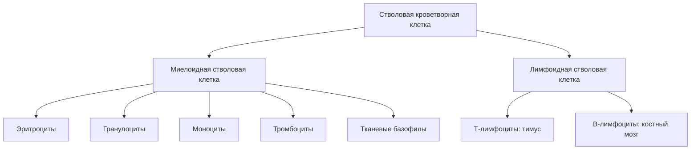

```base
**Гемопоэз (кроветворение)** — процесс образования форменных элементов крови; происходит в кроветворных органах: красный костный мозг, тимус, селезёнка, лимфатические узлы, лимфоидные скопления вдоль полых органов пищеварительной, дыхательной, мочеполовой систем, а у человека в эмбриогенезе — печень.
**Унитарная теория** (А.А. Максимов) — общепринятая экспериментально подтверждённая теория: родоначальницей всех клеток крови является одна стволовая кроветворная клетка (СКК).
**СКК** — полипотентна (может дифференцироваться в любую зрелую клетку крови), способна к самоподдержанию (симметричный и асимметричный митоз) и миграции; в покое (G0) лимфоцитоподобна, при подготовке к делению — бластоподобна.
**Дифферон** — ряд (линия) кроветворения: совокупность клеток от родоначальной до зрелой формы (эритроидный, гранулоцитарный, моноцитарный, тромбоцитарный, лимфоидный ряды).
**Красный костный мозг** — центральный орган кроветворения и иммунной защиты; строма — ретикулярная ткань с остеогенными клетками, паренхима — клетки кроветворных дифферонов.
```

### 16.1. Теории кроветворения и свойства СКК



Существовали полифилетическая, дуалистическая и другие теории кроветворения; общепринятой экспериментально подтверждённой является **унитарная теория А.А. Максимова**. Её основа — свойства **стволовой кроветворной клетки (СКК)**:

1. **Полипотентность** — СКК может дифференцироваться в любую зрелую клетку крови;
2. **Способность к самоподдержанию** — СКК поддерживает своё количество на одном уровне на протяжении всей жизни человека за счёт двух основных механизмов митоза:
   - *асимметричный митоз* — одна СКК делится на 1 стволовую и 1 дифференцирующуюся;
   - *симметричный митоз* — одна СКК делится на 2 дифференцирующиеся, но тогда подаётся сигнал соседней стволовой клетке, и она делится на 2 стволовые;
3. **Способность к миграции** — СКК может переноситься с током крови в другие кроветворные органы, в которых находятся приемлемые условия для её существования.

**Морфология СКК**: поскольку СКК крайне редко делятся, большую часть жизни они проводят в покоящемся G0 периоде и тогда выглядят как лимфоцит (**лимфоцитоподобная СКК**); в этом же состоянии они мигрируют с током крови. Когда СКК должна подготовиться к делению, она выходит из G0, увеличивается в размерах, ядро становится большим с несколькими ядрышками — **бластоподобная СКК**.

```base
**Классы клеток кроветворения:**
- I класс — стволовая кроветворная клетка (СКК);
- II класс — полустволовые (частично потентные) клетки-предшественники миелопоэза и лимфопоэза;
- III класс — унипотентные клетки-предшественники (эритропоэтинчувствительная, тромбопоэтинчувствительная, колониеобразующая в культуре клетка и др.);
- IV класс — морфологически распознаваемые бластные формы;
- V класс — созревающие (дифференцирующиеся) клетки;
- VI класс — зрелые (популяция клеток крови).
```

Самые ранние клеточные стадии гемопоэза очень трудно дифференцировать друг от друга: СКК, клетка-предшественник миелопоэза, колониеобразующая в культуре клетка (предшественник гранулоцитов и моноцитов), эритропоэтинчувствительная клетка, тромбопоэтинчувствительная клетка и клетка-предшественник лимфопоэза морфологически близки к малому лимфоциту; к малодифференцируемым формам также относятся бласты.

```image
{"url": "/library/lectures/histology/hist-16-krovetvorenie/figs/fig1-retikulyarnaya-tkan.jpg", "caption": "Препарат. Ретикулярная ткань — строма кроветворных органов с ретикулярными клетками и волокнами"}
```

### 16.2. Периоды кроветворения в эмбриогенезе

**Желточный период** (2–4 неделя эмбриогенеза):

- очень короткий; происходит вне тела зародыша — в провизорных органах (желточный мешок);
- гемопоэз интраваскулярный — внутри сосудов;
- образуются только клетки эритроидного ряда;
- эритропоэз проходит по «укороченной» схеме: образуется **мегалоцит** — диаметр 13–20 мкм, шаровидная форма, другой тип гемоглобина (HbF), иногда может оставаться ядро.

**Печеночный период** (4–5 неделя — 4–5 месяц эмбриогенеза):

- происходит сначала интраваскулярно, затем экстраваскулярно;
- образуются все форменные элементы;
- схема кроветворения — как в постэмбриональном периоде;
- печень и селезёнка являются **универсальными органами кроветворения** (в них могут образовываться все клетки крови).

**Костномозговой период** (начинается с 4–5 месяца эмбриогенеза и длится всю жизнь) — кроветворение в красном костном мозге.

Эмбриональный гемопоэз — кровь образуется как ткань; постэмбриональный — обеспечение физиологической и репаративной регенерации.

### 16.3. Красный костный мозг

```image
{"trainerId":"feed-prep-75c773d1e5","caption":"Препарат. Красный костный мозг: ретикулярная строма, островки кроветворения, синусоидные капилляры"}
```

```image
{"trainerId":"feed-prep-44d3102c32","caption":"Препарат. Красный костный мозг: мегакариоциты и клетки разных стадий созревания"}
```

**Красный костный мозг** — центральный орган кроветворения и иммунной системы; располагается в ячейках губчатого вещества плоских костей и эпифизов трубчатых костей. Ткань: паренхима — из клеток кроветворных дифферонов, строма — из ретикулярной ткани.

**Строма** — ретикулярная ткань с ретикулоэндотелиальными (адвентициальными) клетками, остеогенными клетками, эндотелием синусоидных капилляров перфорированного типа, макрофагами, жировыми клетками. Строма создаёт **гемопоэтическое микроокружение**: через межклеточные контакты и паракринные факторы регулирует размножение, дифференцировку и миграцию кроветворных клеток (взаимоотношения кроветворных дифферонов и стромы).

**Паренхима** — клетки кроветворных дифферонов на разных стадиях созревания. В костном мозге взрослого человека клетки **миелоидного ряда составляют 53–75 %**, **эритроидного — 14–26 %**, **лимфоидного 5–14 %**, **моноцитарного около 2 %**; мегакариоциты составляют небольшую долю, но легко определяются благодаря очень крупным размерам цитоплазмы и ядра. В крови новорождённого доля эритроидного ростка значительно выше.

```image
{"url": "/library/lectures/histology/hist-16-krovetvorenie/figs/fig2-krasnyy-kostnyy-mozg.jpg", "caption": "Препарат. Красный костный мозг: клетки кроветворных дифферонов на разных стадиях созревания (г.-э.)"}
```

**Факторы, влияющие на гемоцитопоэз:**

- колониестимулирующие факторы (КСФ) — стимуляция гранулоцитарного и моноцитарного ростков;
- **эритропоэтин** — вырабатывается почками при гипоксии; стимулирует эритропоэз;
- **тромбопоэтин** — стимулирует тромбоцитопоэз;
- лимфопоэтические факторы и цитокины;
- витамины (B12, фолиевая кислота), железо;
- гемопоэтическое микроокружение стромы.

Трудность идентификации клеток на мазке костного мозга обусловлена наличием нескольких видов гемопоэза, постепенным характером процессов дифференцировки, а также присутствием деформированных и разрушенных клеток, стромальных клеток, остеобластов и остеокластов. Мазок изучают при больших увеличениях при полной освещённости (поднять конденсор, открыть диафрагму); пригодны участки, где клетки лежат одним слоем.

### 16.4. Гранулоцитопоэз

```image
{"trainerId":"feed-em-d69cfa101f","caption":"Электронограмма. Фагоцитоз нейтрофильным лейкоцитом крови"}
```

Стадии (мазок красного костного мозга, окраска азур-эозином по Романовскому–Гимзе):

- **миелобласт** — 15–20 мкм, округлая форма; ядро округлое, содержит 2–5 ядрышек; хроматин тонкий сетчатый, равномерно окрашен; цитоплазма базофильна, окружает ядро узким ободком; от других бластных форм отличается присутствием в цитоплазме небольшого числа азурофильных зёрен;
- **промиелоцит** — самая крупная клетка миелоидного ряда (25–30 мкм); ядро овальное или бобовидное; хроматин грубее, окрашивается неравномерно, ядрышек 1–2; цитоплазма охватывает ядро широким пояском, базофильна, содержит обильную азурофильную зернистость; редко встречающиеся эозинофильные и базофильные промиелоциты уже имеют небольшое количество типичных для них гранул;
- **миелоцит** — 12–18 мкм, округлая форма; ядро округлое или бобовидное, меньших размеров, чем у промиелоцита; структура ядра грубая, окрашивается темнее; ядрышко отсутствует или слабо различимо; цитоплазма приобретает розоватый тон; зернистость специализированная: у **эозинофильного миелоцита** — крупная розовая (эту клетку найти легче других), у **базофильного** — крупные сине-фиолетовые гранулы, у **нейтрофильного** — мелкие гранулы, окрашивающиеся полихроматофильно (и азуром, и эозином);
- **метамиелоцит (юный гранулоцит)** — 12–15 мкм; по характеру гранул делится на нейтрофильные, эозинофильные и базофильные; от предыдущей стадии отличается более плотным ядром подковообразной формы;
- **палочкоядерный** (нейтрофил, эозинофил, базофил) — отличается наличием тёмного узкого ядра, изогнутого в виде буквы «C»;
- **сегментоядерный (зрелый)** — ядро сегментировано; зрелые нейтрофилы, эозинофилы, базофилы выходят в кровь.

### 16.5. Эритропоэз

- **эритробласт** — 16–20 мкм, округлая форма; ядро округлое, содержит 2–4 ядрышка; хроматин тонкий сетчатый; цитоплазма ярко базофильная, без просветления вокруг ядра, зернистости не содержит (в отличие от миелобластов);
- **пронормоцит** — чуть меньших размеров; округлое ядро без ядрышек; хроматин более грубый; цитоплазма ярко базофильная с лёгким перинуклеарным просветлением;
- **базофильный нормоцит** — ~12 мкм, округлая форма; цитоплазма ярко базофильная с просветлением около ядра; ядро плотное, хроматин в виде заметных глыбок;
- **полихроматофильный нормоцит** — 8–10 мкм; ядро уплотнено; цитоплазма из-за накопления гемоглобина окрашивается в сиреневый цвет;
- **оксифильный нормоцит** — 7–10 мкм; цитоплазма оксифильная; ядро резко пикнотизировано, иногда совершенно непроницаемо для света; часто встречаются картины смещения и выталкивания ядра из клетки;
- **ретикулоцит** — безъядерная клетка с остатками рибосом и РНК (выявляется при специальной окраске);
- **эритроцит** — безъядерная клетка, окрашена резко оксифильно, реже полихромно; размеры 7–8 мкм.

По мере созревания клетки эритроидного ряда: уменьшается размер, уплотняется и выталкивается ядро, цитоплазма из базофильной становится полихромной и оксифильной (накопление гемоглобина — белка, синтезирующегося на рибосомах, поэтому ранняя цитоплазма базофильна).

### 16.6. Тромбоцитопоэз

- **мегакариобласт** — отличается от эритробласта наличием выростов цитоплазмы и чуть более грубым рисунком хроматина;
- **промегакариоцит** — крупная клетка (40–60 мкм); ядро полиплоидное, структура его грубая, ядрышек нет; начинается сегментация ядра; цитоплазма обильная, окрашивается в сиреневые тона, зернистая;
- **мегакариоцит** — клетка гигантских размеров (50–150 мкм); ядро состоит из нескольких крупных долей, прилегающих друг к другу, лежащих иногда кольцеобразно; хроматин грубый; цитоплазма обильная, сиреневого цвета, богата азурофильной зернистостью; наблюдаются картины отделения **кровяных пластинок (тромбоцитов)** и старения мегакариоцитов. От мегакариоцитов следует отличать **остеокласты**, также имеющие значительные размеры, но содержащие несколько ядер, лежащих изолированно друг от друга.

```image
{"url": "/library/lectures/histology/hist-16-krovetvorenie/figs/fig3-kostnyy-mozg-megakariocit.jpg", "caption": "Препарат. Костный мозг: гигантский многодольчатый мегакариоцит среди кроветворных клеток (г.-э.)"}
```

Моноцитопоэз и лимфоцитопоэз проходят в костном мозге до стадий промоноцита/лимфобласта; антигеннезависимая и антигензависимая дифференцировка лимфоцитов — в занятии 17.

## ✅ Мини-тест · занятие 16

Вопросы из банка по теме занятия. Полный тест занятия с проверкой — [занятие 16](/subjects/histology/lesson/16).

```quiz
{"questionIds":["f044f188-09b1-4e35-8d1c-c7addd16c027","66674d6a-9bda-4440-8da0-56e6a36778ba","f88fc6f4-e0a8-4944-b96a-101c345337ed","141888f0-1ff1-41d8-953e-e5461b13d3ed","f2bb60ab-3d87-4b45-bfd3-bd24f07de573","3d8d007f-6455-4689-9c05-1916bdf8602f","6426229b-51cd-473a-924e-7461340b87b7","4be47cb9-a763-49af-a013-88e8da17375b","0d4a55a0-dcab-4b7a-ae02-0457c37a3ddd","b80e7d3f-184a-4d6f-9966-130d5f0b0a48","35e695e4-9348-4316-a997-d2df4db12b6d","38316f7e-2efa-4e0a-a5ce-05f185d94a59"],"subjectId":"977d78ca-7a58-4b0a-9e93-29d8e03f6946","title":"Мини-тест · занятие 16 (12 вопросов)"}
```

## Контрольные вопросы

1. Определение гемопоэза и перечень кроветворных органов.
2. Теории кроветворения; почему унитарная теория Максимова считается общепринятой.
3. Свойства стволовой кроветворной клетки: полипотентность, самоподдержание (симметричный и асимметричный митоз), миграция.
4. Морфология СКК: лимфоцитоподобная и бластоподобная формы, период G0.
5. Классы клеток кроветворения и их морфологическая различимость.
6. Желточный период кроветворения: сроки, локализация, особенности эритропоэза, мегалоцит.
7. Печеночный период: сроки, особенности, универсальные органы кроветворения.
8. Костномозговой период: с какого срока и до какого времени.
9. Строма красного костного мозга: состав клеток и функция гемопоэтического микроокружения.
10. Доли клеточных рядов в костном мозге взрослого человека.
11. Факторы, влияющие на гемоцитопоэз (КСФ, эритропоэтин, тромбопоэтин и др.).
12. Стадии гранулоцитопоэза: миелобласт → промиелоцит → миелоцит → метамиелоцит → палочкоядерный → сегментоядерный; чем каждая стадия отличается.
13. Стадии эритропоэза: эритробласт → пронормоцит → базофильный → полихроматофильный → оксифильный нормоцит → ретикулоцит → эритроцит; как меняются ядро и окраска цитоплазмы.
14. Стадии тромбоцитопоэза; чем мегакариоцит отличается от остеокласта.
15. Как на препарате легче всего найти эозинофильный миелоцит и мегакариоцит?
16. Какие изменения происходят в строении цитоплазмы и ядра на каждой стадии кроветворения?

## Дальше по теме — не потеряйся

- **Лекции** — [все лекции по гистологии](/subjects/histology?tab=lectures): следующее занятие — «Органы лимфоидного кроветворения и иммунологической защиты»
- **ДЗ и контрольные вопросы** — там же, вкладка «Вопросы»
- **Тесты по теме** — [вкладка «Тесты»](/subjects/histology?tab=tests)
